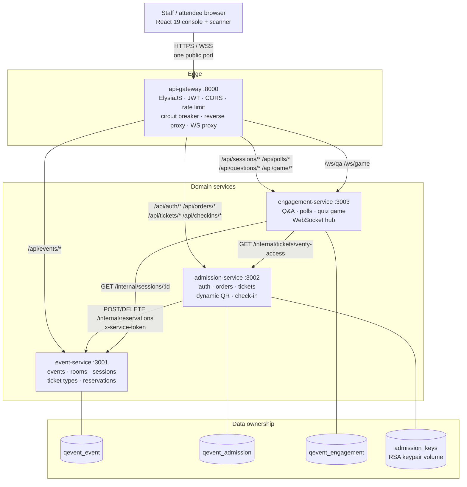
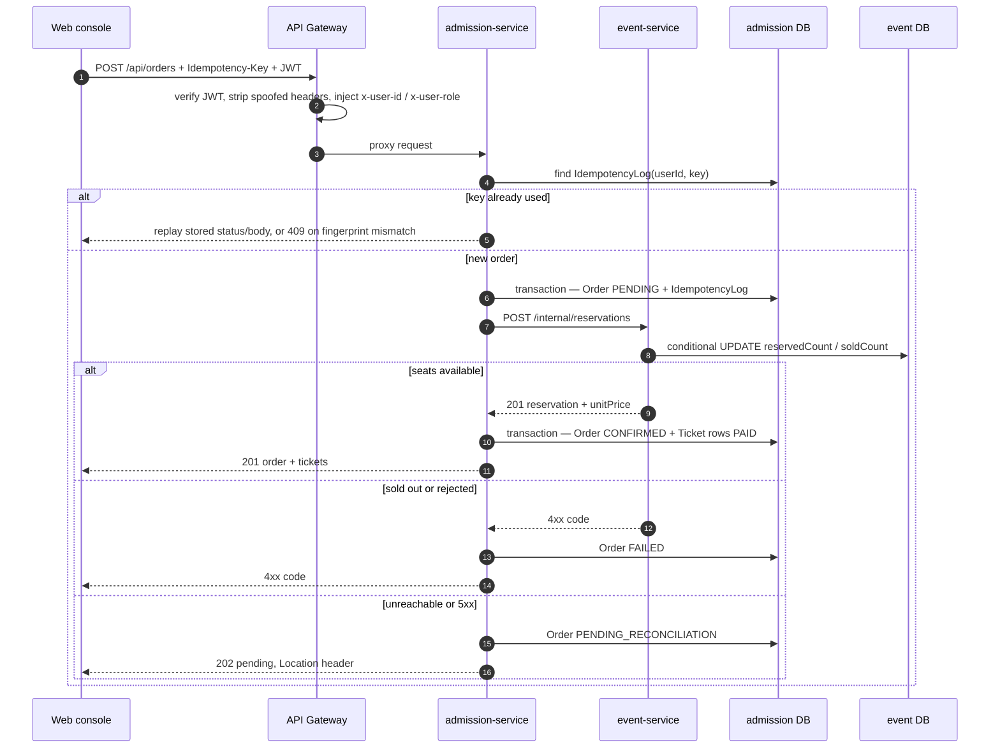
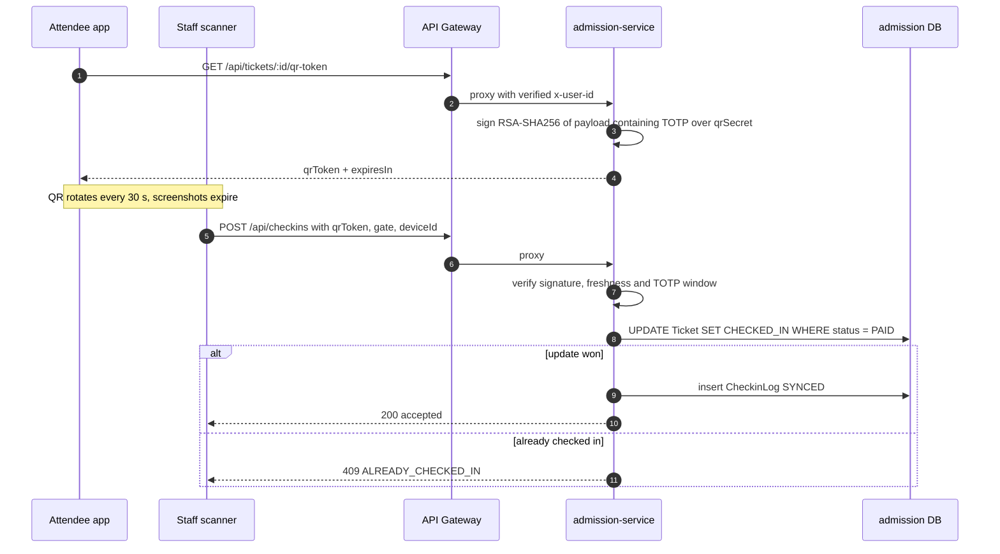

# Architecture — qEvent (QuickEvent)

Event operations platform: organisers publish events, sessions, rooms and ticket types; attendees
buy tickets; staff scan a **dynamic QR code** at the gate and run live **Q&A, polls and quiz games**
in the session room.

The system is a small microservice estate: three domain services with their own database, one public
API gateway, and a React staff/attendee console.

> Generated from the GitNexus knowledge graph at commit `fa828c6` — **311 files, 4,160 symbols,
> 9,322 relationships, 139 communities, 227 execution flows**. Execution-flow names below are the
> graph's own process labels, so they can be re-read with
> `gitnexus://repo/qEvent/process/{name}`.

---

## 1. Overview

```text
Browser / scanner
      │  HTTP + WebSocket  — one public port
      ▼
api-gateway :8000            JWT, CORS, brute-force limits, circuit breaker, reverse proxy, WS proxy
      ├── event-service :3001        Event, Room, Session, TicketType, Reservation, EventHost
      ├── admission-service :3002    Auth, Order, Ticket, Check-in, Dynamic QR
      └── engagement-service :3003   Q&A, Poll, Quiz game, WebSocket hub

One PostgreSQL database per service:
qevent_event · qevent_admission · qevent_engagement
```

Design invariants enforced by the code:

| Invariant | Where it lives |
| --- | --- |
| Only the gateway is exposed; services are not published to the host | `docker-compose.yml` |
| Services never join each other's database — HTTP internal calls only | `*/src/deps.ts`, `*/src/lib/*-client.ts` |
| The gateway strips client-supplied `x-user-id` / `x-user-role` and re-injects them from a verified JWT | `gateway/src/index.ts` |
| Every service owns its migrations and runs `prisma migrate deploy` at boot | `services/*/Dockerfile`, `prisma/migrations/` |
| Cross-service calls carry `x-service-token`; a call failure is `InfraError`, never a business denial | `lib/resilient-fetch.ts` |
| Internal call timeouts stay below the gateway's 2 s budget, so the saga can answer `202` instead of surfacing a gateway timeout | `admission-service/src/deps.ts` |

### Runtime stack

| Layer | Technology |
| --- | --- |
| Gateway + services | Bun, ElysiaJS 1.4, TypeScript |
| Persistence | Prisma 6 + PostgreSQL 16 (one DB per service) |
| Resilience | `opossum` circuit breakers, hand-rolled rate limiter, `resilientFetch` |
| Web console | React 19, Vite 6, React Router 7, TanStack Query, shadcn/Radix, Tailwind 4, Biome |
| Contracts | OpenAPI 3 per service (`openapi.yaml`/`.json`), generated web client (`web/src/lib/api/generated.ts`) |
| Tests | `bun test` per service, Vitest + MSW, Playwright E2E + axe |

---

## 2. Functional areas

The graph's Leiden communities are named heuristically and several share labels (`Ui`, `Services`,
`Modules`), so the table below merges cluster evidence with the physical layout. Cohesion is the
graph's measured intra-cluster cohesion.

| Area | Code | Graph evidence |
| --- | --- | --- |
| **Edge / Gateway** | `gateway/src/index.ts`, `circuit-breaker.ts`, `rate-limit.ts`, `ws-token.ts` | flow `CreateGatewayApp → GetBreaker`; `/health` aggregates breaker + downstream state |
| **Event catalogue** | `services/event-service/src/{app,config,deps}.ts`, `modules/event.routes.ts`, `services/event.service.ts` | 9 route handlers under `/api/events*`; flow `CreateApp → SerializeEvent` |
| **Capacity & reservations** | `services/event-service/src/modules/internal.routes.ts`, `services/reservation.service.ts` | 4 internal routes; flow `InternalRoutes → SerializeReservation` |
| **Identity & access** | `services/admission-service/src/lib/auth.ts`, `modules/auth.routes.ts`, `lib/keys.ts` | 7-symbol `Auth` cluster at 75% cohesion; login/register/me routes |
| **Orders (saga)** | `services/admission-service/src/modules/order.routes.ts`, `services/order.service.ts` | highest-traffic flows in the graph: `CreateApp → MarkPending`, `OrderRoutes → SerializeOrder`, `OrderRoutes → PickNumber` |
| **Tickets & dynamic QR** | `services/admission-service/src/modules/ticket.routes.ts`, `lib/qr.ts` | RSA-SHA256 + TOTP primitives; `sha256`/`hotp` appear as flow terminals |
| **Check-in** | `services/admission-service/src/modules/checkin.routes.ts`, `services/checkin.service.ts` | flow `CheckinRoutes → Hotp`; online and offline-sync branches |
| **Engagement** | `services/engagement-service/src/modules/{qa,poll,game,stats}.routes.ts` | 59-symbol `Engagement` cluster at 82% cohesion; Q&A, poll and game flows |
| **Realtime** | `services/engagement-service/src/lib/broadcast.ts`, `modules/ws.routes.ts`, `web/src/lib/realtime/useRealtime.ts` | 5-symbol `Realtime` cluster at 80% cohesion; flows `Open → ExtractWsToken`, `UseRealtime → ReadToken` |
| **Staff / attendee console** | `web/src/features/*`, `web/src/app/*`, `web/src/lib/*` | largest cluster `Ui` at 191 symbols / 68% cohesion; 8 feature modules |
| **Ops & evidence** | `scripts/*`, `docs/evidence/*`, `docs/plans/*`, `postman/*` | `Scripts` 25 symbols and `E2e` 21 symbols, both 100% cohesive |

### Web console composition

`web/src/app/router.tsx` builds the whole route table with
`import.meta.glob("../features/*/routes.tsx")`. Adding a screen means adding files inside a feature
folder — the shell (`AppShell`, `providers`, `RequireRole`) never changes. Each feature has the same
shape: `routes.tsx` → `pages/` → `api.ts` (TanStack Query hooks) → `mocks.ts` (MSW fixtures).

| Feature | Screens |
| --- | --- |
| `auth` | login, auth context, role-aware shell |
| `dashboard` | cross-event operational overview |
| `events` | event list, new event, overview, rooms / sessions / ticket types tabs |
| `orders` | order list and detail |
| `tickets` | ticket list and detail, dynamic QR display |
| `checkin` | scanner (`@zxing/browser`), check-in log, offline sync (`idb`) |
| `engagement` | Q&A, polls, quiz game, leaderboard, realtime hooks |
| `settings` | console settings |

---

## 3. Key execution flows

Six traced flows matter most; 3.7 covers the cross-service authorization path they depend on.

### 3.1 Place an order — saga in `admission-service`

Graph traces: `CreateApp → MarkPending` (5 steps) and `OrderRoutes → SerializeOrder` (4 steps).

```text
orderRoutes → placeOrder → continueOrder → issueTickets → markPending / markFailed / complete
             (idempotency)  (event call)    (local tx)
```

1. `POST /api/orders` requires `Idempotency-Key`; a missing key is `400 IDEMPOTENCY_KEY_REQUIRED`.
2. `placeOrder` fingerprints the payload (`eventId`, `ticketTypeId`, `quantity`) and looks up
   `IdempotencyLog(userId, key)`. A hit **replays** the stored response, or returns
   `409 IDEMPOTENCY_CONFLICT` when the fingerprint differs — including after a unique-violation race.
3. A transaction creates the `Order` (`PENDING`) plus its idempotency log.
4. `continueOrder` calls event-service `POST /internal/reservations` with the order's `operationId`.
5. On `2xx`: `issueTickets` atomically flips the order to `CONFIRMED` and inserts one `Ticket`
   (`PAID`, random `qrSecret`) per unit, then stores the response in the idempotency log → `201`.
6. On `4xx`: order → `FAILED` with the downstream code, response stored → same status to the client.
7. On an infrastructure failure/timeout: order → `PENDING_RECONCILIATION`, client gets `202` with a
   `Location` header. Wedged compensation is retried by the reconciler.

### 3.2 Reserve capacity in `event-service`

Graph trace: `InternalRoutes → SerializeReservation` (4 steps).

`createReservation` is keyed by `operationId` and is safe to retry:

- an existing reservation whose payload matches is replayed (`200`); a mismatched or already
  `RELEASED` one is `409`;
- otherwise one transaction runs two conditional `UPDATE`s
  (`Event.reservedCount + qty <= maxCapacity`, `TicketType.soldCount + qty <= quota`) and creates the
  `Reservation`. Zero affected rows means `409 SOLD_OUT`; the unique race is re-read and replayed.
- `DELETE /internal/reservations/:operationId` releases the hold and decrements both counters
  (`GREATEST(..., 0)`), and is idempotent on an already-released reservation.

### 3.3 Reconcile stranded orders — timer

Graph traces: `Timer → Complete` and `Timer → MarkFailed` (4 steps each).

`admission-service/src/index.ts` starts a `setInterval` (`RECONCILE_INTERVAL_MS`, default 5 s) calling
`reconcileOnce`:

1. select `PENDING_RECONCILIATION` / `COMPENSATING`, plus `PENDING` orders older than the lease grace
   window;
2. claim each row with a conditional `updateMany` writing `leaseUntil = now + RECONCILE_LEASE_MS`
   (30 s) and incrementing `attempts` — the claim is the mutual-exclusion primitive;
3. `COMPENSATING` → release the reservation (retried on later ticks until the release succeeds),
   then `FAILED` + completed idempotency log;
4. otherwise re-issue the reservation call and finish the order exactly like the request path;
5. a thrown error clears the lease immediately instead of waiting for lease expiry.

### 3.4 Dynamic-QR check-in — `admission-service`

Graph trace: `CheckinRoutes → Hotp` (5 steps):
`checkinRoutes → checkIn → verifyTotp → generateTotp → hotp`.

- Ticket QR payload: `{ tid, eid, code, iat }`, base64url-encoded and signed with **RSA-SHA256**
  using a key generated once into the `admission_keys` volume.
- `code` is a 6-digit **TOTP** derived from the ticket's random `qrSecret`, step 30 s; verification
  accepts the current and previous step only. Token age is capped at 30 s with 5 s future skew, so a
  screenshot dies quickly.
- `checkIn` requires `STAFF`/`ORGANIZER`, re-checks the order is `CONFIRMED`, then performs
  `UPDATE Ticket ... WHERE status = 'PAID'` inside a transaction. The conditional update is the
  anti-double-scan gate; a loser gets `409 ALREADY_CHECKED_IN` with current ticket state.
- The winner writes a `CheckinLog` (`SYNCED`, scanner, gate/device).
- Offline scans POST `/api/checkins/sync-offline`, reusing the same acceptance rules and marking the
  log `isOffline`.

### 3.5 Gateway edge — routing, auth, circuits

Graph trace: `CreateGatewayApp → GetBreaker` (4 steps):
`createGatewayApp → getAllStates → getState → getBreaker`.

- Path prefix selects the service: `/api/events*` → event, `/api/{auth,orders,tickets,checkins}*` →
  admission, `/api/{sessions,polls,questions,game}*` → engagement; anything else is
  `404 ROUTE_NOT_FOUND`.
- The gateway verifies `Authorization: Bearer`, forwards `x-user-id` / `x-user-role` and a generated
  `x-request-id`, and strips hop-by-hop headers.
- Each service gets its own `opossum` breaker (2 s timeout); open circuit → `503 SERVICE_UNAVAILABLE`
  with `circuitState`, timeout → `504 GATEWAY_TIMEOUT`.
- Login is limited to 10 failures per IP per 5 min, registration to 20 per minute — in memory, so the
  gateway must run as one process.
- `/health` probes all three services with a 600 ms deadline and reports breaker states.

### 3.6 Realtime engagement — WebSocket path

Graph traces: `Open → ExtractWsToken` (4 steps) and `UseRealtime → ReadToken` (4 steps).

```text
web useRealtime → ws(s)://host/ws/{qa|game}?token=… → gateway.ws("/ws/*")
   → JWT verify (else close 4401) → upstream ws://engagement-service:3003/ws/* → broadcaster
```

- The token rides in the query string (`extractWsToken`); neither end logs the URL.
- Gateway buffers client frames while the upstream socket is still `CONNECTING`.
- Engagement authenticates asynchronously and queues `JOIN_SESSION` / `JOIN_GAME` behind the auth
  promise; rooms live in the in-process `BroadcastManager` (single instance assumption).
- The browser client owns reconnection: backoff 1/2/4/8/16/30 s + jitter, 25 s heartbeat, `fallback`
  signal after 30 s so screens can switch to polling, one refetch on reconnect, and no retry after
  `4401`. Game answers are deliberately **not** accepted over WS — clients must POST
  `/api/game/:gameId/answer` so the REST auth/validation path is used.

### 3.7 Cross-service authorization for engagement

`engagement-service` never reads admission data. `HttpAdmissionClient.verifyAccess` calls
`GET /internal/tickets/verify-access?userId&eventId` with the service token, treats non-200 as
`InfraError` (→ 503/504, not 403), and caches **only positive** answers for 60 s so a fresh check-in
isn't hidden by a cached denial. Session liveness comes from
`GET /internal/sessions/:id` on event-service.

---

## 4. Architecture diagram



### Order-placement sequence



### Check-in sequence



---

## 5. Service contracts

### Public (through the gateway)

| Prefix | Service | Examples |
| --- | --- | --- |
| `/health` | gateway | downstream probes + breaker states |
| `/api/events*` | event | list, create, update, rooms, sessions, ticket types |
| `/api/auth*` | admission | login, register, me |
| `/api/orders*` | admission | place order, list, detail |
| `/api/tickets*` | admission | my tickets, detail, QR token |
| `/api/checkins*` | admission | check-in, stats, offline sync |
| `/api/sessions/*` | engagement | polls, questions, quiz game, stats |
| `/api/polls*`, `/api/questions*`, `/api/game*` | engagement | poll/QA/game lifecycle |
| `/ws/qa`, `/ws/game` | engagement | authenticated socket upgrade |

### Internal (service token, never published)

| Caller | Endpoint | Purpose |
| --- | --- | --- |
| admission → event | `POST /internal/reservations` | hold capacity |
| admission → event | `DELETE /internal/reservations/:operationId` | release hold during compensation |
| engagement → event | `GET /internal/sessions/:id` | session `eventId` + `isLive` |
| engagement → admission | `GET /internal/tickets/verify-access` | ticket/check-in gate for engagement |

event-service additionally exposes `GET /internal/events/:id`; no in-repo caller uses it yet.

### Data ownership

| Database | Models |
| --- | --- |
| `qevent_event` | `Event`, `Room`, `Session`, `TicketType`, `Reservation`, `EventHost` |
| `qevent_admission` | `User`, `Order`, `IdempotencyLog`, `Ticket`, `CheckinLog` |
| `qevent_engagement` | `QAQuestion`, `QAVote`, `Poll`, `PollOption`, `PollVote`, `QuizGame`, `QuizQuestion`, `QuizAnswer` |

---

## 6. Reliability & security patterns

| Pattern | Implementation |
| --- | --- |
| Idempotent order creation | `Idempotency-Key` + payload fingerprint + stored response replay |
| Idempotent reservations | `operationId` unique key; replay vs. conflict split |
| Saga / compensation | `PENDING` → `CONFIRMED` / `FAILED` / `PENDING_RECONCILIATION` / `COMPENSATING` |
| Reconciliation | leased background scan; conditional claim prevents double work |
| Fail fast inside the gateway budget | 1 s internal timeout, `retries: 0`, gateway 2 s |
| Circuit breaking | per-service `opossum` breaker with state exposed on `/health` |
| Rate limiting | in-memory failure limiter for login/registration |
| Trust boundary | gateway owns JWT verification and identity headers |
| Service-to-service auth | shared `INTERNAL_SERVICE_TOKEN` in `x-service-token` |
| Anti-replay QR | 30 s TOTP + 30 s max age + 5 s skew + RSA signature |
| Anti-double-scan | conditional `PAID → CHECKED_IN` update inside a transaction |
| Offline operation | browser queue (`idb`) + `/checkins/sync-offline` |
| Realtime degradation | exponential backoff, heartbeat, polling fallback after 30 s |

---

## 7. Repository map

```text
qEvent/
├── gateway/                      ElysiaJS API gateway (Bun)
│   └── src/                      index.ts · circuit-breaker.ts · rate-limit.ts · ws-token.ts
├── services/
│   ├── event-service/            event catalogue + reservations
│   ├── admission-service/        auth, orders, tickets, check-in, RSA keys
│   └── engagement-service/       Q&A, polls, quiz, WebSocket
│       (each service: src/{app,index,config,deps,openapi}.ts · src/{lib,modules,services} · prisma/ · test/)
├── web/                          React console
│   └── src/{app,features,lib,components} · e2e/ · test/msw/
├── scripts/                      e2e-smoke, seed-demo-activity, fault-injection,
│                                 order-fault / lost-response experiments
├── docs/                         plans, evidence JSON, team guides
├── plans/                        microservice migration spec (historical)
├── postman/                      collection that runs through the gateway
├── docker-compose.yml            3 databases + 3 services + gateway + web
└── DESIGN.md · PRODUCT.md · MVP.md · README.md
```

Local ports: web `8080`, gateway `8000`, event `3001`, admission `3002`, engagement `3003`;
Postgres `5433` / `5434` / `5435` bound to `127.0.0.1` only.

---

## 8. Changing the system safely

1. **Impact first.** `impact({target: "placeOrder", direction: "upstream"})` before editing a shared
   symbol. Order, reservation and check-in functions sit on many flows; treat HIGH/CRITICAL as a stop
   signal.
2. **Keep the seams.** New cross-service data belongs behind an internal endpoint plus a client in
   `src/lib/*-client.ts`; no shared database access, no direct service port exposure.
3. **Respect the budgets.** Any new internal call must fail under 2 s, and must distinguish
   `InfraError` from a business rejection so callers can return `202`/`503` instead of a false denial.
4. **Extend the web by feature.** Add `web/src/features/<name>/routes.tsx`; the router picks it up.
   Regenerate `web/src/lib/api/generated.ts` from the service OpenAPI when contracts change.
5. **Re-index after structural change.** `node .gitnexus/run.cjs analyze --index-only` and re-read
   `gitnexus://repo/qEvent/processes`; execution-flow names in this document come from that index.
