# BÁO CÁO BÀI TẬP LỚN

**HỌC VIỆN CÔNG NGHỆ BƯU CHÍNH VIỄN THÔNG (PTIT)**
**Môn học:** Kiến trúc Microservices
**Đề tài:** qEvent — Hệ thống quản trị sự kiện, soát vé động và tương tác thời gian thực theo kiến trúc microservices

| Thông tin | Nội dung |
|---|---|
| Nhóm | …… |
| Lớp | …… |
| Giảng viên hướng dẫn | …… |
| Thành viên | Tuấn (nhóm trưởng), Thành, Vũ, Trọng |

> Phạm vi tài liệu: **Phần 1 — Phân tích nghiệp vụ** và **Phần 2 — Thiết kế kiến trúc**.
> Các phần Thiết kế API/OpenAPI, Độ tin cậy — xử lý lỗi, Triển khai — kiểm thử, Đánh giá — hạn chế
> sẽ được trình bày trong các phần tiếp theo của báo cáo.

---

# PHẦN 1 — PHÂN TÍCH NGHIỆP VỤ

## 1.1. Bối cảnh và bài toán

Các sự kiện có quy mô từ vài trăm đến vài nghìn người thường gặp bốn vấn đề vận hành lặp lại:

1. **Nghẽn tại cổng soát vé.** Nhân viên kiểm tra vé thủ công hoặc quét mã QR tĩnh khiến hàng đợi kéo dài vào giờ cao điểm.
2. **Gian lận vé chụp màn hình.** Vé QR tĩnh có thể được chụp lại và gửi cho người khác sử dụng.
3. **Mất kết nối tại cổng.** Wi-Fi/4G tại sân vận động hoặc hội trường không ổn định; hệ thống soát vé không được phép dừng hoàn toàn khi mạng chập chờn.
4. **Tương tác trong phiên bị phân tán.** Câu hỏi, bình chọn và quiz đang được chạy bằng nhiều công cụ rời rạc, không gắn với quyền tham gia thực tế của người đã check-in.

**qEvent** giải quyết các vấn đề trên bằng một nền tảng thống nhất:

- Ban tổ chức tạo sự kiện, phòng, phiên và loại vé với sức chứa xác định.
- Người tham dự đặt vé, nhận vé điện tử và xuất trình **QR động** được ký RSA-SHA256, đổi mã theo TOTP 30 giây.
- Nhân viên soát vé quét QR, hệ thống chống quét trùng và hỗ trợ đồng bộ các lượt soát offline.
- Trong phiên đang diễn ra, người đã check-in có thể đặt câu hỏi, bình chọn và chơi quiz; ban tổ chức điều khiển nội dung theo thời gian thực.

Bài toán được chọn có đủ các đặc điểm để thiết kế theo microservices: nhiều miền nghiệp vụ độc lập, dữ liệu riêng, luồng liên service, yêu cầu chịu lỗi và các điểm truy cập thời gian thực.

## 1.2. Người dùng và vai trò

| Vai trò | Mô tả | Nhu cầu chính |
|---|---|---|
| **Attendee** (người tham dự) | Mua vé, nhận vé điện tử, tham gia Q&A/poll/quiz | Đặt vé nhanh, QR luôn mới, không bị từ chối oan khi mạng yếu |
| **Staff** (nhân viên soát vé) | Quét QR tại cổng, xem lịch sử soát vé, đồng bộ offline | Phản hồi dưới 1 giây, chống quét trùng, hoạt động khi mất mạng |
| **Organizer** (ban tổ chức) | Tạo/sửa sự kiện, phòng, phiên, loại vé; điều khiển Q&A/poll/quiz; có thể mở màn trình chiếu | Kiểm soát sức chứa, theo dõi số liệu, thao tác an toàn |
| **Host** (người dẫn phiên) | Đăng nhập bằng tài khoản `HOST`, chỉ thấy các sự kiện được ban tổ chức phân công; mở màn trình chiếu, sửa Q&A/poll/quiz và điều khiển phiên | Điều khiển trạng thái phiên theo thời gian thực, chữ đủ lớn để đọc trên máy chiếu |

Hệ thống phân quyền theo bốn vai trò toàn cục: `ATTENDEE`, `STAFF`, `HOST`, `ORGANIZER`. `HOST` bị giới hạn theo từng sự kiện: chỉ đọc/sửa nội dung và mở màn trình chiếu của những sự kiện có bản ghi phân công trong bảng `EventHost`. Tài khoản này không quản lý sự kiện, đơn hàng, vé hay sức chứa. `ORGANIZER` phân công host trong tab **Người dẫn** của trang sự kiện; `ORGANIZER` và `STAFF` vẫn thao tác trên mọi sự kiện như trước.

### 1.2.1. Biểu đồ use case

Bốn vai trò tương tác với hệ thống qua các nhóm chức năng dưới đây. `STAFF` và `ORGANIZER` dùng chung miền vận hành; chỉ `HOST` bị giới hạn theo `EventHost`.

**Hình 1.1 — Use case của Attendee.**

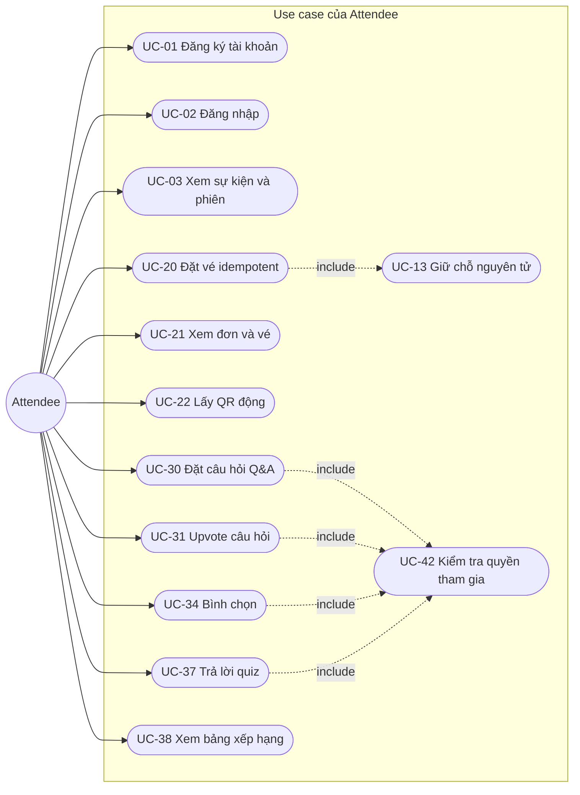

**Hình 1.2 — Use case của Staff.**

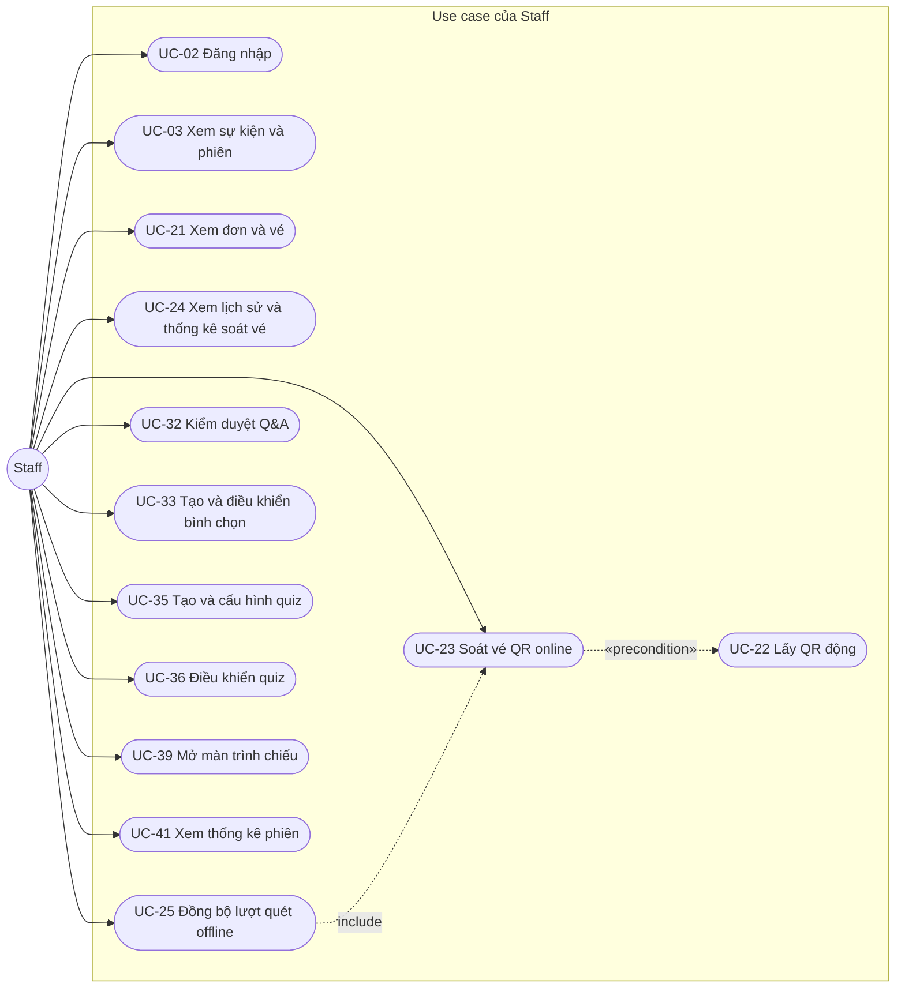

> `STAFF` điều khiển được phiên vì `HOST_ROLES` gồm `ORGANIZER`, `HOST`, `STAFF`; khác biệt duy nhất là
> `STAFF` không bị giới hạn theo `EventHost` và **không** tạo được sự kiện.

**Hình 1.3 — Use case của Host.**

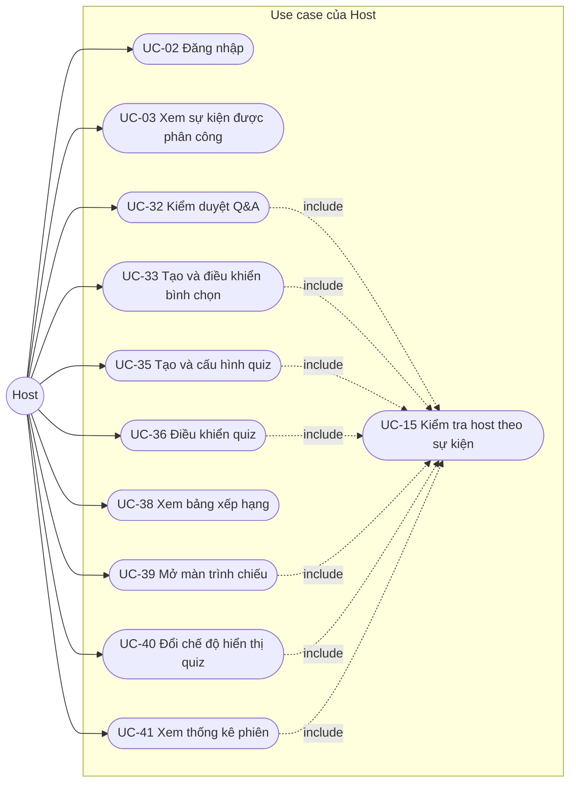

> Host **không** có: quản lý sự kiện/phòng/phiên/loại vé, xem đơn, soát vé, quản lý sức chứa.
> Host vẫn tương tác như khán giả (hỏi, vote, trả lời quiz) nếu đã check-in — khi đó đi qua BR-6, không qua BR-7.

**Hình 1.4 — Use case của Organizer.**

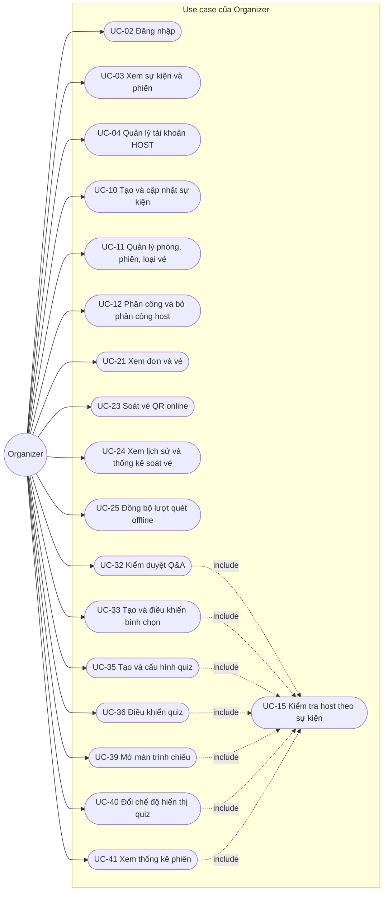

> Organizer là vai trò **duy nhất** tạo/sửa sự kiện và phân công host. Organizer cũng giữ toàn bộ quyền
> vận hành của Staff (soát vé, xem đơn, điều khiển phiên).

**Hình 1.5 — Use case nội bộ giữa các service.**

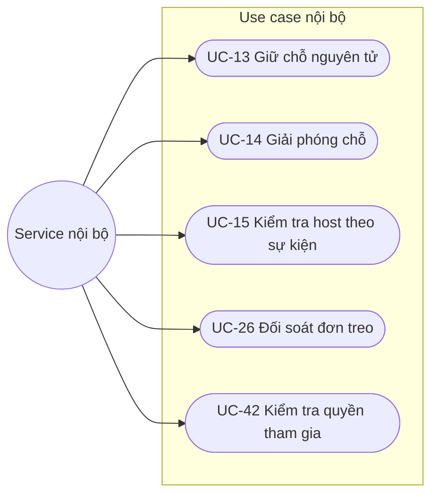

> Các use case này không lộ ra ngoài: chỉ gọi được khi có `x-service-token` (Event, Admission) hoặc do worker
> nội bộ chạy định kỳ (đối soát). Đây là các "use case hệ thống" của kiến trúc microservices.

**Quan hệ include / extend**

| Use case | Quan hệ | Use case đích | Ý nghĩa |
|---|---|---|---|
| UC-20 Đặt vé | `include` | UC-13 Giữ chỗ | Đơn chỉ được xác nhận sau khi Event Service giữ chỗ thành công |
| UC-20 Đặt vé | `extend` | UC-26 Đối soát | Chỉ khi lỗi hạ tầng/không rõ kết quả, đơn chuyển `PENDING_RECONCILIATION` và worker đối soát |
| UC-23 Soát vé | `precondition` | UC-22 QR động | Token QR phải được sinh và ký trước khi quét; đây là tiền điều kiện, không phải include |
| UC-25 Đồng bộ offline | `include` | UC-23 Soát vé | Dùng cùng luật chấp nhận `PAID → CHECKED_IN`, khác nguồn `isOffline` |
| UC-30, 31, 34, 37 | `include` | UC-42 Kiểm tra quyền tham gia | BR-6: phải check-in đúng sự kiện và phiên đang `isLive` |
| UC-32, 33, 35, 36, 39, 40, 41 | `include` | UC-15 Kiểm tra host theo sự kiện | BR-7: chỉ áp dụng cho tài khoản `HOST`; `STAFF`/`ORGANIZER` toàn cục |
| UC-25 Đồng bộ offline | `extend` | UC-23 Soát vé | Chỉ xảy ra khi cổng mất mạng |

**Ma trận quyền theo vai trò**

| Use case | ATTENDEE | STAFF | HOST | ORGANIZER |
|---|---|---|---|---|
| UC-01 Đăng ký | ✅ | — | — | — |
| UC-02 Đăng nhập | ✅ | ✅ | ✅ | ✅ |
| UC-03 Xem sự kiện | ✅ | ✅ | ✅ (chỉ sự kiện được gán) | ✅ |
| UC-04 Quản lý tài khoản HOST | — | — | — | ✅ |
| UC-10 Tạo/cập nhật sự kiện | — | ❌ `403 FORBIDDEN` | ❌ | ✅ |
| UC-11 Phòng/phiên/loại vé | — | — | — | ✅ |
| UC-12 Phân công host | — | — | — | ✅ |
| UC-20 Đặt vé | ✅ | ✅ | ✅ | ✅ |
| UC-21 Xem đơn/vé | ✅ (chỉ của mình) | ✅ (mọi đơn) | ❌ (trừ đơn của chính mình) | ✅ |
| UC-22 Lấy QR động | ✅ (vé của mình) | ✅ | ✅ | ✅ |
| UC-23 Soát vé | — | ✅ | ❌ | ✅ |
| UC-24 Lịch sử/thống kê soát vé | — | ✅ | ❌ | ✅ |
| UC-25 Đồng bộ offline | — | ✅ | ❌ | ✅ |
| UC-30/31 Q&A, upvote | ✅ (đã check-in) | ✅ (đã check-in) | ✅ (đã check-in) | ✅ (đã check-in) |
| UC-32 Kiểm duyệt Q&A | — | ✅ | ✅ (sự kiện được gán) | ✅ |
| UC-33/34 Bình chọn | ✅ (đã check-in) | ✅ (điều khiển; vote cần check-in) | ✅ (điều khiển; vote cần check-in) | ✅ (vote cần check-in) |
| UC-35/36 Quiz | — | ✅ | ✅ (sự kiện được gán) | ✅ |
| UC-37 Trả lời quiz | ✅ (đã check-in) | ✅ (đã check-in) | ✅ (đã check-in) | ✅ (đã check-in) |
| UC-38 Bảng xếp hạng | ✅ (đọc qua API) | ✅ | ✅ | ✅ |
| UC-39 Màn trình chiếu | — | ✅ | ✅ (sự kiện được gán) | ✅ |
| UC-40 Chế độ hiển thị quiz | — | ✅ | ✅ | ✅ |
| UC-41 Thống kê phiên | — | ✅ | ✅ | ✅ |

> Ghi chú hiện thực: `isHostRole()` trong Engagement trả `true` cho cả `STAFF`, `ORGANIZER`, `HOST`;
> chỉ `HOST` đi qua `requireHostSession()`. Vì vậy cột `STAFF`/`ORGANIZER` là toàn cục, cột `HOST` bị chặn bởi `EventHost`.

## 1.3. Quy trình nghiệp vụ chính

### (1) Tổ chức sự kiện

**Hình 1.6 — Hoạt động tạo và cấu hình sự kiện.**

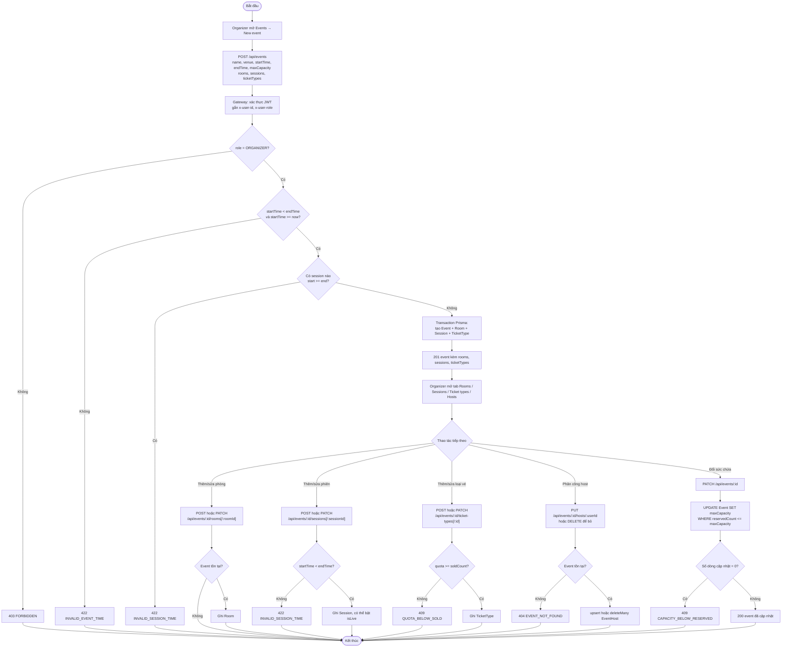

### (2) Đặt vé

**Hình 1.7 — Hoạt động đặt vé (saga).**

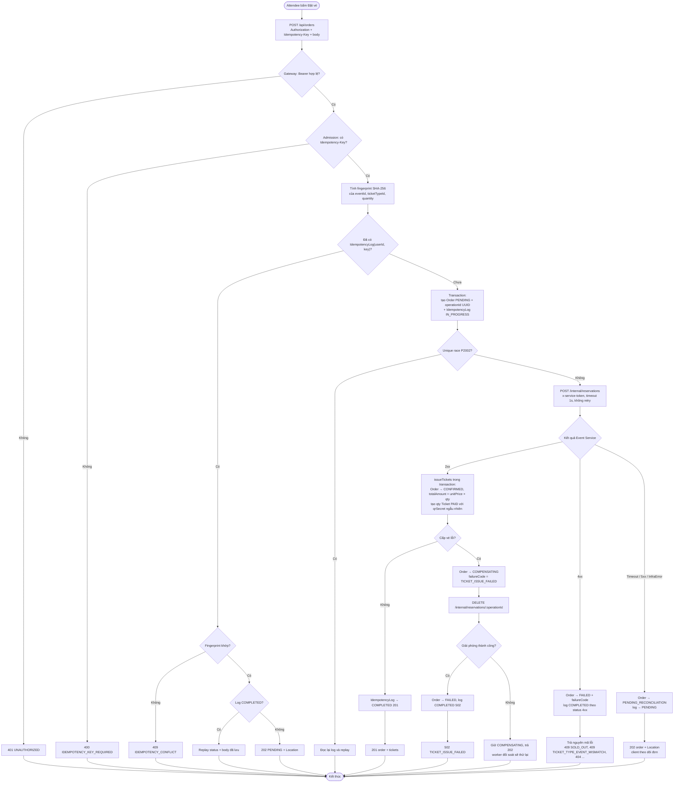

**Hình 1.8 — Chi tiết giữ chỗ bên Event Service.**

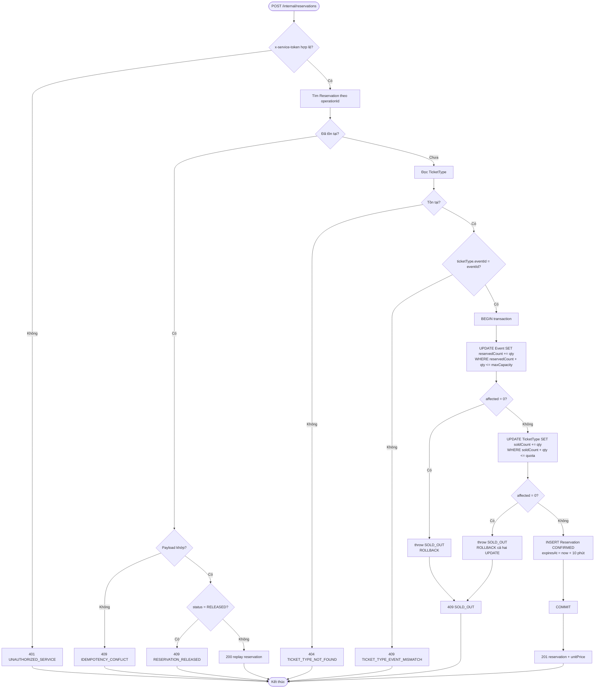

**Hình 1.9 — Trạng thái đơn hàng.**

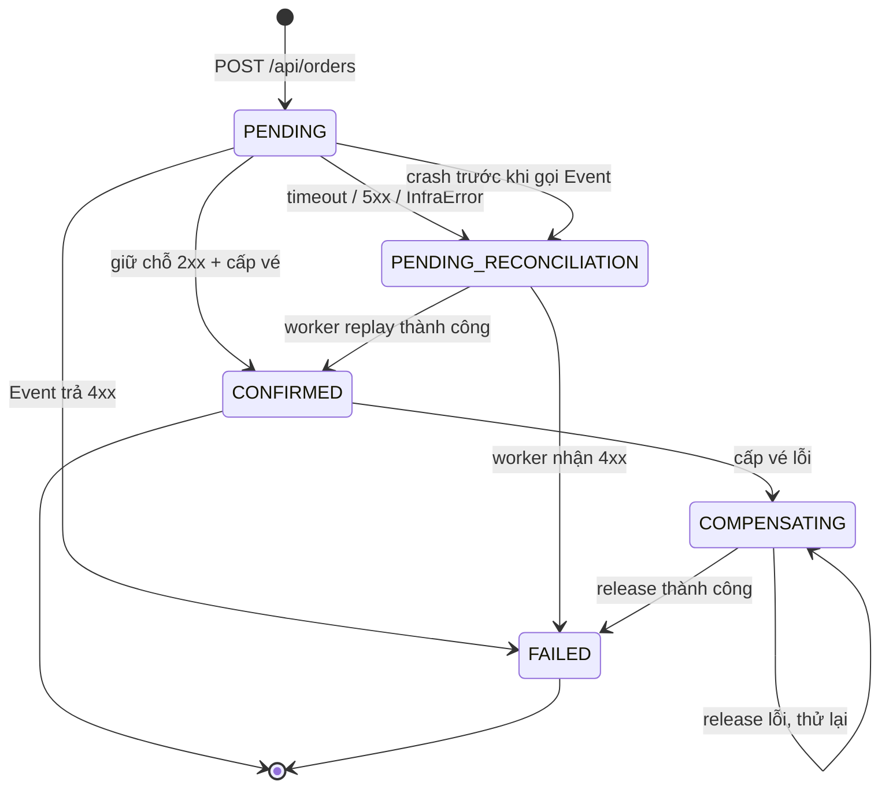

### (3) Soát vé tại cổng

**Hình 1.10 — Cấp QR động.**

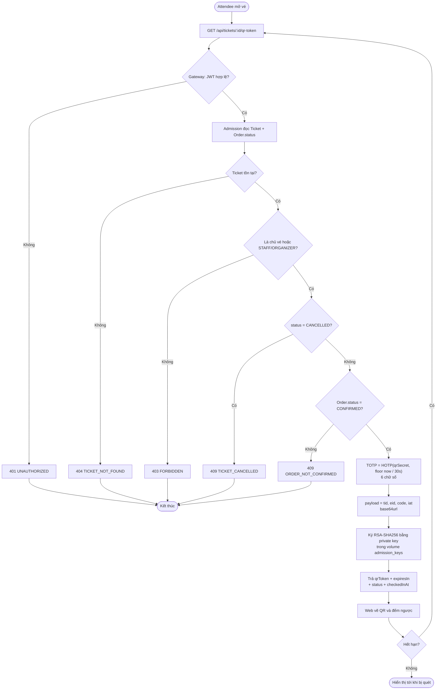

**Hình 1.11 — Soát vé QR online.**

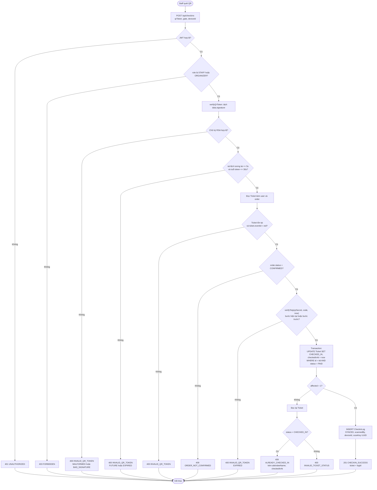

**Hình 1.12 — Đồng bộ lượt quét offline.**

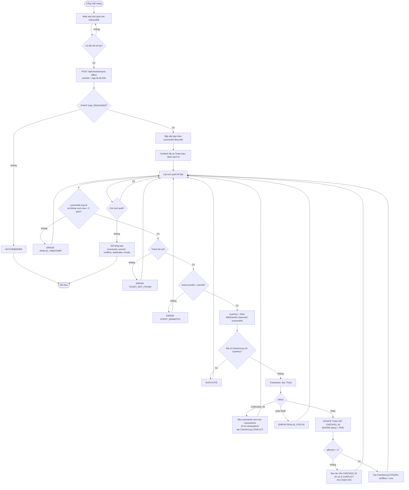

**Hình 1.13 — Trạng thái vé.**

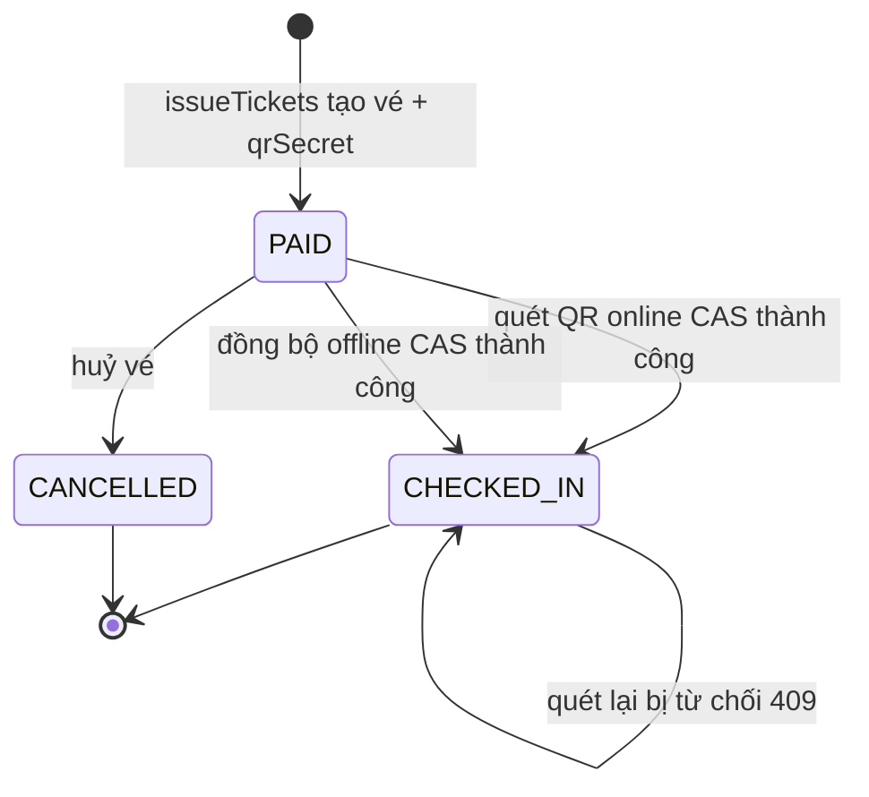

### (4) Tương tác trong phiên

**Hình 1.14 — Hoạt động hỏi đáp Q&A.**

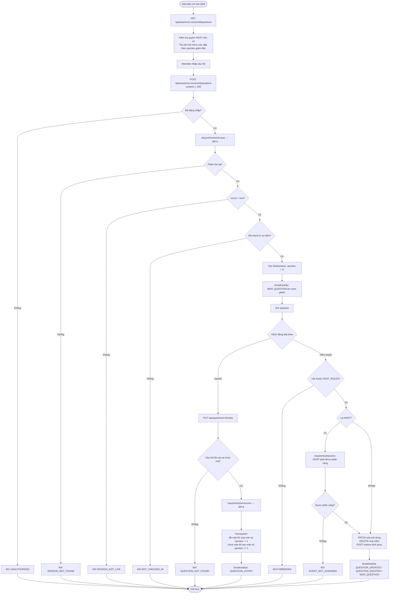

**Hình 1.15 — Hoạt động bình chọn (poll).**

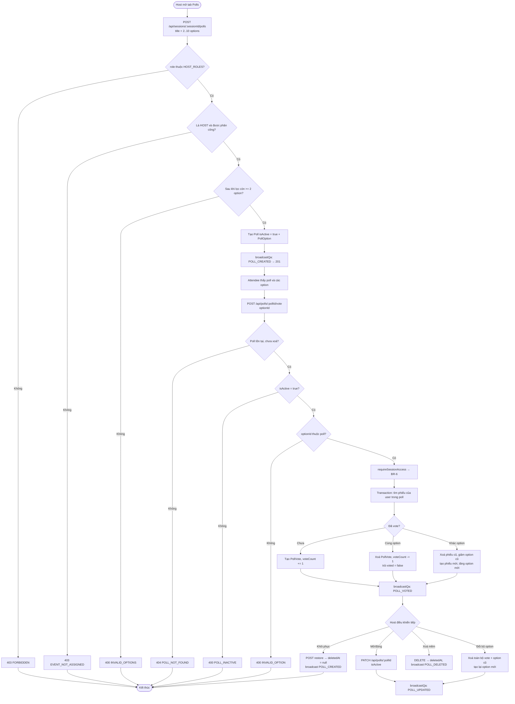

**Hình 1.16 — Quiz: sinh và điều khiển.**

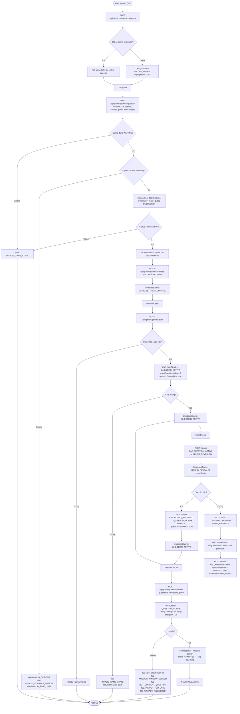

**Hình 1.17 — Trạng thái QuizGame.**

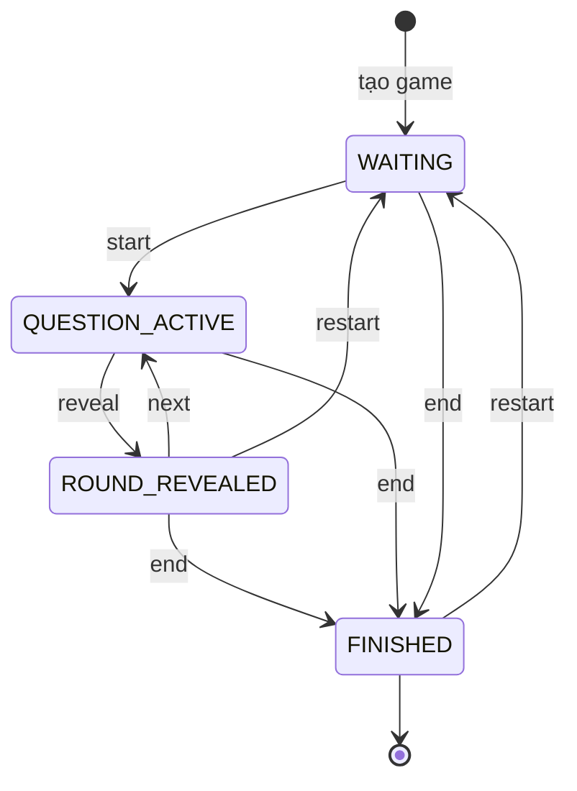

**Hình 1.18 — Màn trình chiếu của Host.**

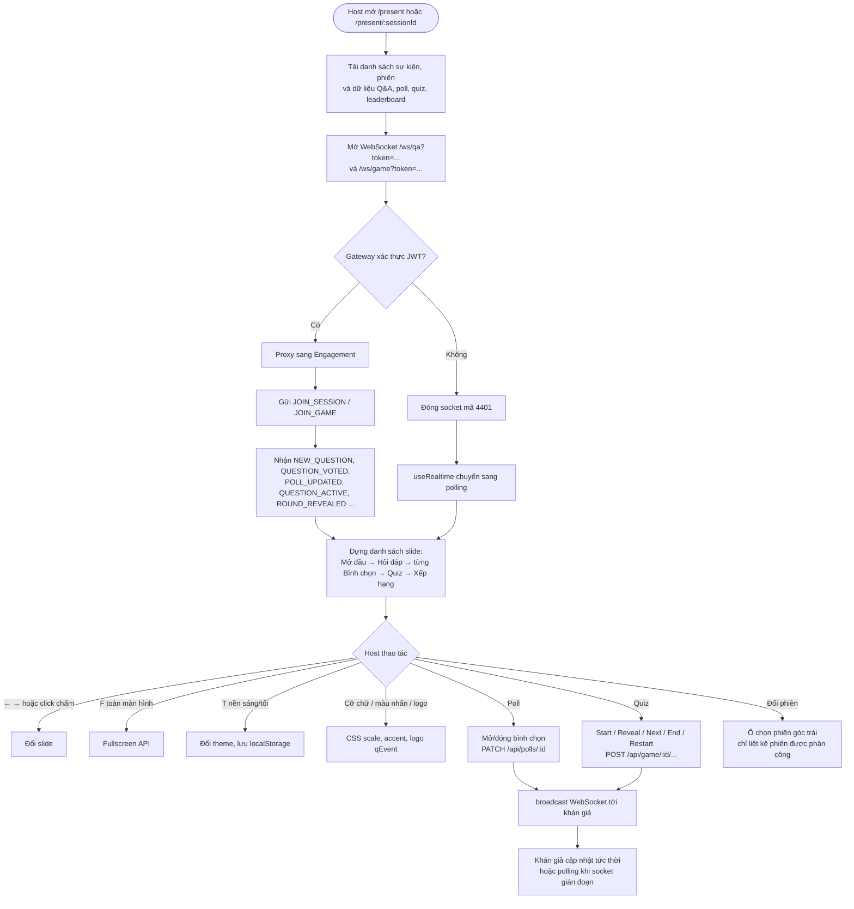

## 1.4. Quy tắc nghiệp vụ

Hệ thống hiện thực và kiểm thử sáu quy tắc cốt lõi:

| Mã | Quy tắc | Mô tả | Phản hồi khi vi phạm |
|---|---|---|---|
| **BR-1** | Thời gian sự kiện hợp lệ | `startTime` phải trước `endTime` và không nằm trong quá khứ | `422 INVALID_EVENT_TIME` |
| **BR-2** | Giới hạn sức chứa | Tổng vé đã bán/giữ chỗ không vượt `maxCapacity` của sự kiện và `quota` của loại vé | `409 SOLD_OUT` |
| **BR-3** | Idempotency đặt vé | Cùng `Idempotency-Key` + cùng payload thì trả kết quả cũ; payload khác thì từ chối | `409 IDEMPOTENCY_CONFLICT` |
| **BR-4** | Chống soát vé trùng | Mỗi vé chỉ được check-in thành công một lần (`PAID → CHECKED_IN`) | `409 ALREADY_CHECKED_IN` |
| **BR-5** | QR động hợp lệ | Token phải có chữ ký RSA hợp lệ và TOTP còn trong cửa sổ 30 giây | `400 INVALID_QR_TOKEN` |
| **BR-6** | Quyền tham gia tương tác | Chỉ người đã check-in đúng sự kiện và phiên đang diễn ra mới được Q&A/poll/quiz | `403 NOT_CHECKED_IN`, `403 SESSION_NOT_LIVE` |
| **BR-7** | Phạm vi của Host | Host chỉ đọc/sửa nội dung và mở màn trình chiếu của sự kiện được phân công trong `EventHost` | `403 EVENT_FORBIDDEN`, `403 EVENT_NOT_ASSIGNED` |

Ngoài bảy quy tắc trên, hệ thống còn ràng buộc:

- Đăng ký công khai luôn tạo tài khoản `ATTENDEE`; không tin `role` do client gửi.
- Không cho giảm `maxCapacity` xuống dưới số chỗ đã giữ/bán (`409 CAPACITY_BELOW_RESERVED`).
- Không nhận đáp án quiz qua WebSocket; đáp án phải đi qua REST để xác thực và tính điểm.
- Điểm quiz do server tính từ thời điểm câu hỏi bắt đầu; không tin thời gian client gửi.

## 1.5. Yêu cầu chức năng

| Miền nghiệp vụ | Chức năng bắt buộc |
|---|---|
| **Sự kiện & sức chứa** | Tạo/sửa/đọc sự kiện; quản lý phòng, phiên, loại vé; giữ chỗ và giải phóng chỗ nguyên tử |
| **Định danh & đặt vé** | Đăng ký, đăng nhập, JWT; đặt vé idempotent; xem đơn và vé; cấp QR động |
| **Soát vé** | Quét QR online; chống trùng; xem lịch sử và thống kê; đồng bộ lượt quét offline |
| **Tương tác** | Q&A có upvote; poll có mở/đóng; quiz có state machine, leaderboard; WebSocket |
| **Trình chiếu phiên** | Màn hình toàn cửa sổ cho Host: slide mở đầu, hỏi đáp, từng bình chọn, quiz và bảng xếp hạng; điều khiển quiz/poll tại chỗ; đổi nền, cỡ chữ, màu nhấn; bật/tắt logo qEvent |
| **Phân công host** | Organizer gán/bỏ gán tài khoản HOST theo từng sự kiện; host chỉ thấy sự kiện được gán và sửa được Q&A/poll/quiz của sự kiện đó |
| **Hiển thị quiz trên điện thoại** | Host chọn khán giả thấy đầy đủ câu hỏi + đáp án, hoặc chỉ A/B/C/D |
| **Vận hành** | Health check từng service; gateway định tuyến, xác thực, giới hạn đăng nhập; chạy toàn hệ thống bằng Docker Compose |

## 1.6. Yêu cầu phi chức năng

| Nhóm | Yêu cầu | Cách đáp ứng trong kiến trúc |
|---|---|---|
| **Hiệu năng** | Soát vé phản hồi dưới 1 giây; luồng đặt vé không vượt ngân sách 2 giây của gateway | Timeout nội bộ ngắn, circuit breaker, cache kết quả dương cho BR-6 |
| **Độ tin cậy** | Một service chết không làm sập toàn hệ thống; không mất đơn, không oversell, không cấp vé trùng | Database riêng, saga + trạng thái `PENDING_RECONCILIATION`, worker đối soát, idempotency |
| **Nhất quán** | Sức chứa và trạng thái vé phải nhất quán | Transaction cục bộ + cập nhật có điều kiện (CAS), không join chéo database |
| **Bảo mật** | Chống giả mạo danh tính, giả mạo vé, phát lại QR | JWT tại gateway và service, `x-service-token`, RSA-SHA256 + TOTP, xóa header giả mạo |
| **Khả dụng offline** | Cổng soát vé vẫn hoạt động khi mạng yếu | Hàng đợi cục bộ phía web + endpoint đồng bộ offline |
| **Khả năng trình chiếu** | Đọc được trên máy chiếu/điện thoại quay; host thao tác nhanh, không cần chuyển sang màn quản trị | Màn hình toàn cửa sổ, ba cỡ chữ, nền sáng/tối, màu nhấn tương phản, phím tắt đổi slide, logo qEvent bật/tắt |
| **Khả năng triển khai** | Chạy toàn hệ thống bằng một lệnh | Dockerfile cho từng service + `docker-compose.yml` |
| **Khả năng kiểm chứng** | Có OpenAPI, Postman và kịch bản lỗi | OpenAPI 3 cho từng service, collection Postman, script fault injection |

## 1.7. Phạm vi

**Trong phạm vi:**

- Ba service nghiệp vụ: Event, Admission, Engagement; một API Gateway.
- Web console cho Staff/Organizer, tài khoản Host và luồng Attendee qua API.
- Màn trình chiếu phiên cho Host/Organizer: slide mở đầu, hỏi đáp, bình chọn, quiz, xếp hạng; tuỳ chỉnh nền, cỡ chữ, màu nhấn và logo qEvent.
- Thanh toán được mô phỏng (đơn chuyển thẳng sang `CONFIRMED`); không tích hợp cổng thanh toán thật.
- Tương tác thời gian thực qua WebSocket, có fallback polling ở phía client.

**Ngoài phạm vi:**

- Ứng dụng mobile native hoàn chỉnh (giao diện mobile chỉ ở mức đặc tả).
- Import file PowerPoint/PDF vào màn trình chiếu; hiện mỗi phiên dùng bố cục cố định gồm năm loại slide.
- Đồng bộ tuỳ chỉnh trình chiếu giữa nhiều máy; lựa chọn lưu trên trình duyệt của người dẫn.
- Phân quyền theo từng sự kiện, đa tenant.
- Hàng đợi thông điệp (RabbitMQ/Kafka) và DLQ — hệ thống hiện dùng gọi HTTP đồng bộ + saga.
- Thanh toán thật, hóa đơn, hoàn tiền tự động.
- Triển khai Kubernetes hoặc hạ tầng cloud nhiều vùng.

---

# PHẦN 2 — THIẾT KẾ KIẾN TRÚC

## 2.1. Động lực kiến trúc

Kiến trúc được chọn dựa trên bốn động lực chính:

1. **Phân tách theo miền nghiệp vụ.** Sự kiện/sức chứa, vé/soát vé và tương tác phiên có vòng đời và tốc độ thay đổi khác nhau; mỗi miền cần dữ liệu và quy tắc riêng.
2. **Cô lập lỗi tại cổng soát vé.** Một sự cố ở Engagement không được làm chậm luồng soát vé; một sự cố ở Event không được làm mất vé đã cấp.
3. **Ranh giới giao dịch rõ ràng.** Vé và check-in phải nằm cùng một service để chống soát trùng bằng transaction cục bộ; giữ chỗ phải nằm ở service sở hữu sức chứa.
4. **Chia việc cho nhóm 4 người.** Mỗi thành viên sở hữu một service/module trọn vẹn, giảm xung đột mã nguồn và cho phép giải thích độc lập khi vấn đáp.

## 2.2. Sơ đồ kiến trúc tổng thể

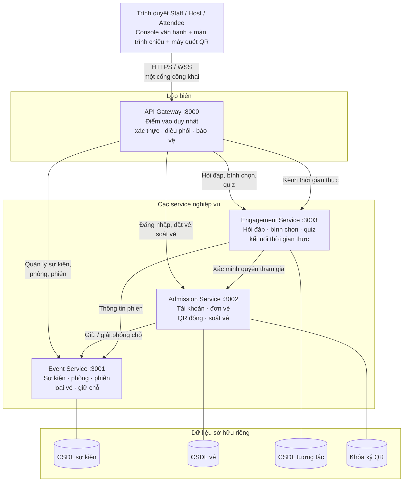

**Nguyên tắc bắt buộc của sơ đồ:**

- Client chỉ biết một địa chỉ công khai là gateway; ba service không publish cổng ra host.
- Mỗi service chỉ đọc/ghi database của mình; không join, không foreign key xuyên service.
- Giao tiếp liên service chỉ qua HTTP nội bộ có xác thực; ID xuyên service là scalar tham chiếu.
- Gateway không chứa luật nghiệp vụ; nó chỉ định tuyến, xác thực, áp chính sách và bảo vệ downstream.
- Màn trình chiếu là một màn hình của web console, dùng chung API và WebSocket với màn quản trị tương tác; nó **không** phải một service nghiệp vụ mới.

## 2.3. Phân rã service

| Service | Miền nghiệp vụ | Trách nhiệm chính | Dữ liệu sở hữu | API tiêu biểu | Cổng |
|---|---|---|---|---|---|
| **API Gateway** | Lớp biên | Điểm vào duy nhất; định tuyến theo prefix; xác thực JWT; xóa header giả mạo; circuit breaker; giới hạn đăng nhập; proxy WebSocket | Không sở hữu database | `/api/*`, `/ws/*`, `/health` | `8000` |
| **Event Service** | Sự kiện & sức chứa | Quản lý sự kiện, phòng, phiên, loại vé, phân công host; kiểm tra BR-1 và BR-7; giữ/giải phóng chỗ nguyên tử | `Event`, `Room`, `Session`, `TicketType`, `Reservation`, `EventHost` | `/api/events*`, `/api/events/:id/hosts*`, `/internal/reservations*`, `/internal/sessions/:id` | `3001` |
| **Admission Service** | Vé & soát vé | Đăng ký/đăng nhập; saga đặt vé; idempotency; cấp QR động; soát vé chống trùng; đồng bộ offline | `User`, `Order`, `IdempotencyLog`, `Ticket`, `CheckinLog` | `/api/auth*`, `/api/orders*`, `/api/tickets*`, `/api/checkins*`, `/internal/tickets/verify-access` | `3002` |
| **Engagement Service** | Tương tác phiên | Q&A, upvote; poll; quiz state machine; leaderboard; phát sự kiện WebSocket; xác minh BR-6 và BR-7 | `QAQuestion`, `QAVote`, `Poll`, `PollOption`, `PollVote`, `QuizGame`, `QuizQuestion`, `QuizAnswer` | `/api/sessions/*`, `/api/questions/*`, `/api/polls/*`, `/api/game/*`, `/ws/*` | `3003` |

**Màn trình chiếu không phải service riêng.** Nó là một route toàn màn hình của web console, gọi đúng các API Engagement như màn quản trị. Cách này giữ nguyên ba miền nghiệp vụ, không tạo thêm dữ liệu hay điểm gọi liên service, nhưng vẫn cho Host điều khiển phiên ngay trước khán giả.

## 2.4. Vì sao chia như vậy?

### 2.4.1. Ranh giới theo miền (bounded context)

- **Event** là nguồn sự thật duy nhất về “sự kiện có gì, còn bao nhiêu chỗ và ai được dẫn phiên”. Mọi thay đổi sức chứa, quota, phiên và phân công host đều nằm ở đây.
- **Admission** là nguồn sự thật duy nhất về “ai có vé và ai đã vào cổng”. Vé và check-in nằm cùng service để thao tác soát vé vẫn là transaction cục bộ.
- **Engagement** là nguồn sự thật duy nhất về “mọi người tương tác thế nào trong phiên”. Nó không cần quyền ghi vào dữ liệu vé hay sự kiện, nhưng hỏi Event Service xem host có được phân công đúng sự kiện hay không.

### 2.4.2. Ranh giới giao dịch

- Giữ chỗ và kiểm tra sức chứa phải nguyên tử → đặt trong Event Service với hai câu `UPDATE` có điều kiện trong cùng transaction.
- Cấp vé và chuyển đơn sang `CONFIRMED` phải nguyên tử → đặt trong Admission Service.
- Chống soát trùng cần `UPDATE ... WHERE status = 'PAID'` → đặt trong Admission Service, nơi sở hữu `Ticket`.

Nếu gộp vé và sự kiện vào một database dùng chung, nhóm sẽ có transaction đơn giản hơn nhưng mất ranh giới dữ liệu và không còn đáp ứng yêu cầu “mỗi service có dữ liệu riêng”.

### 2.4.3. Vì sao không tách thêm service?

- **Auth không tách riêng** vì chỉ phục vụ Admission và không có dữ liệu nghiệp vụ độc lập; tách ra sẽ tạo thêm một điểm gọi trong mọi request mà không tăng giá trị.
- **Không tách Notification/Media** vì chưa có nghiệp vụ tương ứng trong phạm vi bài tập.
- **Không tách Presenter Service** vì màn trình chiếu chỉ đọc/ghi cùng dữ liệu tương tác của Engagement. Tách ra sẽ tạo thêm một kết nối realtime và một điểm gọi, trong khi không có dữ liệu riêng để sở hữu.
- Ba service nghiệp vụ là mức tối thiểu đáp ứng yêu cầu nhóm 3–4 người, đồng thời giữ số lượng điểm gọi liên service trong tầm kiểm soát.

### 2.4.4. Vì sao có API Gateway?

- Che giấu topology nội bộ; client chỉ cần một địa chỉ.
- Tập trung xác thực JWT và loại bỏ header giả mạo (`x-user-id`, `x-user-role`) trước khi request vào service.
- Áp dụng circuit breaker, timeout và giới hạn tần suất tại một chỗ.
- Proxy WebSocket để realtime đi qua cùng điểm vào.

### 2.4.5. Biểu đồ lớp miền nghiệp vụ

Các lớp dưới đây mô hình hoá trạng thái và hành vi nghiệp vụ; hành vi được cài trong service tương ứng, còn lớp truy cập dữ liệu nằm ở mục 2.6.4.

**Hình 2.1 — Miền Sự kiện và sức chứa.**

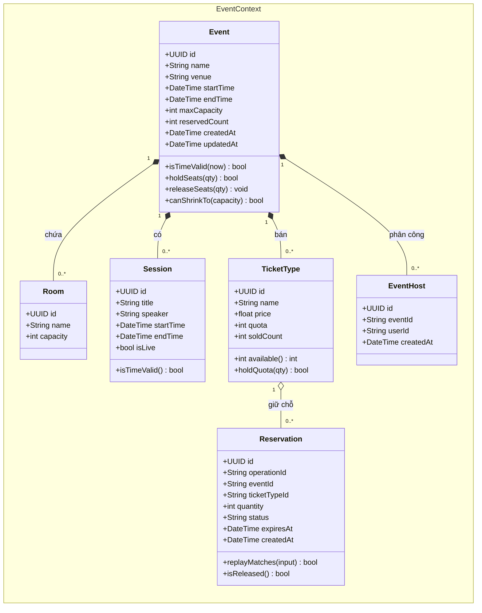

**Ràng buộc trên lớp**

| Lớp | Bất biến | Nơi kiểm tra |
|---|---|---|
| `Event` | `startTime < endTime` và `startTime >= now` khi tạo/đổi giờ bắt đầu | `createEvent`, `updateEvent` → `422 INVALID_EVENT_TIME` |
| `Event` | `reservedCount <= maxCapacity` tại mọi thời điểm | `UPDATE ... WHERE reservedCount + qty <= maxCapacity` |
| `Event` | Không hạ `maxCapacity` dưới `reservedCount` | `UPDATE ... WHERE reservedCount <= maxCapacity` → `409 CAPACITY_BELOW_RESERVED` |
| `TicketType` | `soldCount <= quota` | `UPDATE ... WHERE soldCount + qty <= quota` → `409 SOLD_OUT` |
| `TicketType` | Không hạ `quota` dưới `soldCount` | `updateTicketType` → `409 QUOTA_BELOW_SOLD` |
| `Session` | `startTime < endTime` | `422 INVALID_SESSION_TIME` |
| `Reservation` | `operationId` duy nhất; `RELEASED` không tái sử dụng | unique index + `replay()` → `409 RESERVATION_RELEASED` |
| `EventHost` | Duy nhất cặp `(eventId, userId)` | `@@unique([eventId, userId])` |

**Hình 2.2 — Miền Vé và soát vé.**

```mermaid
classDiagram
    direction LR

    namespace AdmissionContext {
        class User {
            +UUID id
            +String email
            +String passwordHash
            +String fullName
            +Role role
            +DateTime createdAt
            +verifyPassword(raw) bool
        }

        class Order {
            +UUID id
            +String userId
            +String eventId
            +String ticketTypeId
            +String idempotencyKey
            +String operationId
            +String status
            +int quantity
            +float totalAmount
            +String failureCode
            +DateTime leaseUntil
            +int attempts
            +DateTime createdAt
            +DateTime updatedAt
            +canConfirm() bool
            +isReconcilable(now, graceMs) bool
        }

        class IdempotencyLog {
            +UUID id
            +String userId
            +String key
            +String fingerprint
            +String orderId
            +String status
            +int responseStatus
            +String responseBody
            +DateTime createdAt
            +DateTime updatedAt
            +matches(fingerprint) bool
            +isCompleted() bool
        }

        class Ticket {
            +UUID id
            +String orderId
            +String userId
            +String eventId
            +String ticketTypeId
            +TicketStatus status
            +String qrSecret
            +DateTime checkedInAt
            +DateTime createdAt
            +DateTime updatedAt
            +canCheckIn() bool
            +applyCheckIn(at) bool
        }

        class CheckinLog {
            +UUID id
            +String ticketId
            +String scannedBy
            +DateTime scannedAt
            +bool isOffline
            +String deviceId
            +String syncStatus
            +String scanKey
        }

        class Role {
            <<enumeration>>
            ORGANIZER
            HOST
            STAFF
            ATTENDEE
        }

        class TicketStatus {
            <<enumeration>>
            PENDING_PAYMENT
            PAID
            CHECKED_IN
            CANCELLED
        }
    }

    User "1" --> "0..*" Order : đặt
    User "1" --> "0..*" Ticket : sở hữu
    Order "1" *-- "1..*" Ticket : cấp
    Order "1" -- "0..1" IdempotencyLog : chống trùng
    Ticket "1" --> "0..*" CheckinLog : ghi nhận
    User --> Role
    Ticket --> TicketStatus
```

**Trạng thái `Order`** (`status` là `String`, không phải enum Prisma):

`PENDING → CONFIRMED | FAILED | PENDING_RECONCILIATION → COMPENSATING → FAILED`

**Trạng thái `Ticket`**: `PENDING_PAYMENT → PAID → CHECKED_IN`, nhánh `CANCELLED`. Trong luồng hiện tại vé được tạo thẳng `PAID`.

**Hình 2.3 — Miền Tương tác trong phiên.**

```mermaid
classDiagram
    direction LR

    namespace EngagementContext {
        class QAQuestion {
            +UUID id
            +String sessionId
            +String userId
            +String content
            +int upvotes
            +DateTime createdAt
            +DateTime deletedAt
            +isVisible() bool
            +softDelete(at) void
        }

        class QAVote {
            +UUID id
            +String questionId
            +String userId
        }

        class Poll {
            +UUID id
            +String sessionId
            +String title
            +bool isActive
            +DateTime createdAt
            +DateTime deletedAt
            +hasAtLeastTwoOptions() bool
            +close() void
        }

        class PollOption {
            +UUID id
            +String content
            +int voteCount
        }

        class PollVote {
            +UUID id
            +String optionId
            +String userId
        }

        class QuizGame {
            +UUID id
            +String sessionId
            +String status
            +int currentQuestionIndex
            +String displayMode
            +canStart() bool
            +canReveal() bool
            +canAdvance() bool
        }

        class QuizQuestion {
            +UUID id
            +int orderNum
            +String content
            +String[] options
            +int correctOption
            +int timeLimitSec
            +DateTime questionStartedAt
            +DateTime deletedAt
            +isAnswerWindowOpen(now, graceMs) bool
        }

        class QuizAnswer {
            +UUID id
            +String questionId
            +String userId
            +int selectedOption
            +int responseTimeMs
            +int score
            +DateTime answeredAt
        }
    }

    QAQuestion "1" *-- "0..*" QAVote : nhận
    Poll "1" *-- "2..10" PollOption : gồm
    PollOption "1" *-- "0..*" PollVote : nhận
    QuizGame "1" *-- "0..*" QuizQuestion : chứa
    QuizQuestion "1" *-- "0..*" QuizAnswer : nhận
```

**Trạng thái `QuizGame`**: `WAITING → QUESTION_ACTIVE → ROUND_REVEALED → … → FINISHED`, và `FINISHED | ROUND_REVEALED → WAITING` khi restart.

**Công thức điểm** (`calculateQuizScore`):

```text
score = 0                                        nếu sai
score = round(1000 × (1 − t / (2 × timeLimitMs))) nếu đúng
t     = min(max(elapsed, 0), timeLimitMs)         thời gian server đo
```

**Hình 2.4 — Ba miền và tham chiếu xuyên service.**

```mermaid
classDiagram
    direction LR

    namespace EventDB {
        class Event
        class Room
        class Session
        class TicketType
        class Reservation
        class EventHost
    }

    namespace AdmissionDB {
        class User
        class Order
        class IdempotencyLog
        class Ticket
        class CheckinLog
    }

    namespace EngagementDB {
        class QAQuestion
        class QAVote
        class Poll
        class PollOption
        class PollVote
        class QuizGame
        class QuizQuestion
        class QuizAnswer
    }

    Event "1" *-- "0..*" Room
    Event "1" *-- "0..*" Session
    Event "1" *-- "0..*" TicketType
    Event "1" *-- "0..*" EventHost
    TicketType "1" o-- "0..*" Reservation

    User "1" --> "0..*" Order
    User "1" --> "0..*" Ticket
    Order "1" *-- "1..*" Ticket
    Order "1" -- "0..1" IdempotencyLog
    Ticket "1" --> "0..*" CheckinLog

    QAQuestion "1" *-- "0..*" QAVote
    Poll "1" *-- "2..10" PollOption
    PollOption "1" *-- "0..*" PollVote
    QuizGame "1" *-- "0..*" QuizQuestion
    QuizQuestion "1" *-- "0..*" QuizAnswer

    Order ..> Event : "eventId (scalar)"
    Ticket ..> Event : "eventId (scalar)"
    Reservation ..> Event : "eventId (FK nội bộ)"
    EventHost ..> User : "userId (scalar)"
    QAQuestion ..> Session : "sessionId (scalar)"
    Poll ..> Session : "sessionId (scalar)"
    QuizGame ..> Session : "sessionId (scalar)"
```

> Ba khối trên nằm ở **ba database vật lý khác nhau**. Các đường nét đứt là **tham chiếu scalar**, không có
> foreign key và không join được. Đây chính là lý do phải có saga, gọi HTTP nội bộ và đối soát.

## 2.5. Giao tiếp liên service

### 2.5.1. Gọi HTTP đồng bộ có kiểm soát

| Luồng gọi | Endpoint nội bộ | Timeout / retry | Xử lý khi lỗi |
|---|---|---|---|
| Admission → Event (giữ chỗ) | `POST /internal/reservations` | 1 s; không retry (gateway bỏ cuộc ở 2 s) | `4xx` → đơn `FAILED`; lỗi hạ tầng → `PENDING_RECONCILIATION` + `202` |
| Admission → Event (bồi hoàn) | `DELETE /internal/reservations/:operationId` | 1 s; không retry; worker thử lại | Giữ `COMPENSATING` và tiếp tục thử bởi worker |
| Engagement → Event (phiên) | `GET /internal/sessions/:id` | 1 s; không retry | `503 EVENT_SERVICE_UNAVAILABLE`, không biến thành `403`; kèm `userId` để trả `hostAssigned` cho BR-7 |
| Engagement → Admission (quyền tham gia) | `GET /internal/tickets/verify-access` | 1 s; không retry | `503 ADMISSION_SERVICE_UNAVAILABLE`; chỉ cache kết quả dương 60 s |

Mọi lời gọi nội bộ đều gửi `x-service-token`; địa chỉ service lấy từ biến môi trường (`EVENT_SERVICE_URL`, `ADMISSION_SERVICE_URL`, `ENGAGEMENT_SERVICE_URL`).

**Hình 2.5 — Xác minh quyền tham gia (BR-6).**

```mermaid
sequenceDiagram
    participant A as Attendee
    participant E as Engagement Service
    participant ES as Event Service
    participant AS as Admission Service

    A->>E: 1. Gọi API ghi tương tác
    E->>ES: 2. GET /internal/sessions/:id kèm x-service-token
    alt Không tìm thấy phiên
        ES-->>E: 2a. 404
        E-->>A: 2b. 404 SESSION_NOT_FOUND
    end
    alt Event lỗi hoặc timeout
        ES-->>E: 2c. 5xx hoặc timeout
        E-->>A: 2d. 503 hoặc 504 EVENT_SERVICE_*
    end
    ES-->>E: 3. session với eventId và isLive
    E->>E: 4. Kiểm tra isLive
    alt Phiên chưa diễn ra
        E-->>A: 4a. 403 SESSION_NOT_LIVE
    end
    E->>AS: 5. GET /internal/tickets/verify-access?userId&eventId
    alt Admission lỗi hoặc timeout
        AS-->>E: 5a. Non-200 hoặc lỗi mạng
        E-->>A: 5b. 503 hoặc 504 ADMISSION_SERVICE_*
    end
    AS-->>E: 6. 200 checkedIn, hasAccess, ticketId
    E->>E: 7. Chỉ cache kết quả dương 60 giây
    alt checkedIn = false
        E-->>A: 7a. 403 NOT_CHECKED_IN
    end
    E->>E: 8. Ghi dữ liệu và broadcast
    E-->>A: 9. 200 hoặc 201
```

**Các bước**

1. Attendee gửi câu hỏi, upvote, bình chọn hoặc trả lời quiz.
2. Engagement hỏi Event Service thông tin phiên; `eventId` luôn lấy từ server, **không** lấy từ body client.
    2a/2b. Phiên không tồn tại → `404 SESSION_NOT_FOUND`.
    2c/2d. Service lỗi/timeout → `503` hoặc `504 EVENT_SERVICE_UNAVAILABLE/TIMEOUT` (không biến thành `403`).
3. Nhận `{sessionId, eventId, isLive}`.
4. Kiểm tra phiên đang diễn ra.
   4a. `isLive = false` → `403 SESSION_NOT_LIVE`.
5. Hỏi Admission xem người dùng đã check-in đúng sự kiện chưa.
    5a/5b. Admission lỗi → `503/504 ADMISSION_SERVICE_*`.
6. Admission trả `200 {checkedIn, hasAccess, ticketId}`; từ chối được biểu diễn bằng `200 + false`, không phải `404`.
7. Cache **chỉ** kết quả dương trong 60 giây để không khóa oan người vừa check-in.
   7a. `checkedIn = false` → `403 NOT_CHECKED_IN`.
8. Hợp lệ → ghi dữ liệu và phát WebSocket.
9. Trả kết quả cho client.

### 2.5.2. Saga đặt vé

**Hình 2.6 — Đặt vé: luồng thành công.**

```mermaid
sequenceDiagram
    participant A as Attendee
    participant G as API Gateway
    participant AS as Admission Service
    participant ES as Event Service
    participant AD as CSDL vé
    participant ED as CSDL sự kiện

    A->>G: 1. POST /api/orders + Idempotency-Key + body
    G->>G: 2. Verify JWT, xoá header giả, gắn x-user-id
    G->>AS: 3. Proxy qua circuit breaker
    AS->>AD: 4. findUnique IdempotencyLog theo userId và key
    AD-->>AS: 5. null
    AS->>AS: 6. fingerprint = SHA-256 của payload
    AS->>AD: 7. Transaction: create Order PENDING + log IN_PROGRESS
    AD-->>AS: 8. Order kèm operationId
    AS->>ES: 9. POST /internal/reservations + x-service-token
    ES->>ED: 10. findUnique Reservation theo operationId
    ED-->>ES: 11. null
    ES->>ED: 12. Transaction: UPDATE reservedCount, UPDATE soldCount
    ES->>ED: 13. create Reservation CONFIRMED
    ED-->>ES: 14. Reservation + giá vé
    ES-->>AS: 15. 201 reservation + unitPrice
    AS->>AD: 16. Transaction: Order sang CONFIRMED, tạo qty Ticket PAID
    AD-->>AS: 17. order + tickets
    AS->>AD: 18. IdempotencyLog sang COMPLETED, lưu status 201 và body
    AS-->>G: 19. 201
    G-->>A: 20. 201 order + tickets
    A->>A: 21. Hiển thị vé và nút QR
```

**Các bước**

1. Attendee gửi `eventId`, `ticketTypeId`, `quantity` (1–10) kèm `Idempotency-Key`.
2. Gateway xác thực JWT, làm sạch header, gắn `x-user-id`.
3. Chuyển tiếp sang Admission Service.
4. Tìm `IdempotencyLog` theo `(userId, key)`.
5. Không có bản ghi → đây là yêu cầu mới.
6. Tính fingerprint SHA-256 của `{eventId, ticketTypeId, quantity}`.
7. Trong transaction: tạo `Order` trạng thái `PENDING` với `operationId` UUID, tạo log `IN_PROGRESS`.
8. Nhận `orderId` và `operationId`.
9. Gọi nội bộ Event Service kèm `x-service-token`, timeout 1 giây, không retry.
10. Event tra `Reservation` theo `operationId` để chống giữ chỗ hai lần.
11. Chưa có → tiếp tục giữ chỗ.
12. Trong transaction: `UPDATE Event SET reservedCount += qty WHERE reservedCount + qty <= maxCapacity`;
    sau đó `UPDATE TicketType SET soldCount += qty WHERE soldCount + qty <= quota`.
13. Tạo `Reservation` trạng thái `CONFIRMED`, `expiresAt = now + 10 phút`.
14. Trả reservation kèm `unitPrice` của loại vé.
15. Event trả `201`; bất kỳ `4xx` nào cũng là từ chối nghiệp vụ, không phải lỗi hạ tầng.
16. Admission chạy transaction cấp vé: CAS `Order → CONFIRMED`, `totalAmount = unitPrice × quantity`,
    chèn `quantity` bản ghi `Ticket` trạng thái `PAID` với `qrSecret` ngẫu nhiên 20 byte.
17. Trả order kèm danh sách vé.
18. Ghi đè log idempotency thành `COMPLETED`, lưu `responseStatus = 201` và `responseBody`.
19. Admission trả `201`.
20. Gateway forward `201`.
21. Web hiển thị vé; attendee có thể mở QR động.

> Các kiểm tra chi tiết bên trong Event Service — `TicketType` tồn tại, lệch `eventId`, CAS `soldCount`,
> replay `operationId`, race `P2002` — nằm ở biểu đồ **“Chi tiết giữ chỗ bên Event Service”** (Hình 1.8).

**Hình 2.7 — Đặt vé: hết chỗ.**

```mermaid
sequenceDiagram
    participant A as Attendee
    participant G as API Gateway
    participant AS as Admission Service
    participant ES as Event Service
    participant AD as CSDL vé
    participant ED as CSDL sự kiện

    A->>G: 1. POST /api/orders + Idempotency-Key
    G->>AS: 2. Proxy sau khi xác thực JWT
    AS->>AD: 3. Tìm IdempotencyLog theo userId và key
    AD-->>AS: 4. null
    AS->>AD: 5. Transaction: Order PENDING + log IN_PROGRESS
    AS->>ES: 6. POST /internal/reservations
    ES->>ED: 7. Kiểm tra Reservation theo operationId
    ED-->>ES: 8. null
    ES->>ED: 9. UPDATE Event reservedCount với điều kiện sức chứa
    ED-->>ES: 10. affected = 0
    ES->>ED: 11. ROLLBACK transaction
    ES-->>AS: 12. 409 SOLD_OUT
    AS->>AD: 13. Order sang FAILED, failureCode SOLD_OUT
    AS->>AD: 14. Log sang COMPLETED với status 409
    AS-->>G: 15. 409 SOLD_OUT
    G-->>A: 16. 409 SOLD_OUT
    A->>A: 17. Hiển thị hết chỗ, không tạo vé
```

**Các bước**

1. Attendee gửi yêu cầu đặt vé.
2. Gateway xác thực và chuyển tiếp.
3. Admission tra log idempotency.
4. Không có → yêu cầu mới.
5. Tạo `Order PENDING` + log `IN_PROGRESS`.
6. Gọi Event giữ chỗ.
7. Event kiểm tra `operationId` chưa được dùng.
8. Chưa có reservation.
9. Câu `UPDATE Event` có điều kiện `reservedCount + qty <= maxCapacity`.
10. Không dòng nào bị ảnh hưởng → hết sức chứa sự kiện (hoặc bước `UPDATE TicketType` trả 0 vì hết quota).
11. Transaction rollback, không có reservation và không trừ chỗ.
12. Event trả `409 SOLD_OUT`.
13. Admission đánh dấu đơn `FAILED`, lưu `failureCode`.
14. Ghi log idempotency `COMPLETED` với status 409 để retry sau trả lại đúng kết quả.
15. Trả `409` cho gateway.
16. Gateway forward `409`.
17. Client hiển thị thông báo; **không** có vé nào được tạo.

> Nhánh hết quota loại vé và nhánh lệch `eventId` của `TicketType` nằm trong cùng biểu đồ chi tiết ở Hình 1.8.

**Hình 2.8 — Đặt vé: Event Service không phản hồi.**

```mermaid
sequenceDiagram
    participant A as Attendee
    participant G as API Gateway
    participant AS as Admission Service
    participant ES as Event Service
    participant AD as CSDL vé

    A->>G: 1. POST /api/orders + Idempotency-Key
    G->>AS: 2. Proxy sau khi xác thực JWT
    AS->>AD: 3. Tạo Order PENDING + log IN_PROGRESS
    AS->>ES: 4. POST /internal/reservations, timeout 1s
    ES--xAS: 5. Không phản hồi hoặc trả 5xx
    AS->>AS: 6. Phân loại InfraError, không phải từ chối nghiệp vụ
    AS->>AD: 7. Order sang PENDING_RECONCILIATION
    AS->>AD: 8. Log sang PENDING
    AS-->>G: 9. 202 order + Location
    G-->>A: 10. 202 + Location
    A->>A: 11. Theo dõi đơn, chưa kết luận thành công hay thất bại
    Note over AS,AD: Worker đối soát sẽ xử lý ở Hình 2.9
```

**Các bước**

1. Attendee gửi yêu cầu.
2. Gateway xác thực và chuyển tiếp.
3. Admission tạo đơn `PENDING` và log `IN_PROGRESS` trước khi gọi chéo — nhờ vậy không mất đơn.
4. Gọi Event với timeout 1 giây.
5. Không có phản hồi, hoặc phản hồi `5xx`, hoặc lỗi mạng.
6. `resilient-fetch` ném `InfraError`; đây **không** phải `4xx` nghiệp vụ.
7. Đơn chuyển `PENDING_RECONCILIATION` (chưa biết Event đã giữ chỗ hay chưa).
8. Log idempotency chuyển `PENDING` để retry cùng key vẫn nhận `202`.
9. Trả `202` kèm `Location: /api/orders/:id`.
10. Gateway forward `202`.
11. Client hiển thị “đang xử lý”; đơn không bị mất và không bị báo sai là thất bại.

> Worker đối soát (Hình 2.9) replay bằng đúng `operationId`, nên nếu Event đã giữ chỗ thì nhận lại
> reservation cũ thay vì giữ thêm lần nữa.

**Hình 2.9 — Worker đối soát đơn treo.**

```mermaid
sequenceDiagram
    participant T as Timer
    participant R as Reconciler
    participant AD as CSDL vé
    participant ES as Event Service
    participant ED as CSDL sự kiện

    T->>R: 1. Mỗi 5 giây gọi reconcileOnce(10)
    R->>AD: 2. Tìm PENDING_RECONCILIATION, COMPENSATING, PENDING quá hạn lease
    AD-->>R: 3. Danh sách ứng viên
    loop Từng ứng viên
        R->>AD: 4. updateMany claim lease 30s, attempts += 1
        AD-->>R: 5. Số dòng claim được
        alt Không claim được
            R->>R: 5a. Bỏ qua, worker khác đang xử lý
        end
        alt Đơn COMPENSATING
            R->>ES: 6. DELETE /internal/reservations/:operationId
            ES->>ED: 7. Đánh dấu RELEASED, giảm reservedCount và soldCount
            ES-->>R: 8. 200 hoặc lỗi
            R->>AD: 9. Thành công thì Order FAILED + log COMPLETED 409
        else Đơn chờ giữ chỗ
            R->>ES: 10. POST /internal/reservations cùng operationId
            ES-->>R: 11. 2xx, 4xx hoặc 5xx
            R->>AD: 12. 2xx thì CONFIRMED và cấp vé, 4xx thì FAILED và lưu lỗi
        end
        alt Xử lý ném lỗi
            R->>AD: 13. Xoá lease ngay để lượt sau nhặt lại
        end
    end
```

**Các bước**

1. `setInterval` 5 giây gọi `reconcileOnce(deps, 10)`.
2. Chọn đơn `PENDING_RECONCILIATION`, `COMPENSATING`, hoặc `PENDING` cũ hơn cửa sổ lease (chống đơn kẹt do crash),
   đồng thời `leaseUntil` null hoặc đã hết hạn.
3. Nhận danh sách ứng viên theo `createdAt` tăng dần.
4. Với từng đơn, `updateMany` có điều kiện trạng thái + lease để giành quyền xử lý; ghi `leaseUntil = now + 30s`,
   tăng `attempts`. Đây là primitive loại trừ lẫn nhau giữa các worker.
5. Nếu 0 dòng bị ảnh hưởng: 5a. bỏ qua.
6. Nếu đơn `COMPENSATING`: gọi release reservation.
7. Event chuyển `Reservation` sang `RELEASED` và hoàn `reservedCount`/`soldCount` (không xuống dưới 0).
8. Nhận kết quả release.
9. Release thành công → đơn `FAILED`, log idempotency `COMPLETED` 409.
   Release lỗi → giữ `COMPENSATING`, lượt sau thử lại.
10. Ngược lại, replay giữ chỗ bằng đúng `operationId`.
11. Event trả `2xx` (kể cả replay), `4xx` hoặc `5xx`.
12. `2xx` → `issueTickets` chuyển `CONFIRMED`, cấp vé, log `COMPLETED 201`;
    `4xx` → `FAILED`, log `COMPLETED` theo mã lỗi; `5xx`/timeout → giữ nguyên để lượt sau.
13. Nếu `reconcileOrder` ném lỗi, worker xoá lease ngay thay vì chờ 30 giây.

**Hình 2.10 — Trạng thái Reservation.**

```mermaid
stateDiagram-v2
    [*] --> CONFIRMED : giữ chỗ thành công
    CONFIRMED --> RELEASED : DELETE /internal/reservations/:operationId
    RELEASED --> RELEASED : gọi lại trả 200
    CONFIRMED --> CONFIRMED : replay cùng operationId
    RELEASED --> [*]
```

Trạng thái đơn: `PENDING → CONFIRMED | FAILED | PENDING_RECONCILIATION → COMPENSATING → FAILED`.
Worker đối soát chạy định kỳ, dùng lease CAS để hai tiến trình không xử lý cùng một đơn, và replay cùng `operationId` để Event Service trả lại kết quả cũ thay vì giữ chỗ lần hai.

### 2.5.3. WebSocket

**Hình 2.11 — Kết nối WebSocket.**

```mermaid
sequenceDiagram
    participant C as Client
    participant G as API Gateway
    participant E as Engagement Service

    C->>G: 1. GET /ws/qa?token=... hoặc /ws/game?token=...
    G->>G: 2. extractWsToken từ query hoặc subprotocol
    G->>G: 3. Verify JWT
    alt Token thiếu hoặc sai
        G-->>C: 3a. Close 4401 UNAUTHORIZED
    end
    G->>E: 4. Mở WebSocket upstream tới /ws/qa hoặc /ws/game
    G->>G: 5. Buffer frame client gửi trong lúc CONNECTING
    C->>G: 6. Gửi JOIN_SESSION hoặc JOIN_GAME
    G->>E: 7. Forward frame
    E->>E: 8. Xác thực token bất đồng bộ, chờ authPromise
    alt Xác thực thất bại
        E-->>C: 8a. Close 4401
    end
    E->>E: 9. Nếu role HOST, kiểm tra hostAssigned
    alt HOST không được phân công
        E-->>C: 9a. ERROR EVENT_NOT_ASSIGNED
    end
    E->>E: 10. subscribeQa hoặc subscribeGame theo room
    E-->>C: 11. JOINED_SESSION hoặc JOINED_GAME
    E-->>C: 12. NEW_QUESTION, QUESTION_VOTED, POLL_CREATED, POLL_VOTED, QUESTION_ACTIVE, ROUND_REVEALED, GAME_FINISHED
    C->>G: 13. Đóng kết nối
    G->>E: 14. Đóng upstream
    E->>E: 15. unsubscribe khỏi room
```

**Các bước**

1. Client mở `/ws/qa` (Q&A, poll) hoặc `/ws/game` (quiz) kèm `?token=<jwt>`.
2. Gateway trích token từ query string hoặc subprotocol; không ghi URL đầy đủ vào log.
3. Verify JWT.
   3a. Không hợp lệ → đóng `4401` trước khi mở upstream.
4. Mở kết nối tới Engagement.
5. Nếu client gửi frame khi upstream còn `CONNECTING`, gateway đệm lại.
6. Client gửi `JOIN_SESSION` / `JOIN_GAME`.
7. Gateway forward frame.
8. Engagement xác thực lại token bất đồng bộ; message đến sớm được chờ `authPromise`.
   8a. Thất bại → đóng `4401`.
9. Với `HOST`, kiểm tra phân công sự kiện trước khi cho vào room.
   9a. Không được phân công → gửi `ERROR EVENT_NOT_ASSIGNED` và không subscribe.
10. Đăng ký client vào `BroadcastManager` theo `sessionId` hoặc `gameId` (room trong bộ nhớ tiến trình).
11. Gửi xác nhận `JOINED_*`.
12. Server đẩy các sự kiện nghiệp vụ; đáp án quiz **không** đi qua kênh này — nếu client gửi `SUBMIT_ANSWER`,
    Engagement trả `ERROR WS_SUBMIT_DEPRECATED` và buộc dùng REST.
13. Client đóng kết nối.
14. Gateway đóng upstream.
15. Engagement huỷ đăng ký room, giải phóng client.

Ghi chú: màn trình chiếu mở cùng kênh `/ws/qa` và `/ws/game`; khi socket không lên được hoặc rớt quá 30 giây, client chuyển sang làm mới định kỳ. Đáp án quiz không đi qua WebSocket.

### 2.5.4. Luồng soát vé và đồng bộ offline

**Hình 2.12 — Cấp QR động.**

```mermaid
sequenceDiagram
    participant A as Attendee
    participant G as API Gateway
    participant AS as Admission Service
    participant AD as CSDL vé

    A->>G: 1. GET /api/tickets/:id/qr-token
    G->>AS: 2. Proxy sau khi xác thực JWT
    AS->>AD: 3. findUnique Ticket kèm order.status
    AD-->>AS: 4. Ticket hoặc null
    AS->>AS: 5. Kiểm tra chủ vé/role, CANCELLED, order CONFIRMED
    alt Không hợp lệ
        AS-->>A: 5a. 404, 403, 409 TICKET_CANCELLED hoặc 409 ORDER_NOT_CONFIRMED
    end
    AS->>AS: 6. TOTP = HOTP(qrSecret, floor now / 30s)
    AS->>AS: 7. Payload tid, eid, code, iat, base64url, ký RSA-SHA256
    AS-->>G: 8. qrToken + expiresIn + status + checkedInAt
    G-->>A: 9. 200
    A->>A: 10. Vẽ QR, đếm ngược 30 giây rồi gọi lại
```

**Các bước**

1. Attendee mở chi tiết vé và bấm hiển thị QR.
2. Gateway xác thực JWT.
3. Admission đọc ticket kèm trạng thái đơn.
4. Không có ticket → dừng.
5. Kiểm tra: người gọi là chủ vé hoặc `STAFF`/`ORGANIZER`; vé không `CANCELLED`; đơn `CONFIRMED`.
   5a. Lần lượt trả `404 TICKET_NOT_FOUND`, `403 FORBIDDEN`, `409 TICKET_CANCELLED`, `409 ORDER_NOT_CONFIRMED`.
6. Sinh TOTP 6 chữ số từ `qrSecret` theo bước 30 giây.
7. Tạo payload `{tid, eid, code, iat}`, encode base64url, ký `RSA-SHA256` bằng private key trong volume.
8. Trả `qrToken`, `expiresIn` (giây còn lại của bước TOTP), trạng thái vé và `checkedInAt`.
9. Gateway forward.
10. Web vẽ QR và tự làm mới trước khi hết hạn; ảnh chụp màn hình cũ sẽ chết sau tối đa 30 giây.

**Hình 2.13 — Soát vé QR online.**

```mermaid
sequenceDiagram
    participant S as Staff scanner
    participant G as API Gateway
    participant AS as Admission Service
    participant AD as CSDL vé

    S->>G: 1. POST /api/checkins với qrToken, gate, deviceId
    G->>AS: 2. Proxy sau khi xác thực JWT
    AS->>AS: 3. Kiểm tra role STAFF hoặc ORGANIZER
    alt Sai role
        AS-->>S: 3a. 403 FORBIDDEN
    end
    AS->>AS: 4. verifyQrToken: chữ ký RSA, payload, iat, tuổi token
    alt Token không hợp lệ
        AS-->>S: 4a. 400 INVALID_QR_TOKEN
    end
    AS->>AD: 5. findUnique Ticket kèm user và order
    AD-->>AS: 6. Ticket
    AS->>AS: 7. Kiểm tra ticket.eventId và order.status
    alt Sai sự kiện hoặc đơn chưa xác nhận
        AS-->>S: 7a. 400 INVALID_QR_TOKEN hoặc 409 ORDER_NOT_CONFIRMED
    end
    AS->>AS: 8. verifyTotp với bước hiện tại và bước trước
    alt TOTP sai
        AS-->>S: 8a. 400 INVALID_QR_TOKEN
    end
    AS->>AD: 9. Transaction: UPDATE Ticket SET CHECKED_IN WHERE status = PAID
    AD-->>AS: 10. Số dòng cập nhật
    alt affected = 0
        AS->>AD: 11. Đọc lại Ticket
        AS-->>S: 12. 409 ALREADY_CHECKED_IN kèm attendeeName hoặc 400 INVALID_TICKET_STATUS
    else affected = 1
        AS->>AD: 13. INSERT CheckinLog SYNCED, scannedBy, deviceId, scanKey
        AS-->>G: 14. 201 CHECKIN_SUCCESS
        G-->>S: 15. 201
    end
```

**Các bước**

1. Staff quét mã và gửi token kèm `gate`/`deviceId`.
2. Gateway xác thực JWT rồi chuyển tiếp.
3. Service yêu cầu role `STAFF` hoặc `ORGANIZER`.
   3a. Vai trò khác → `403 FORBIDDEN`.
4. Tách token thành `data.signature`, verify chữ ký RSA-SHA256, parse payload, kiểm tra `iat` không vượt
   hiện tại quá 5 giây và tuổi token không quá 30 giây.
   4a. Lỗi `MALFORMED`, `BAD_SIGNATURE`, `EXPIRED`, `FUTURE` → `400 INVALID_QR_TOKEN`.
5. Đọc ticket kèm người dùng và đơn hàng.
6. Nhận ticket hoặc `null`.
7. So `ticket.eventId` với `eid` trong token; kiểm tra `order.status = CONFIRMED`.
   7a. Lệch sự kiện → `400`; đơn chưa xác nhận → `409 ORDER_NOT_CONFIRMED`.
8. Tính TOTP từ `ticket.qrSecret`, chấp nhận bước hiện tại và bước ngay trước (bù trừ đồng hồ).
   8a. Sai → `400 INVALID_QR_TOKEN`.
9. Trong transaction, chạy `UPDATE Ticket SET status = CHECKED_IN, checkedInAt = now WHERE id = ? AND status = 'PAID'`.
   Đây là **cổng chống soát trùng**: chỉ một request thắng.
10. Nhận số dòng bị ảnh hưởng.
11. Nếu 0 dòng, đọc lại ticket để phân biệt “đã soát” với “sai trạng thái”.
12. `CHECKED_IN` → `409 ALREADY_CHECKED_IN` kèm tên người và thời điểm soát; trạng thái khác → `400 INVALID_TICKET_STATUS`.
13. Nếu thắng, ghi `CheckinLog` với `syncStatus = SYNCED`, người quét, thiết bị, `scanKey` UUID.
14. Trả `201 CHECKIN_SUCCESS` kèm ticket và `logId`.
15. Gateway forward; scanner hiện kết quả xanh và tên người.

**Hình 2.14 — Đồng bộ lượt quét offline.**

```mermaid
sequenceDiagram
    participant S as Staff scanner
    participant W as Web console
    participant G as API Gateway
    participant AS as Admission Service
    participant AD as CSDL vé

    S->>W: 1. Quét QR khi mất mạng
    W->>W: 2. Xếp lượt quét vào IndexedDB
    S->>W: 3. Bấm Đồng bộ khi có mạng
    W->>G: 4. POST /api/checkins/sync-offline với eventId và logs
    G->>AS: 5. Proxy sau khi xác thực JWT
    AS->>AS: 6. Kiểm tra role STAFF hoặc ORGANIZER
    alt Sai role
        AS-->>W: 6a. 403 FORBIDDEN
    end
    AS->>AS: 7. Sắp xếp logs theo scannedAt tăng dần
    AS->>AD: 8. Prefetch tất cả Ticket theo danh sách id
    AD-->>AS: 9. Map ticketId sang Ticket
    loop Từng lượt quét
        AS->>AS: 10. Kiểm tra timestamp, eventId, scanKey
        alt Bản ghi không hợp lệ
            AS->>AS: 10a. Ghi ERROR tương ứng
        end
        AS->>AD: 11. findUnique CheckinLog theo scanKey
        alt Đã tồn tại
            AS->>AS: 11a. Ghi DUPLICATE
        end
        AS->>AD: 12. Transaction: đọc Ticket và phân nhánh trạng thái
        alt Vé đã CHECKED_IN
            AS->>AD: 12a. Có thể lùi checkedInAt, tạo log CONFLICT
        else Vé còn PAID
            AS->>AD: 12b. UPDATE sang CHECKED_IN, tạo log SYNCED
        else Trạng thái khác
            AS->>AS: 12c. Ghi ERROR INVALID_STATUS
        end
    end
    AS-->>W: 13. 200 processed, synced, conflicts, duplicates, results
    W-->>S: 14. Hiển thị kết quả từng lượt
```

**Các bước**

1. Cổng mất mạng; staff vẫn quét được vì web không gọi server.
2. Web lưu `{ticketId, scannedAt, deviceId}` vào hàng đợi IndexedDB.
3. Khi có mạng, staff bấm đồng bộ.
4. Web gửi tối đa 500 lượt kèm `eventId`.
5. Gateway xác thực và chuyển tiếp.
6. Yêu cầu role `STAFF`/`ORGANIZER`.
   6a. Sai → `403`.
7. Sắp xếp theo thời điểm quét thật để “lượt sớm nhất thắng”.
8. Truy vấn một lần tất cả ticket liên quan (thay vì hai query mỗi lượt).
9. Dựng map `ticketId → ticket`.
10. Kiểm tra `scannedAt` hợp lệ và không vượt hiện tại quá 5 phút; ticket tồn tại; `ticket.eventId` khớp.
    10a. Ghi `ERROR` với `INVALID_TIMESTAMP`, `TICKET_NOT_FOUND`, `EVENT_MISMATCH`.
11. Tính `scanKey = SHA-256(ticketId | deviceId | scannedAt)` và tra log.
    11a. Đã có → `DUPLICATE` (đồng bộ lại nhiều lần không tạo log mới).
12. Transaction đọc ticket:
    12a. Đã `CHECKED_IN` → nếu `scannedAt` sớm hơn `checkedInAt` thì lùi lại (lượt quét vật lý sớm nhất thắng),
         tạo log `CONFLICT`.
    12b. Còn `PAID` → CAS `PAID → CHECKED_IN` với `checkedInAt = scannedAt`, tạo log `SYNCED`, `isOffline = true`.
    12c. Trạng thái khác → `ERROR INVALID_STATUS`.
13. Trả tổng hợp và mảng `results` chi tiết.
14. Web hiển thị từng lượt: đồng bộ, xung đột, trùng hay lỗi.

## 2.6. Kiến trúc dữ liệu

### 2.6.1. Database-per-service

Hệ thống dùng ba database vật lý độc lập, mỗi service sở hữu một database và không có foreign key xuyên database.

**Hình 2.15 — ERD database `qevent_event`.**

```mermaid
erDiagram
    Event {
        uuid id PK
        string name
        string venue
        datetime startTime
        datetime endTime
        int maxCapacity
        int reservedCount
        datetime createdAt
        datetime updatedAt
    }

    Room {
        uuid id PK
        uuid eventId FK
        string name
        int capacity
    }

    Session {
        uuid id PK
        uuid eventId FK
        string title
        string speaker
        datetime startTime
        datetime endTime
        boolean isLive
    }

    TicketType {
        uuid id PK
        uuid eventId FK
        string name
        float price
        int quota
        int soldCount
    }

    Reservation {
        uuid id PK
        string operationId UK
        uuid eventId FK
        uuid ticketTypeId FK
        int quantity
        string status
        datetime expiresAt
        datetime createdAt
    }

    EventHost {
        uuid id PK
        uuid eventId FK
        string userId
        datetime createdAt
    }

    Event ||--o{ Room : "1 - n"
    Event ||--o{ Session : "1 - n"
    Event ||--o{ TicketType : "1 - n"
    Event ||--o{ EventHost : "1 - n"
    TicketType ||--o{ Reservation : "1 - n"
```

| Bảng | Khóa / chỉ mục | Ghi chú thiết kế |
|---|---|---|
| `Event` | PK `id` | `reservedCount` là bộ đếm nguyên tử, không suy ra từ `Reservation` khi đọc |
| `Room` | PK `id`; index `eventId`; FK `eventId → Event.id` ON DELETE CASCADE | Phòng thuộc đúng một sự kiện |
| `Session` | PK `id`; index `eventId`; FK CASCADE | `isLive` là cờ duy nhất quyết định BR-6 |
| `TicketType` | PK `id`; index `eventId`; FK CASCADE | `soldCount` được giữ chỗ/hoàn trả cùng transaction với `Event.reservedCount` |
| `Reservation` | PK `id`; UNIQUE `operationId`; index `eventId`; FK `ticketTypeId` CASCADE | `operationId` là khóa replay của saga |
| `EventHost` | PK `id`; UNIQUE `(eventId, userId)`; index `userId`; FK CASCADE | Nguồn sự thật của BR-7 |

**Hình 2.16 — ERD database `qevent_admission`.**

```mermaid
erDiagram
    User {
        uuid id PK
        string email UK
        string passwordHash
        string fullName
        string role
        datetime createdAt
    }

    Order {
        uuid id PK
        uuid userId FK
        uuid eventId
        uuid ticketTypeId
        string idempotencyKey
        string operationId UK
        string status
        int quantity
        float totalAmount
        string failureCode
        datetime leaseUntil
        int attempts
        datetime createdAt
        datetime updatedAt
    }

    IdempotencyLog {
        uuid id PK
        uuid userId FK
        string key
        string fingerprint
        uuid orderId FK
        string status
        int responseStatus
        string responseBody
        datetime createdAt
        datetime updatedAt
    }

    Ticket {
        uuid id PK
        uuid orderId FK
        uuid userId FK
        uuid eventId
        uuid ticketTypeId
        string status
        string qrSecret
        datetime checkedInAt
        datetime createdAt
        datetime updatedAt
    }

    CheckinLog {
        uuid id PK
        uuid ticketId FK
        string scannedBy
        datetime scannedAt
        boolean isOffline
        string deviceId
        string syncStatus
        string scanKey UK
    }

    User ||--o{ Order : "đặt"
    User ||--o{ Ticket : "sở hữu"
    User ||--o{ IdempotencyLog : "gửi"
    Order ||--|{ Ticket : "cấp"
    Order |o--o| IdempotencyLog : "ánh xạ"
    Ticket ||--o{ CheckinLog : "ghi nhận"
```

| Bảng | Khóa / chỉ mục | Ghi chú thiết kế |
|---|---|---|
| `User` | PK `id`; UNIQUE `email` | `role` là enum `Role`: `ORGANIZER`, `HOST`, `STAFF`, `ATTENDEE` |
| `Order` | PK `id`; UNIQUE `operationId` | `status` là chuỗi: `PENDING`, `CONFIRMED`, `FAILED`, `PENDING_RECONCILIATION`, `COMPENSATING` |
| `IdempotencyLog` | PK `id`; UNIQUE `(userId, key)`; UNIQUE `orderId`; index `status`; FK `userId`, `orderId` | Lưu cả `responseStatus` + `responseBody` để replay nguyên văn |
| `Ticket` | PK `id`; index `(userId, eventId)`; index `(eventId, updatedAt)`; FK `orderId`, `userId` | `qrSecret` ngẫu nhiên 20 byte, không bao giờ trả ra ngoài |
| `CheckinLog` | PK `id`; UNIQUE `scanKey`; index `ticketId`, `scannedAt`; FK `ticketId` | `scanKey = SHA-256(ticketId | deviceId | scannedAt)` chống đồng bộ trùng |

> Lưu ý: `Order.ticketTypeId` và `Ticket.ticketTypeId` là **scalar**, không có FK vì `TicketType` thuộc database khác.

**Hình 2.17 — ERD database `qevent_engagement`.**

```mermaid
erDiagram
    QAQuestion {
        uuid id PK
        uuid sessionId
        string userId
        string content
        int upvotes
        datetime createdAt
        datetime deletedAt
    }

    QAVote {
        uuid id PK
        uuid questionId FK
        string userId
    }

    Poll {
        uuid id PK
        uuid sessionId
        string title
        boolean isActive
        datetime createdAt
        datetime deletedAt
    }

    PollOption {
        uuid id PK
        uuid pollId FK
        string content
        int voteCount
    }

    PollVote {
        uuid id PK
        uuid optionId FK
        string userId
    }

    QuizGame {
        uuid id PK
        uuid sessionId UK
        string status
        int currentQuestionIndex
        string displayMode
    }

    QuizQuestion {
        uuid id PK
        uuid gameId FK
        int orderNum
        string content
        string options
        int correctOption
        int timeLimitSec
        datetime questionStartedAt
        datetime deletedAt
    }

    QuizAnswer {
        uuid id PK
        uuid questionId FK
        string userId
        int selectedOption
        int responseTimeMs
        int score
        datetime answeredAt
    }

    QAQuestion ||--o{ QAVote : "nhận"
    Poll ||--|{ PollOption : "gồm"
    PollOption ||--o{ PollVote : "nhận"
    QuizGame ||--o{ QuizQuestion : "chứa"
    QuizQuestion ||--o{ QuizAnswer : "nhận"
```

| Bảng | Khóa / chỉ mục | Ghi chú thiết kế |
|---|---|---|
| `QAQuestion` | PK `id` | `deletedAt` là xoá mềm; restore không mất upvote |
| `QAVote` | PK `id`; UNIQUE `(questionId, userId)`; FK CASCADE | Một người chỉ upvote một lần |
| `PollOption` | PK `id`; FK CASCADE | `voteCount` là bộ đếm phi chuẩn hoá, cập nhật cùng transaction với `PollVote` |
| `PollVote` | PK `id`; UNIQUE `(optionId, userId)`; FK CASCADE | Đổi option = xoá phiếu cũ + tạo phiếu mới |
| `QuizGame` | PK `id`; UNIQUE `sessionId` | Mỗi phiên tối đa một game; `displayMode`: `FULL` hoặc `LETTERS` |
| `QuizQuestion` | PK `id`; UNIQUE `(gameId, orderNum)`; FK CASCADE | `options` là mảng chuỗi; `deletedAt` xoá mềm; `questionStartedAt` là mốc tính điểm |
| `QuizAnswer` | PK `id`; UNIQUE `(questionId, userId)`; FK CASCADE | `responseTimeMs` do server đo, không tin client |

**Hình 2.18 — Tham chiếu xuyên service (không có FK).**

```mermaid
erDiagram
    Event {
        uuid id PK
    }
    Session {
        uuid id PK
        uuid eventId FK
    }
    TicketType {
        uuid id PK
        uuid eventId FK
    }
    User {
        uuid id PK
        string email
    }
    Order {
        uuid id PK
        uuid eventId
        uuid ticketTypeId
    }
    Ticket {
        uuid id PK
        uuid eventId
        uuid ticketTypeId
    }
    EventHost {
        uuid id PK
        uuid eventId
        string userId
    }
    QAQuestion {
        uuid id PK
        uuid sessionId
    }
    Poll {
        uuid id PK
        uuid sessionId
    }
    QuizGame {
        uuid id PK
        uuid sessionId
    }

    Event ||--o{ Session : "cùng DB"
    Event ||--o{ TicketType : "cùng DB"
    Event ||--o{ EventHost : "cùng DB"
    Session ||..o{ QAQuestion : "sessionId tham chiếu"
    Session ||..o{ Poll : "sessionId tham chiếu"
    Session ||..o{ QuizGame : "sessionId tham chiếu"
    User ||..o{ EventHost : "userId tham chiếu"
    Event ||..o{ Order : "eventId tham chiếu"
    Event ||..o{ Ticket : "eventId tham chiếu"
    TicketType ||..o{ Order : "ticketTypeId tham chiếu"
    TicketType ||..o{ Ticket : "ticketTypeId tham chiếu"
```

> Đường `||..o{` biểu diễn quan hệ **logic** bằng scalar, không phải foreign key. Không service nào join hai
> database; mọi nhu cầu dữ liệu chéo đi qua endpoint nội bộ.


### 2.6.2. Quy ước dữ liệu

- Không foreign key xuyên service; `eventId`, `sessionId`, `ticketId` chỉ là scalar tham chiếu.
- Không service nào truy cập database của service khác; mọi nhu cầu dữ liệu chéo đi qua endpoint nội bộ.
- Mỗi service tự quản lý migration và chạy `prisma migrate deploy` khi khởi động.
- Nhất quán trong service là transaction ACID; nhất quán xuyên service là **eventual** thông qua saga, idempotency và đối soát.
- Các bộ đếm sức chứa (`reservedCount`, `soldCount`) được cập nhật bằng câu lệnh có điều kiện, không đọc rồi ghi.

### 2.6.3. Đánh đổi dữ liệu

| Quyết định | Lợi ích | Đánh đổi |
|---|---|---|
| Database riêng từng service | Ranh giới rõ, cô lập lỗi, triển khai độc lập | Không join/transaction xuyên service; phải dùng saga và đối soát |
| Không dùng message broker | Ít hạ tầng, dễ demo, phù hợp phạm vi bài tập | Phụ thuộc độ sẵn sàng của service gọi; cần worker bù trừ |
| Cache kết quả dương BR-6 | Giảm tải gọi chéo, không khóa oan người vừa check-in | Có thể chấp nhận quyền tham gia trong tối đa 60 s |
| Khóa idempotency lưu trong DB | Chống tạo đơn/vé trùng khi retry | Cần dọn log cũ và xử lý race unique |

### 2.6.4. Biểu đồ lớp DAO

Trong mã nguồn, lớp truy cập dữ liệu được hiện thực bằng **Prisma Client**: mỗi DAO tương ứng một delegate
(`prisma.event`, `prisma.order`, ...) và được gọi qua đối tượng `Deps`. Sơ đồ dưới đây chuẩn hoá các delegate
thành lớp DAO để thấy rõ ranh giới ba tầng:

```text
Route/Controller  →  Service (nghiệp vụ)  →  DAO (Prisma delegate)  →  PostgreSQL
```

Quy ước:

| Ký hiệu | Ý nghĩa |
|---|---|
| `<<Controller>>` | Hàm route Elysia: validate, phân quyền, map HTTP status |
| `<<Service>>` | Nghiệp vụ, transaction, gọi service khác |
| `<<DAO>>` | Truy vấn/ghi một model; không chứa luật nghiệp vụ |
| `<<Client>>` | HTTP client nội bộ hoặc hạ tầng dùng chung |

**Hình 2.19 — DAO tầng Event Service.**

```mermaid
classDiagram
    direction TB

    namespace EventControllers {
        class EventController {
            <<Controller>>
            +listEvents(headers)
            +getEvent(id, headers)
            +createEvent(body, headers)
            +updateEvent(id, body, headers)
            +addRoom(eventId, body)
            +updateRoom(eventId, roomId, body)
            +addSession(eventId, body)
            +updateSession(eventId, sessionId, body)
            +addTicketType(eventId, body)
            +updateTicketType(eventId, id, body)
            +listHosts(eventId)
            +assignHost(eventId, userId)
            +unassignHost(eventId, userId)
        }

        class InternalController {
            <<Controller>>
            +createReservation(body)
            +releaseReservation(operationId)
            +getInternalEvent(id)
            +getInternalSession(id, userId)
        }
    }

    namespace EventServices {
        class EventService {
            <<Service>>
            +listEvents(hostUserId)
            +getEvent(id, hostUserId)
            +createEvent(input)
            +updateEvent(id, patch)
            +addRoom(eventId, input)
            +addSession(eventId, input)
            +addTicketType(eventId, input)
            +assignEventHost(eventId, userId)
            +unassignEventHost(eventId, userId)
            +isEventHost(eventId, userId) bool
        }

        class ReservationService {
            <<Service>>
            +createReservation(input)
            +releaseReservation(operationId)
            -replay(existing, input)
            -soldOut()
        }
    }

    namespace EventDAOs {
        class EventDao {
            <<DAO>>
            +findMany(hostUserId) Event[]
            +findUnique(id) Event
            +exists(id) bool
            +createWithRelations(input) Event
            +update(id, patch) Event
            +setMaxCapacityCas(id, cap) int
            +holdSeats(eventId, qty) int
            +releaseSeats(eventId, qty) void
        }

        class RoomDao {
            <<DAO>>
            +create(eventId, input) Room
            +findByIdInEvent(roomId, eventId) Room
            +update(id, patch) Room
        }

        class SessionDao {
            <<DAO>>
            +create(eventId, input) Session
            +findUniqueWithEvent(id) Session
            +findByIdInEvent(sessionId, eventId) Session
            +update(id, patch) Session
        }

        class TicketTypeDao {
            <<DAO>>
            +create(eventId, input) TicketType
            +findUnique(id) TicketType
            +findByIdInEvent(id, eventId) TicketType
            +update(id, patch) TicketType
            +holdQuota(id, qty) int
            +releaseQuota(id, qty) void
        }

        class ReservationDao {
            <<DAO>>
            +findByOperationId(operationId) Reservation
            +create(input) Reservation
            +claimRelease(id) int
            +findById(id) Reservation
            +transaction(fn) result
        }

        class EventHostDao {
            <<DAO>>
            +findUnique(eventId, userId) EventHost
            +findMany(eventId) EventHost[]
            +upsert(eventId, userId) EventHost
            +deleteMany(eventId, userId) int
        }

        class PrismaEventClient {
            <<Client>>
            +event EventDao
            +room RoomDao
            +session SessionDao
            +ticketType TicketTypeDao
            +reservation ReservationDao
            +eventHost EventHostDao
            +executeRaw(sql, params) int
        }
    }

    EventController --> EventService
    InternalController --> EventService
    InternalController --> ReservationService
    EventService --> EventDao
    EventService --> RoomDao
    EventService --> SessionDao
    EventService --> TicketTypeDao
    EventService --> EventHostDao
    ReservationService --> ReservationDao
    ReservationService --> EventDao
    ReservationService --> TicketTypeDao
    ReservationDao --> PrismaEventClient
    EventDao --> PrismaEventClient
    RoomDao --> PrismaEventClient
    SessionDao --> PrismaEventClient
    TicketTypeDao --> PrismaEventClient
    EventHostDao --> PrismaEventClient
```

**Hình 2.20 — DAO tầng Admission Service.**

```mermaid
classDiagram
    direction TB

    namespace AdmissionControllers {
        class AuthController {
            <<Controller>>
            +register(body)
            +login(body)
            +me(currentUser)
        }
        class OrderController {
            <<Controller>>
            +placeOrder(body, key, currentUser)
            +listOrders(query, currentUser)
            +getOrder(id, currentUser)
        }
        class TicketController {
            <<Controller>>
            +listTickets(query, currentUser)
            +listMyTickets(currentUser)
            +getTicket(id, currentUser)
            +getQrToken(id, currentUser)
        }
        class CheckinController {
            <<Controller>>
            +checkIn(body, currentUser)
            +syncOffline(body, currentUser)
            +getStats(query, currentUser)
            +listCheckins(query, currentUser)
        }
        class AdmissionInternalController {
            <<Controller>>
            +verifyAccess(userId, eventId)
        }
        class UserController {
            <<Controller>>
            +listUsers(role, currentUser)
        }
    }

    namespace AdmissionServices {
        class AuthService {
            <<Service>>
            +register(email, password, fullName)
            +login(email, password)
            +currentUser()
            -signJwt(user)
        }
        class OrderService {
            <<Service>>
            +placeOrder(user, key, input)
            +listOrders(query)
            -continueOrder(ctx)
            -issueTickets(orderId, reservation)
            -markPending(orderId, status)
            -markFailed(orderId, code)
            -replay(log, fingerprint)
        }
        class ReconciliationWorker {
            <<Service>>
            +reconcileOnce(limit) int
            -reconcileOrder(order)
        }
        class CheckinService {
            <<Service>>
            +checkIn(user, input)
            +syncOffline(user, eventId, scans)
            -classifyScan(scan)
        }
        class QrService {
            <<Service>>
            +generateTotp(secret, at) string
            +verifyTotp(secret, code, at) bool
            +buildQrToken(ticket, at) QrToken
            +verifyQrToken(token, at) QrVerification
            +signQrToken(payload) string
        }
        class EventGatewayClient {
            <<Client>>
            +createReservation(input) Response
            +releaseReservation(operationId) Response
        }
        class KeyStore {
            <<Client>>
            +privateKey string
            +publicKey string
            +loadOrCreate() KeyPair
        }
    }

    namespace AdmissionDAOs {
        class UserDao {
            <<DAO>>
            +findByEmail(email) User
            +findById(id) User
            +create(input) User
            +findManyByRole(role) User[]
        }
        class OrderDao {
            <<DAO>>
            +create(input) Order
            +findById(id) Order
            +findByIdWithTickets(id) Order
            +updateStatus(id, status, patch) Order
            +listPaged(query) Order[]
            +groupByStatus(eventId) Group[]
            +findReconcilable(now, graceMs, limit) Order[]
            +claimForReconcile(id, status, now, leaseMs) int
            +clearLease(id) void
        }
        class IdempotencyLogDao {
            <<DAO>>
            +findByUserAndKey(userId, key) IdempotencyLog
            +create(userId, key, fingerprint, orderId) IdempotencyLog
            +markCompleted(userId, key, status, body) void
            +markPending(userId, key) void
        }
        class TicketDao {
            <<DAO>>
            +createForOrder(order, unitPrice) Ticket
            +findByIdWithUserAndOrder(id) Ticket
            +findManyPaged(query) Ticket[]
            +findMyTickets(userId) Ticket[]
            +countByEvent(eventId, status) int
            +claimCheckIn(ticketId, at) int
            +findFirstCheckedIn(userId, eventId) Ticket
        }
        class CheckinLogDao {
            <<DAO>>
            +create(input) CheckinLog
            +findByScanKey(scanKey) CheckinLog
            +listPaged(query) CheckinLog[]
            +groupByDevice(eventId) Group[]
            +findLast(eventId) CheckinLog
        }
        class PrismaAdmissionClient {
            <<Client>>
            +user UserDao
            +order OrderDao
            +idempotencyLog IdempotencyLogDao
            +ticket TicketDao
            +checkinLog CheckinLogDao
            +transaction(fn) result
        }
    }

    AuthController --> AuthService
    OrderController --> OrderService
    TicketController --> TicketDao
    TicketController --> QrService
    TicketController --> KeyStore
    CheckinController --> CheckinService
    AdmissionInternalController --> TicketDao
    UserController --> UserDao

    AuthService --> UserDao
    AuthService --> KeyStore

    OrderService --> OrderDao
    OrderService --> IdempotencyLogDao
    OrderService --> TicketDao
    OrderService --> EventGatewayClient

    ReconciliationWorker --> OrderDao
    ReconciliationWorker --> IdempotencyLogDao
    ReconciliationWorker --> EventGatewayClient
    ReconciliationWorker --> OrderService

    CheckinService --> TicketDao
    CheckinService --> CheckinLogDao
    CheckinService --> QrService

    QrService --> KeyStore

    UserDao --> PrismaAdmissionClient
    OrderDao --> PrismaAdmissionClient
    IdempotencyLogDao --> PrismaAdmissionClient
    TicketDao --> PrismaAdmissionClient
    CheckinLogDao --> PrismaAdmissionClient
```

**Hình 2.21 — DAO tầng Engagement Service.**

```mermaid
classDiagram
    direction TB

    namespace EngagementControllers {
        class QaController {
            <<Controller>>
            +listQuestions(sessionId, currentUser)
            +askQuestion(sessionId, body, currentUser)
            +toggleVote(questionId, currentUser)
            +editQuestion(questionId, body, currentUser)
            +deleteQuestion(questionId, currentUser)
            +restoreQuestion(questionId, currentUser)
        }
        class PollController {
            <<Controller>>
            +listPolls(sessionId, currentUser)
            +createPoll(sessionId, body, currentUser)
            +vote(pollId, body, currentUser)
            +updatePoll(pollId, body, currentUser)
            +deletePoll(pollId, currentUser)
            +restorePoll(pollId, currentUser)
        }
        class GameController {
            <<Controller>>
            +getGame(gameId, currentUser)
            +getSessionGame(sessionId, currentUser)
            +createGame(sessionId, currentUser)
            +updateSettings(gameId, body, currentUser)
            +addQuestion(gameId, body, currentUser)
            +editQuestion(gameId, questionId, body, currentUser)
            +deleteQuestion(gameId, questionId, currentUser)
            +restoreQuestion(gameId, questionId, currentUser)
            +start(gameId, currentUser)
            +reveal(gameId, currentUser)
            +next(gameId, currentUser)
            +end(gameId, currentUser)
            +restart(gameId, currentUser)
            +answer(gameId, body, currentUser)
            +leaderboard(gameId, currentUser)
        }
        class StatsController {
            <<Controller>>
            +sessionStats(sessionId, currentUser)
        }
        class WsController {
            <<Controller>>
            +openQa(ws)
            +joinQa(ws, message)
            +openGame(ws)
            +joinGame(ws, message)
            +close(ws)
        }
    }

    namespace EngagementGuards {
        class AccessGuard {
            <<Service>>
            +requireSessionAccess(userId, sessionId) SessionAccessInfo
            -upstreamFailure(service, error) AccessError
        }
        class HostGuard {
            <<Service>>
            +requireHostSession(currentUser, set, sessionId) ErrorBody
        }
        class ScoreCalculator {
            <<Service>>
            +calculateQuizScore(isCorrect, responseTimeMs, timeLimitSec) int
        }
    }

    namespace EngagementClients {
        class EventHttpClient {
            <<Client>>
            +getSession(sessionId, userId) SessionAccessInfo
        }
        class AdmissionHttpClient {
            <<Client>>
            +verifyAccess(userId, eventId) AccessVerification
            +clearCache() void
        }
        class Broadcaster {
            <<Client>>
            +subscribeQa(sessionId, client) Function
            +broadcastQa(sessionId, payload) void
            +subscribeGame(gameId, client) Function
            +broadcastGame(gameId, payload) void
        }
    }

    namespace EngagementDAOs {
        class QAQuestionDao {
            <<DAO>>
            +findManyActive(sessionId) QAQuestion[]
            +findManyDeleted(sessionId) QAQuestion[]
            +findById(id) QAQuestion
            +create(input) QAQuestion
            +updateContent(id, content) QAQuestion
            +softDelete(id) void
            +restore(id) QAQuestion
        }
        class QAVoteDao {
            <<DAO>>
            +findByQuestionAndUser(questionId, userId) QAVote
            +create(questionId, userId) QAVote
            +delete(id) void
        }
        class PollDao {
            <<DAO>>
            +findManyActive(sessionId) Poll[]
            +findManyDeleted(sessionId) Poll[]
            +findByIdWithOptions(id) Poll
            +findById(id) Poll
            +create(sessionId, title, options) Poll
            +update(id, patch) Poll
            +softDelete(id) void
            +restore(id) Poll
        }
        class PollOptionDao {
            <<DAO>>
            +replaceAll(pollId, options) void
            +findByIdInPoll(optionId, pollId) PollOption
            +increment(optionId) void
            +decrement(optionId) void
        }
        class PollVoteDao {
            <<DAO>>
            +findByUserInPoll(userId, pollId) PollVote
            +create(optionId, userId) PollVote
            +delete(id) void
            +deleteAllInPoll(pollId) void
        }
        class QuizGameDao {
            <<DAO>>
            +findBySessionId(sessionId) QuizGame
            +findById(id) QuizGame
            +create(sessionId) QuizGame
            +updateSettings(id, displayMode) QuizGame
            +updateStatusCas(id, from, to, patch) int
            +reset(id) void
        }
        class QuizQuestionDao {
            <<DAO>>
            +findManyActive(gameId) QuizQuestion[]
            +findManyDeleted(gameId) QuizQuestion[]
            +findByIdInGame(questionId, gameId) QuizQuestion
            +maxOrderNum(gameId) int
            +create(gameId, input, orderNum) QuizQuestion
            +update(id, patch) QuizQuestion
            +markStarted(id, at) void
            +softDelete(id) void
            +restore(id) QuizQuestion
            +resetStartedAt(gameId) void
        }
        class QuizAnswerDao {
            <<DAO>>
            +findByQuestionAndUser(questionId, userId) QuizAnswer
            +create(input) QuizAnswer
            +deleteAllForGame(gameId) void
            +findAllForGame(gameId) QuizAnswer[]
        }
        class PrismaEngagementClient {
            <<Client>>
            +qAQuestion QAQuestionDao
            +qAVote QAVoteDao
            +poll PollDao
            +pollOption PollOptionDao
            +pollVote PollVoteDao
            +quizGame QuizGameDao
            +quizQuestion QuizQuestionDao
            +quizAnswer QuizAnswerDao
            +transaction(fn) result
        }
    }

    QaController --> AccessGuard
    QaController --> HostGuard
    QaController --> QAQuestionDao
    QaController --> QAVoteDao
    QaController --> Broadcaster

    PollController --> AccessGuard
    PollController --> HostGuard
    PollController --> PollDao
    PollController --> PollOptionDao
    PollController --> PollVoteDao
    PollController --> Broadcaster

    GameController --> AccessGuard
    GameController --> HostGuard
    GameController --> ScoreCalculator
    GameController --> QuizGameDao
    GameController --> QuizQuestionDao
    GameController --> QuizAnswerDao
    GameController --> Broadcaster

    StatsController --> HostGuard
    StatsController --> QAQuestionDao
    StatsController --> PollDao
    StatsController --> QuizGameDao

    WsController --> EventHttpClient
    WsController --> Broadcaster

    AccessGuard --> EventHttpClient
    AccessGuard --> AdmissionHttpClient
    HostGuard --> EventHttpClient

    QAQuestionDao --> PrismaEngagementClient
    QAVoteDao --> PrismaEngagementClient
    PollDao --> PrismaEngagementClient
    PollOptionDao --> PrismaEngagementClient
    PollVoteDao --> PrismaEngagementClient
    QuizGameDao --> PrismaEngagementClient
    QuizQuestionDao --> PrismaEngagementClient
    QuizAnswerDao --> PrismaEngagementClient
```

**Bảng đối chiếu DAO ↔ model ↔ thao tác nghiệp vụ**

| Service | DAO | Model | Thao tác tiêu biểu |
|---|---|---|---|
| Event | `EventDao` | `Event` | đọc danh sách theo host, tạo kèm quan hệ, CAS `maxCapacity`, giữ/hoàn chỗ |
| Event | `RoomDao`, `SessionDao`, `TicketTypeDao` | `Room`, `Session`, `TicketType` | CRUD theo `eventId`, CAS `soldCount`/quota |
| Event | `ReservationDao` | `Reservation` | `findByOperationId`, `create`, `claimRelease` trong transaction |
| Event | `EventHostDao` | `EventHost` | `upsert`, `deleteMany`, kiểm tra phân công |
| Admission | `UserDao` | `User` | đăng ký, đăng nhập, liệt kê tài khoản HOST |
| Admission | `OrderDao` | `Order` | tạo đơn, chuyển trạng thái, quét đơn treo, claim lease |
| Admission | `IdempotencyLogDao` | `IdempotencyLog` | tra khóa, lưu fingerprint, replay response |
| Admission | `TicketDao` | `Ticket` | cấp vé, CAS check-in, thống kê |
| Admission | `CheckinLogDao` | `CheckinLog` | ghi log online/offline, chống trùng `scanKey` |
| Engagement | `QAQuestionDao`, `QAVoteDao` | `QAQuestion`, `QAVote` | đăng câu hỏi, upvote, xoá mềm/khôi phục |
| Engagement | `PollDao`, `PollOptionDao`, `PollVoteDao` | `Poll`, `PollOption`, `PollVote` | tạo poll, đổi phiếu, đóng/mở, xoá mềm |
| Engagement | `QuizGameDao`, `QuizQuestionDao`, `QuizAnswerDao` | `QuizGame`, `QuizQuestion`, `QuizAnswer` | state machine CAS, chấm điểm, leaderboard, reset |

## 2.7. Công nghệ sử dụng

| Lớp | Công nghệ | Lý do chọn |
|---|---|---|
| Runtime | **Bun** + **TypeScript** | Khởi động nhanh, chạy test tích hợp sẵn, kiểu tĩnh giảm lỗi hợp đồng |
| Framework service | **ElysiaJS 1.4** | Nhẹ, hỗ trợ TypeBox/validation và WebSocket; phù hợp service nhỏ |
| Gateway | ElysiaJS + `opossum` | Reverse proxy, JWT, circuit breaker, WS proxy trong cùng runtime |
| ORM / DB | **Prisma 6** + **PostgreSQL 16** | Migration rõ ràng, transaction và cập nhật có điều kiện; Postgres khóa hàng tốt cho bài toán giữ chỗ |
| Xác thực | **JWT** (HS256) | Gateway và từng service đều xác thực; role/id lấy từ token |
| Vé động | **RSA-SHA256 + TOTP RFC 6238** | Chống chụp màn hình/phát lại; khóa riêng lưu trong volume |
| Realtime | **WebSocket** (Elysia) | Đẩy câu hỏi, upvote và trạng thái quiz tức thời |
| Web console | **React 19 + Vite 6 + TanStack Query** | Tách feature, cache/refetch rõ ràng; quét QR bằng `@zxing/browser` |
| Trình chiếu | React toàn màn hình + CSS scale + Fullscreen API | Cùng dữ liệu Engagement, không thêm service; chữ co giãn theo cỡ, nền tối có bảng màu riêng |
| UI | shadcn/Radix + Tailwind 4 + Biome | Thành phần truy cập tốt, kiểm soát style và lint |
| Hợp đồng API | **OpenAPI 3** cho từng service | Sinh client, kiểm tra lệch hợp đồng trong test |
| Đóng gói | **Docker + Docker Compose** | Một lệnh chạy 3 DB + 3 service + gateway + web |
| Kiểm thử | `bun test`, Vitest + MSW, Playwright + axe | Unit/integration theo service, component và E2E |

## 2.8. Triển khai và vận hành

```text
docker compose up -d --build
        │
        ├── postgres-event      :5433  ── event-service      :3001
        ├── postgres-admission  :5434  ── admission-service  :3002
        ├── postgres-engagement :5435  ── engagement-service :3003
        ├── api-gateway         :8000  (cổng công khai duy nhất)
        └── web                 :8080  (Nginx, proxy /api + /ws)
```

- Chỉ gateway và web publish cổng ra host; service và database chỉ nằm trong mạng Docker.
- Màn trình chiếu chạy trong chính web console (`:8080`), không thêm container hay cổng mới.
- Mỗi service có `GET /health`; gateway có `/health` tổng hợp trạng thái downstream và circuit breaker.
- Mỗi service có Dockerfile riêng, chạy migration khi khởi động.
- Dữ liệu và khóa RSA được giữ trong volume riêng (`event_data`, `admission_data`, `engagement_data`, `admission_keys`).
- Biến môi trường tách khỏi mã nguồn (`.env`); không commit secret thật.

## 2.9. Độ tin cậy và bảo mật trong kiến trúc

| Cơ chế | Vị trí | Tác dụng |
|---|---|---|
| Idempotency-Key + fingerprint | Admission | Retry an toàn, không tạo đơn trùng |
| `operationId` duy nhất | Event | Giữ chỗ replay được, không trừ sức chứa hai lần |
| Saga + trạng thái `PENDING_RECONCILIATION` | Admission ↔ Event | Không mất đơn khi không rõ kết quả |
| Worker đối soát + lease CAS | Admission | Tự chữa đơn kẹt, tránh hai worker xử lý cùng đơn |
| Timeout ngắn + retry có chọn lọc | Các client nội bộ | Phân biệt lỗi nghiệp vụ với lỗi hạ tầng |
| Circuit breaker theo service | Gateway | Ngăn cascading failure; trả `503` nhanh khi downstream chết |
| Xác thực JWT + xóa header giả mạo | Gateway và service | Không tin danh tính do client tự khai |
| Vai trò `HOST` tách khỏi `STAFF`/`ORGANIZER` | Admission + Engagement | Host điều khiển phiên nhưng không đọc/ghi đơn hàng, vé, sức chứa hay cấu hình sự kiện |
| Phân công host theo sự kiện (`EventHost`) | Event Service + Engagement | Host chỉ mở/sửa được sự kiện được gán; request trực tiếp tới sự kiện khác nhận `403 EVENT_FORBIDDEN` / `EVENT_NOT_ASSIGNED` |
| `x-service-token` | Các endpoint nội bộ | Chặn gọi trực tiếp trái phép |
| QR RSA + TOTP 30 s | Admission | Chống vé giả, vé chụp màn hình, phát lại |
| CAS `PAID → CHECKED_IN` | Admission | Chống soát trùng tuyệt đối |
| Đồng bộ offline | Web + Admission | Cổng vẫn hoạt động khi mạng yếu |

**Hình 2.22 — Luồng biên tại API Gateway.**

```mermaid
sequenceDiagram
    participant C as Client
    participant G as API Gateway
    participant CB as Circuit Breaker
    participant S as Service đích

    C->>G: 1. Request tới /api/*
    G->>G: 2. Gán x-request-id, lấy IP client
    G->>G: 3. Nếu login/register: kiểm tra rate limit
    alt IP đang bị chặn
        G-->>C: 3a. 429 TOO_MANY_ATTEMPTS
    end
    G->>G: 4. Map prefix sang service
    alt Không khớp prefix
        G-->>C: 4a. 404 ROUTE_NOT_FOUND
    end
    G->>G: 5. Xoá x-user-id, x-user-role, host<br/>gắn x-request-id
    G->>G: 6. Verify Bearer JWT nếu có
    alt Token sai hoặc hết hạn
        G-->>C: 6a. 401 UNAUTHORIZED
    end
    G->>CB: 7. Lấy breaker theo service, fire với timeout 2s
    CB->>S: 8. Forward request + header tin cậy
    S-->>CB: 9. Response
    CB-->>G: 10. Trả response cho gateway
    G->>G: 11. Xoá hop-by-hop header<br/>login 401 thì ghi failure, ok thì reset
    G-->>C: 12. Forward status, header, body
    alt Circuit mở hoặc không kết nối được
        G-->>C: 12a. 503 SERVICE_UNAVAILABLE + circuitState
    end
    alt Quá timeout
        G-->>C: 12b. 504 GATEWAY_TIMEOUT
    end
    G->>G: 13. Ghi log JSON: requestId, method, path, service, status, durationMs
```

**Các bước**

1. Client gọi một địa chỉ công khai duy nhất (`:8000`), path bắt đầu bằng `/api/`.
2. Gateway gán `x-request-id` (hoặc giữ header client gửi) và lấy IP để giới hạn tần suất.
3. Với `POST /api/auth/login` và `POST /api/auth/register`, kiểm tra bộ đếm trong bộ nhớ.
   3a. Login bị chặn sau 10 lần sai trong 5 phút; register bị chặn sau 20 lượt trong 1 phút → `429`.
4. Chọn service theo prefix: `/api/events` → Event; `/api/auth`, `/api/users`, `/api/orders`, `/api/tickets`,
   `/api/checkins` → Admission; `/api/sessions`, `/api/polls`, `/api/questions`, `/api/game` → Engagement.
   4a. Không khớp → `404 ROUTE_NOT_FOUND`.
5. Clone header, **xoá** `x-user-id`, `x-user-role`, `host` do client có thể giả mạo; gắn `x-request-id`.
6. Nếu có `Authorization: Bearer`, verify JWT; hợp lệ thì gắn lại `x-user-id`, `x-user-role` từ claims.
   6a. Token sai/hết hạn → `401 UNAUTHORIZED`.
7. Lấy `opossum` breaker của service đích; timeout 2 giây.
8. Forward request (method, query, body, header đã làm sạch) tới service.
9. Service xử lý và trả response.
10. Breaker trả kết quả; lỗi được phân loại timeout hay không kết nối.
11. Xoá `transfer-encoding`, `connection`; với login: `401` ghi nhận failure, `2xx` reset bộ đếm IP.
12. Forward nguyên status/body về client, kèm `x-request-id`.
    12a. Circuit mở hoặc service không truy cập được → `503 SERVICE_UNAVAILABLE` + `circuitState`.
    12b. Quá 2 giây → `504 GATEWAY_TIMEOUT`.
13. Ghi log JSON có `requestId`, `service`, `status`, `durationMs` để đối chiếu khi debug liên service.

**Hình 2.23 — Hoạt động đối soát đơn treo.**

```mermaid
flowchart TD
    S([Timer mỗi 5 giây]) --> A["reconcileOnce(limit = 10)"]
    A --> B["Tìm Order thỏa:<br/>status PENDING_RECONCILIATION hoặc COMPENSATING<br/>hoặc PENDING cũ hơn cửa sổ lease"]
    B --> C{"Có ứng viên?"}
    C -- Không --> Z([Kết thúc lượt])
    C -- Có --> D["Với từng ứng viên:<br/>updateMany WHERE status cũ và lease hết hạn<br/>SET leaseUntil = now + 30s, attempts += 1"]
    D --> E{"Giành được lease?"}
    E -- Không --> D
    E -- Có --> F{"status = COMPENSATING?"}
    F -- Có --> G["DELETE /internal/reservations/:operationId"]
    G --> H{"Release thành công?"}
    H -- Không --> H1["Giữ lease, lượt sau thử lại"] --> D
    H -- Có --> H2["Order → FAILED<br/>log COMPLETED 409"]
    H2 --> D
    F -- Không --> I["POST /internal/reservations<br/>cùng operationId để replay an toàn"]
    I --> J{"Kết quả"}
    J -- "2xx" --> K["issueTickets → CONFIRMED<br/>log COMPLETED 201"] --> D
    J -- "4xx" --> L["Order → FAILED<br/>log COMPLETED theo mã lỗi"] --> D
    J -- "5xx / timeout" --> M["Giữ nguyên trạng thái<br/>lease hết hạn sẽ được thử lại"] --> D
    D --> N{"Còn ứng viên?"}
    N -- Có --> D
    N -- Không --> Z
```

> Nếu `reconcileOrder` ném lỗi, worker **xoá lease ngay** thay vì chờ 30 giây, để lượt sau nhặt lại sớm.

**Bằng chứng đã đo (trích từ `docs/evidence/`):**

| Kịch bản | Kết quả chính |
|---|---|
| Event sập khi đặt 5 đơn | 5/5 nhận `202`, 5/5 được xác nhận sau khi Event trở lại; `reservedCount` và `soldCount` tăng đúng +5; 0 vé trùng |
| Event giữ chỗ nhưng response bị mất (8 đơn) | 8/8 nhận `202`, 8/8 xác nhận; replay theo `operationId` không giữ chỗ lần hai |
| Tắt Engagement | Luồng vé/soát vé vẫn `200`/`400` bình thường; không bị ảnh hưởng |
| Tắt Admission | Gateway trả `504`/`503` và mở circuit; không treo vô hạn |

## 2.10. Đánh đổi và hạn chế của kiến trúc

- **Giao tiếp đồng bộ làm tăng phụ thuộc thời gian.** Khi Event chậm, luồng đặt vé phải chuyển sang `PENDING_RECONCILIATION` thay vì trả kết quả ngay. Hướng cải tiến: thêm message broker + DLQ cho luồng phụ.
- **Chưa có distributed tracing.** Debug liên service dựa vào `x-request-id` và log từng service; chưa có Jaeger/OpenTelemetry.
- **Rate limit lưu trong bộ nhớ.** Gateway phải chạy một instance; scale ngang cần Redis hoặc bộ đếm chia sẻ.
- **WebSocket giữ phòng trong bộ nhớ.** Engagement phải chạy một instance; scale ngang cần pub/sub (Redis) để phát sự kiện giữa các instance.
- **Phân quyền toàn cục cho STAFF/ORGANIZER.** `STAFF` và `ORGANIZER` vẫn thao tác trên mọi sự kiện; chỉ `HOST` được giới hạn theo `EventHost`. Phân quyền theo sự kiện cho staff là hướng mở rộng.
- **Màn hình khán giả chưa có UI riêng.** Chế độ `FULL` / `LETTERS` đã được API trả đúng, nhưng điện thoại khán giả cần client (mobile/web attendee) để hiển thị; repo này mới có console và API.
- **Màn trình chiếu chưa import slide bên ngoài.** Nội dung lấy trực tiếp từ phiên (câu hỏi, bình chọn, quiz), không đọc file PowerPoint/PDF; bố cục cố định năm loại slide.
- **Tuỳ chỉnh trình chiếu lưu cục bộ.** Nền, cỡ chữ, màu nhấn và logo nằm trong trình duyệt của người dẫn; đổi máy phải chỉnh lại.
- **Thanh toán mô phỏng.** Chưa có tích hợp cổng thanh toán, hoàn tiền hay đối soát tài chính.
- **Không có DLQ.** Lỗi khi gọi nội bộ được xử lý bằng retry + đối soát, không có hàng đợi lỗi riêng.

---

# BẢNG PHÂN CHIA CÔNG VIỆC

| Thành viên | Vai trò | Service / Module phụ trách | Nhiệm vụ cụ thể | Sản phẩm bàn giao | Phần báo cáo & vấn đáp |
|---|---|---|---|---|---|
| **Tuấn** | Nhóm trưởng | `gateway/`, tích hợp hệ thống | Thiết kế kiến trúc tổng thể; định tuyến; xác thực JWT; xóa header giả mạo; circuit breaker; rate limit; proxy WebSocket; Docker Compose; duyệt PR | Mã nguồn gateway, cấu hình compose, kịch bản demo lỗi | Phần 2.1–2.2, 2.4.4, 2.9; giải thích kiến trúc, gateway, circuit breaker, demo tắt service |
| **Thành** | Thành viên | `services/event-service/` | Nghiệp vụ sự kiện/phòng/phiên/loại vé; phân công host theo sự kiện (`EventHost`); kiểm tra BR-1, BR-7; giữ chỗ nguyên tử; API nội bộ cho Admission và Engagement; OpenAPI; test | Mã nguồn Event Service, migration, OpenAPI, test | Phần 1.3(1), 1.4 (BR-1, BR-2, BR-7), 2.3–2.4 (Event), 2.6; giải thích chống oversell, CAS và phân quyền host |
| **Vũ** | Thành viên | `services/admission-service/` | Đăng ký/đăng nhập; vai trò `HOST`; danh sách tài khoản cho organizer; saga đặt vé; idempotency; QR động RSA+TOTP; soát vé chống trùng; đồng bộ offline; API nội bộ cho Engagement; OpenAPI; test | Mã nguồn Admission Service, migration, khóa RSA, OpenAPI, test | Phần 1.2 (vai trò), 1.3(2)(3), 1.4 (BR-3, BR-4, BR-5), 2.5.2, 2.9; giải thích saga, QR động, chống double check-in |
| **Trọng** | Thành viên | `services/engagement-service/`, màn trình chiếu | Q&A/upvote; poll; quiz state machine; leaderboard; WebSocket; xác minh BR-6/BR-7 qua gọi chéo service; chế độ hiển thị quiz cho điện thoại; màn trình chiếu toàn màn hình cho Host; OpenAPI; Postman; slide | Mã nguồn Engagement Service, migration, OpenAPI, collection Postman, slide | Phần 1.3(4), 1.4 (BR-6, BR-7), 2.5.3, 2.7, 2.9; giải thích BR-6/BR-7, WebSocket, chống gian lận quiz, màn trình chiếu |

**Quy ước làm việc nhóm:**

- Mỗi thành viên sở hữu trọn vẹn service của mình: schema, route, test, OpenAPI và phần báo cáo tương ứng.
- Thay đổi xuyên service phải có review của nhóm trưởng và cập nhật tài liệu hợp đồng.
- Không sửa database hoặc mã nguồn của service khác; nhu cầu dữ liệu chéo phải đi qua endpoint nội bộ.
- Mỗi thành viên phải chạy được service của mình, giải thích được luồng xử lý và các quyết định đánh đổi khi vấn đáp.
