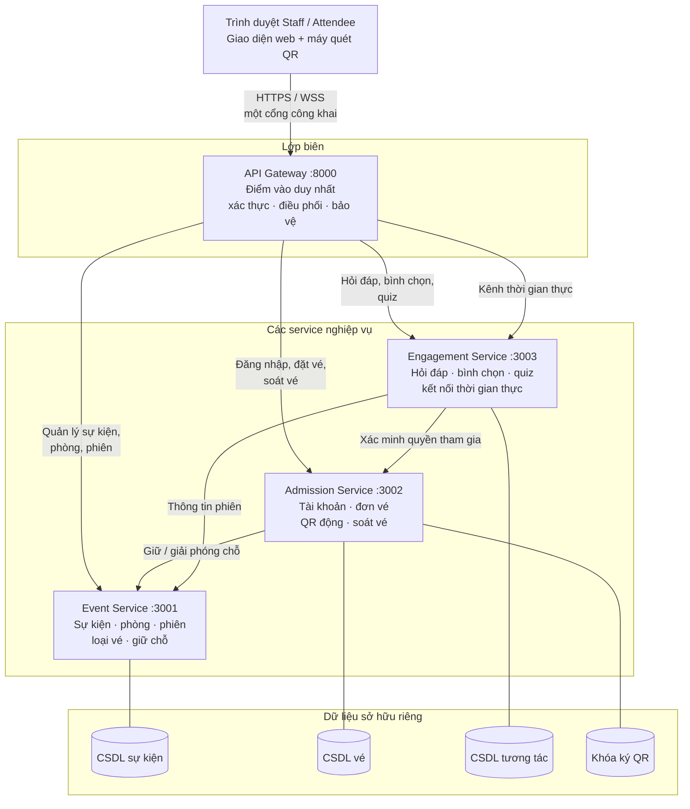
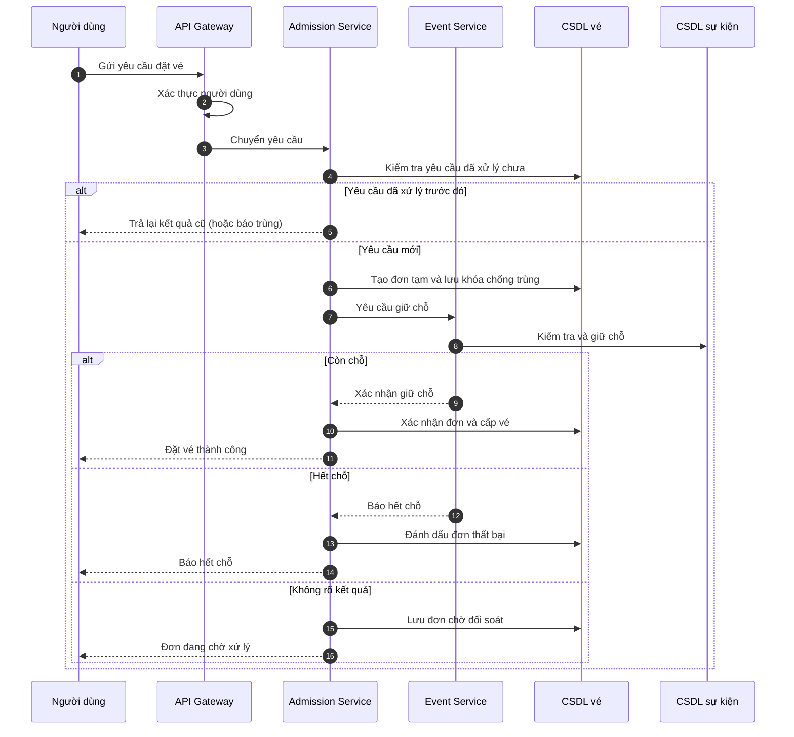

# BÁO CÁO BÀI TẬP LỚN

**HỌC VIỆN CÔNG NGHỆ BƯU CHÍNH VIỄN THÔNG (PTIT)**
**Môn học:** Kiến trúc Microservices
**Đề tài:** qEvent — Hệ thống quản trị sự kiện, soát vé động và tương tác thời gian thực theo kiến trúc microservices

| Thông tin | Nội dung |
|---|---|
| Nhóm | …… |
| Lớp | …… |
| Giảng viên hướng dẫn | …… |
| Thành viên | Tuấn (nhóm trưởng), Thành, Vũ, Trọng |

> Phạm vi tài liệu: **Phần 1 — Phân tích nghiệp vụ** và **Phần 2 — Thiết kế kiến trúc**.
> Các phần Thiết kế API/OpenAPI, Độ tin cậy — xử lý lỗi, Triển khai — kiểm thử, Đánh giá — hạn chế
> sẽ được trình bày trong các phần tiếp theo của báo cáo.

---

# PHẦN 1 — PHÂN TÍCH NGHIỆP VỤ

## 1.1. Bối cảnh và bài toán

Các sự kiện có quy mô từ vài trăm đến vài nghìn người thường gặp bốn vấn đề vận hành lặp lại:

1. **Nghẽn tại cổng soát vé.** Nhân viên kiểm tra vé thủ công hoặc quét mã QR tĩnh khiến hàng đợi kéo dài vào giờ cao điểm.
2. **Gian lận vé chụp màn hình.** Vé QR tĩnh có thể được chụp lại và gửi cho người khác sử dụng.
3. **Mất kết nối tại cổng.** Wi-Fi/4G tại sân vận động hoặc hội trường không ổn định; hệ thống soát vé không được phép dừng hoàn toàn khi mạng chập chờn.
4. **Tương tác trong phiên bị phân tán.** Câu hỏi, bình chọn và quiz đang được chạy bằng nhiều công cụ rời rạc, không gắn với quyền tham gia thực tế của người đã check-in.

**qEvent** giải quyết các vấn đề trên bằng một nền tảng thống nhất:

- Ban tổ chức tạo sự kiện, phòng, phiên và loại vé với sức chứa xác định.
- Người tham dự đặt vé, nhận vé điện tử và xuất trình **QR động** được ký RSA-SHA256, đổi mã theo TOTP 30 giây.
- Nhân viên soát vé quét QR, hệ thống chống quét trùng và hỗ trợ đồng bộ các lượt soát offline.
- Trong phiên đang diễn ra, người đã check-in có thể đặt câu hỏi, bình chọn và chơi quiz; ban tổ chức điều khiển nội dung theo thời gian thực.

Bài toán được chọn có đủ các đặc điểm để thiết kế theo microservices: nhiều miền nghiệp vụ độc lập, dữ liệu riêng, luồng liên service, yêu cầu chịu lỗi và các điểm truy cập thời gian thực.

## 1.2. Người dùng và vai trò

| Vai trò | Mô tả | Nhu cầu chính |
|---|---|---|
| **Attendee** (người tham dự) | Mua vé, nhận vé điện tử, tham gia Q&A/poll/quiz | Đặt vé nhanh, QR luôn mới, không bị từ chối oan khi mạng yếu |
| **Staff** (nhân viên soát vé) | Quét QR tại cổng, xem lịch sử soát vé, đồng bộ offline | Phản hồi dưới 1 giây, chống quét trùng, hoạt động khi mất mạng |
| **Organizer** (ban tổ chức) | Tạo/sửa sự kiện, phòng, phiên, loại vé; điều khiển Q&A/poll/quiz | Kiểm soát sức chứa, theo dõi số liệu, thao tác an toàn |
| **Host/Speaker** (người dẫn phiên) | Điều khiển quiz, duyệt/ẩn câu hỏi, mở/đóng poll | Điều khiển trạng thái phiên theo thời gian thực |

Hệ thống phân quyền theo vai trò toàn cục `ATTENDEE`, `STAFF`, `ORGANIZER`. Trong phạm vi hiện tại, `STAFF` và `ORGANIZER` có thể thao tác trên mọi sự kiện; phân quyền theo từng sự kiện là hạn chế đã biết và được ghi nhận ở phần đánh giá.

## 1.3. Quy trình nghiệp vụ chính

### (1) Tổ chức sự kiện

1. Organizer tạo sự kiện với thời gian bắt đầu/kết thúc và sức chứa tối đa.
2. Organizer thêm phòng, phiên (session) và từng loại vé với quota riêng.
3. Hệ thống kiểm tra tính hợp lệ của thời gian và không cho sức chứa nhỏ hơn số chỗ đã giữ/bán.

### (2) Đặt vé

1. Attendee chọn sự kiện, loại vé và số lượng, gửi yêu cầu kèm `Idempotency-Key`.
2. Hệ thống kiểm tra khóa idempotency: nếu đã xử lý cùng payload thì trả lại kết quả cũ; nếu payload khác thì từ chối.
3. Hệ thống giữ chỗ nguyên tử bên Event Service (kiểm tra đồng thời sức chứa sự kiện và quota loại vé).
4. Nếu giữ chỗ thành công, hệ thống tạo đơn `CONFIRMED` và cấp vé `PAID`, mỗi vé có `qrSecret` riêng.
5. Nếu hết chỗ, đơn chuyển `FAILED` và trả lỗi nghiệp vụ.
6. Nếu không xác định được kết quả do lỗi hạ tầng, đơn chuyển `PENDING_RECONCILIATION`, trả `202` và được worker đối soát lại.

### (3) Soát vé tại cổng

1. Attendee mở vé; hệ thống sinh QR động gồm `ticketId`, `eventId`, mã TOTP và thời điểm phát hành, ký bằng RSA-SHA256.
2. Staff quét QR. Hệ thống xác thực chữ ký, kiểm tra độ mới của token và cửa sổ TOTP.
3. Hệ thống chuyển vé từ `PAID` sang `CHECKED_IN` bằng một cập nhật có điều kiện; chỉ một lượt quét thắng.
4. Lượt quét thắng được ghi log; lượt quét sau nhận `409 ALREADY_CHECKED_IN`.
5. Khi mất mạng, các lượt quét được xếp hàng cục bộ và đồng bộ lại khi có kết nối; hệ thống phân loại kết quả `synced` / `conflicts` / `duplicates`.

### (4) Tương tác trong phiên

1. Người dùng gửi câu hỏi, bình chọn hoặc câu trả lời quiz.
2. Hệ thống xác minh phiên tồn tại và đang diễn ra, sau đó xác minh người dùng đã check-in đúng sự kiện.
3. Nội dung hợp lệ được ghi nhận và phát cho các client đang kết nối WebSocket.
4. Host điều khiển quiz theo trạng thái: `WAITING → QUESTION_ACTIVE → ROUND_REVEALED → … → FINISHED`.

## 1.4. Quy tắc nghiệp vụ

Hệ thống hiện thực và kiểm thử sáu quy tắc cốt lõi:

| Mã | Quy tắc | Mô tả | Phản hồi khi vi phạm |
|---|---|---|---|
| **BR-1** | Thời gian sự kiện hợp lệ | `startTime` phải trước `endTime` và không nằm trong quá khứ | `422 INVALID_EVENT_TIME` |
| **BR-2** | Giới hạn sức chứa | Tổng vé đã bán/giữ chỗ không vượt `maxCapacity` của sự kiện và `quota` của loại vé | `409 SOLD_OUT` |
| **BR-3** | Idempotency đặt vé | Cùng `Idempotency-Key` + cùng payload thì trả kết quả cũ; payload khác thì từ chối | `409 IDEMPOTENCY_CONFLICT` |
| **BR-4** | Chống soát vé trùng | Mỗi vé chỉ được check-in thành công một lần (`PAID → CHECKED_IN`) | `409 ALREADY_CHECKED_IN` |
| **BR-5** | QR động hợp lệ | Token phải có chữ ký RSA hợp lệ và TOTP còn trong cửa sổ 30 giây | `400 INVALID_QR_TOKEN` |
| **BR-6** | Quyền tham gia tương tác | Chỉ người đã check-in đúng sự kiện và phiên đang diễn ra mới được Q&A/poll/quiz | `403 NOT_CHECKED_IN`, `403 SESSION_NOT_LIVE` |

Ngoài sáu quy tắc trên, hệ thống còn ràng buộc:

- Đăng ký công khai luôn tạo tài khoản `ATTENDEE`; không tin `role` do client gửi.
- Không cho giảm `maxCapacity` xuống dưới số chỗ đã giữ/bán (`409 CAPACITY_BELOW_RESERVED`).
- Không nhận đáp án quiz qua WebSocket; đáp án phải đi qua REST để xác thực và tính điểm.
- Điểm quiz do server tính từ thời điểm câu hỏi bắt đầu; không tin thời gian client gửi.

## 1.5. Yêu cầu chức năng

| Miền nghiệp vụ | Chức năng bắt buộc |
|---|---|
| **Sự kiện & sức chứa** | Tạo/sửa/đọc sự kiện; quản lý phòng, phiên, loại vé; giữ chỗ và giải phóng chỗ nguyên tử |
| **Định danh & đặt vé** | Đăng ký, đăng nhập, JWT; đặt vé idempotent; xem đơn và vé; cấp QR động |
| **Soát vé** | Quét QR online; chống trùng; xem lịch sử và thống kê; đồng bộ lượt quét offline |
| **Tương tác** | Q&A có upvote; poll có mở/đóng; quiz có state machine, leaderboard; WebSocket |
| **Vận hành** | Health check từng service; gateway định tuyến, xác thực, giới hạn đăng nhập; chạy toàn hệ thống bằng Docker Compose |

## 1.6. Yêu cầu phi chức năng

| Nhóm | Yêu cầu | Cách đáp ứng trong kiến trúc |
|---|---|---|
| **Hiệu năng** | Soát vé phản hồi dưới 1 giây; luồng đặt vé không vượt ngân sách 2 giây của gateway | Timeout nội bộ ngắn, circuit breaker, cache kết quả dương cho BR-6 |
| **Độ tin cậy** | Một service chết không làm sập toàn hệ thống; không mất đơn, không oversell, không cấp vé trùng | Database riêng, saga + trạng thái `PENDING_RECONCILIATION`, worker đối soát, idempotency |
| **Nhất quán** | Sức chứa và trạng thái vé phải nhất quán | Transaction cục bộ + cập nhật có điều kiện (CAS), không join chéo database |
| **Bảo mật** | Chống giả mạo danh tính, giả mạo vé, phát lại QR | JWT tại gateway và service, `x-service-token`, RSA-SHA256 + TOTP, xóa header giả mạo |
| **Khả dụng offline** | Cổng soát vé vẫn hoạt động khi mạng yếu | Hàng đợi cục bộ phía web + endpoint đồng bộ offline |
| **Khả năng triển khai** | Chạy toàn hệ thống bằng một lệnh | Dockerfile cho từng service + `docker-compose.yml` |
| **Khả năng kiểm chứng** | Có OpenAPI, Postman và kịch bản lỗi | OpenAPI 3 cho từng service, collection Postman, script fault injection |

## 1.7. Phạm vi

**Trong phạm vi:**

- Ba service nghiệp vụ: Event, Admission, Engagement; một API Gateway.
- Web console cho Staff/Organizer và luồng Attendee qua API.
- Thanh toán được mô phỏng (đơn chuyển thẳng sang `CONFIRMED`); không tích hợp cổng thanh toán thật.
- Tương tác thời gian thực qua WebSocket, có fallback polling ở phía client.

**Ngoài phạm vi:**

- Ứng dụng mobile native hoàn chỉnh (giao diện mobile chỉ ở mức đặc tả).
- Phân quyền theo từng sự kiện, đa tenant.
- Hàng đợi thông điệp (RabbitMQ/Kafka) và DLQ — hệ thống hiện dùng gọi HTTP đồng bộ + saga.
- Thanh toán thật, hóa đơn, hoàn tiền tự động.
- Triển khai Kubernetes hoặc hạ tầng cloud nhiều vùng.

---

# PHẦN 2 — THIẾT KẾ KIẾN TRÚC

## 2.1. Động lực kiến trúc

Kiến trúc được chọn dựa trên bốn động lực chính:

1. **Phân tách theo miền nghiệp vụ.** Sự kiện/sức chứa, vé/soát vé và tương tác phiên có vòng đời và tốc độ thay đổi khác nhau; mỗi miền cần dữ liệu và quy tắc riêng.
2. **Cô lập lỗi tại cổng soát vé.** Một sự cố ở Engagement không được làm chậm luồng soát vé; một sự cố ở Event không được làm mất vé đã cấp.
3. **Ranh giới giao dịch rõ ràng.** Vé và check-in phải nằm cùng một service để chống soát trùng bằng transaction cục bộ; giữ chỗ phải nằm ở service sở hữu sức chứa.
4. **Chia việc cho nhóm 4 người.** Mỗi thành viên sở hữu một service/module trọn vẹn, giảm xung đột mã nguồn và cho phép giải thích độc lập khi vấn đáp.

## 2.2. Sơ đồ kiến trúc tổng thể



**Nguyên tắc bắt buộc của sơ đồ:**

- Client chỉ biết một địa chỉ công khai là gateway; ba service không publish cổng ra host.
- Mỗi service chỉ đọc/ghi database của mình; không join, không foreign key xuyên service.
- Giao tiếp liên service chỉ qua HTTP nội bộ có xác thực; ID xuyên service là scalar tham chiếu.
- Gateway không chứa luật nghiệp vụ; nó chỉ định tuyến, xác thực, áp chính sách và bảo vệ downstream.

## 2.3. Phân rã service

| Service | Miền nghiệp vụ | Trách nhiệm chính | Dữ liệu sở hữu | API tiêu biểu | Cổng |
|---|---|---|---|---|---|
| **API Gateway** | Lớp biên | Điểm vào duy nhất; định tuyến theo prefix; xác thực JWT; xóa header giả mạo; circuit breaker; giới hạn đăng nhập; proxy WebSocket | Không sở hữu database | `/api/*`, `/ws/*`, `/health` | `8000` |
| **Event Service** | Sự kiện & sức chứa | Quản lý sự kiện, phòng, phiên, loại vé; kiểm tra BR-1; giữ/giải phóng chỗ nguyên tử | `Event`, `Room`, `Session`, `TicketType`, `Reservation` | `/api/events*`, `/internal/reservations*`, `/internal/sessions/:id` | `3001` |
| **Admission Service** | Vé & soát vé | Đăng ký/đăng nhập; saga đặt vé; idempotency; cấp QR động; soát vé chống trùng; đồng bộ offline | `User`, `Order`, `IdempotencyLog`, `Ticket`, `CheckinLog` | `/api/auth*`, `/api/orders*`, `/api/tickets*`, `/api/checkins*`, `/internal/tickets/verify-access` | `3002` |
| **Engagement Service** | Tương tác phiên | Q&A, upvote; poll; quiz state machine; leaderboard; phát sự kiện WebSocket; xác minh BR-6 | `QAQuestion`, `QAVote`, `Poll`, `PollOption`, `PollVote`, `QuizGame`, `QuizQuestion`, `QuizAnswer` | `/api/sessions/*`, `/api/questions/*`, `/api/polls/*`, `/api/game/*`, `/ws/*` | `3003` |

## 2.4. Vì sao chia như vậy?

### 2.4.1. Ranh giới theo miền (bounded context)

- **Event** là nguồn sự thật duy nhất về “sự kiện có gì và còn bao nhiêu chỗ”. Mọi thay đổi sức chứa, quota, phiên đều nằm ở đây.
- **Admission** là nguồn sự thật duy nhất về “ai có vé và ai đã vào cổng”. Vé và check-in nằm cùng service để thao tác soát vé vẫn là transaction cục bộ.
- **Engagement** là nguồn sự thật duy nhất về “mọi người tương tác thế nào trong phiên”. Nó không cần quyền ghi vào dữ liệu vé hay sự kiện.

### 2.4.2. Ranh giới giao dịch

- Giữ chỗ và kiểm tra sức chứa phải nguyên tử → đặt trong Event Service với hai câu `UPDATE` có điều kiện trong cùng transaction.
- Cấp vé và chuyển đơn sang `CONFIRMED` phải nguyên tử → đặt trong Admission Service.
- Chống soát trùng cần `UPDATE ... WHERE status = 'PAID'` → đặt trong Admission Service, nơi sở hữu `Ticket`.

Nếu gộp vé và sự kiện vào một database dùng chung, nhóm sẽ có transaction đơn giản hơn nhưng mất ranh giới dữ liệu và không còn đáp ứng yêu cầu “mỗi service có dữ liệu riêng”.

### 2.4.3. Vì sao không tách thêm service?

- **Auth không tách riêng** vì chỉ phục vụ Admission và không có dữ liệu nghiệp vụ độc lập; tách ra sẽ tạo thêm một điểm gọi trong mọi request mà không tăng giá trị.
- **Không tách Notification/Media** vì chưa có nghiệp vụ tương ứng trong phạm vi bài tập.
- Ba service nghiệp vụ là mức tối thiểu đáp ứng yêu cầu nhóm 3–4 người, đồng thời giữ số lượng điểm gọi liên service trong tầm kiểm soát.

### 2.4.4. Vì sao có API Gateway?

- Che giấu topology nội bộ; client chỉ cần một địa chỉ.
- Tập trung xác thực JWT và loại bỏ header giả mạo (`x-user-id`, `x-user-role`) trước khi request vào service.
- Áp dụng circuit breaker, timeout và giới hạn tần suất tại một chỗ.
- Proxy WebSocket để realtime đi qua cùng điểm vào.

## 2.5. Giao tiếp liên service

### 2.5.1. Gọi HTTP đồng bộ có kiểm soát

| Luồng gọi | Endpoint nội bộ | Timeout / retry | Xử lý khi lỗi |
|---|---|---|---|
| Admission → Event (giữ chỗ) | `POST /internal/reservations` | 2 s; tối đa 2 lần, backoff 300 ms; chỉ retry lỗi mạng/502/503/504 | `4xx` → đơn `FAILED`; lỗi hạ tầng → `PENDING_RECONCILIATION` + `202` |
| Admission → Event (bồi hoàn) | `DELETE /internal/reservations/:operationId` | 2 s; retry như trên | Giữ `COMPENSATING` và tiếp tục thử bởi worker |
| Engagement → Event (phiên) | `GET /internal/sessions/:id` | 1 s; không retry | `503 EVENT_SERVICE_UNAVAILABLE`, không biến thành `403` |
| Engagement → Admission (quyền tham gia) | `GET /internal/tickets/verify-access` | 1 s; không retry | `503 ADMISSION_SERVICE_UNAVAILABLE`; chỉ cache kết quả dương 60 s |

Mọi lời gọi nội bộ đều gửi `x-service-token`; địa chỉ service lấy từ biến môi trường (`EVENT_SERVICE_URL`, `ADMISSION_SERVICE_URL`, `ENGAGEMENT_SERVICE_URL`).

### 2.5.2. Saga đặt vé



Trạng thái đơn: `PENDING → CONFIRMED | FAILED | PENDING_RECONCILIATION → COMPENSATING → FAILED`.
Worker đối soát chạy định kỳ, dùng lease CAS để hai tiến trình không xử lý cùng một đơn, và replay cùng `operationId` để Event Service trả lại kết quả cũ thay vì giữ chỗ lần hai.

### 2.5.3. WebSocket

- Client kết nối `ws://<host>/ws/qa?token=<jwt>` hoặc `/ws/game`; token cũng có thể gửi qua subprotocol.
- Gateway xác thực JWT trước khi mở kết nối; token sai/thiếu bị đóng với mã `4401`.
- Engagement giữ phòng theo phiên trong bộ nhớ tiến trình và phát sự kiện Q&A/quiz.
- Đáp án quiz **không** nhận qua WebSocket; client phải gọi REST để đi qua xác thực và kiểm tra thời gian.

## 2.6. Kiến trúc dữ liệu

### 2.6.1. Database-per-service

| Database | Service sở hữu | Model chính |
|---|---|---|
| `qevent_event` | Event Service | `Event`, `Room`, `Session`, `TicketType`, `Reservation` |
| `qevent_admission` | Admission Service | `User`, `Order`, `IdempotencyLog`, `Ticket`, `CheckinLog` |
| `qevent_engagement` | Engagement Service | `QAQuestion`, `QAVote`, `Poll`, `PollOption`, `PollVote`, `QuizGame`, `QuizQuestion`, `QuizAnswer` |

### 2.6.2. Quy ước dữ liệu

- Không foreign key xuyên service; `eventId`, `sessionId`, `ticketId` chỉ là scalar tham chiếu.
- Không service nào truy cập database của service khác; mọi nhu cầu dữ liệu chéo đi qua endpoint nội bộ.
- Mỗi service tự quản lý migration và chạy `prisma migrate deploy` khi khởi động.
- Nhất quán trong service là transaction ACID; nhất quán xuyên service là **eventual** thông qua saga, idempotency và đối soát.
- Các bộ đếm sức chứa (`reservedCount`, `soldCount`) được cập nhật bằng câu lệnh có điều kiện, không đọc rồi ghi.

### 2.6.3. Đánh đổi dữ liệu

| Quyết định | Lợi ích | Đánh đổi |
|---|---|---|
| Database riêng từng service | Ranh giới rõ, cô lập lỗi, triển khai độc lập | Không join/transaction xuyên service; phải dùng saga và đối soát |
| Không dùng message broker | Ít hạ tầng, dễ demo, phù hợp phạm vi bài tập | Phụ thuộc độ sẵn sàng của service gọi; cần worker bù trừ |
| Cache kết quả dương BR-6 | Giảm tải gọi chéo, không khóa oan người vừa check-in | Có thể chấp nhận quyền tham gia trong tối đa 60 s |
| Khóa idempotency lưu trong DB | Chống tạo đơn/vé trùng khi retry | Cần dọn log cũ và xử lý race unique |

## 2.7. Công nghệ sử dụng

| Lớp | Công nghệ | Lý do chọn |
|---|---|---|
| Runtime | **Bun** + **TypeScript** | Khởi động nhanh, chạy test tích hợp sẵn, kiểu tĩnh giảm lỗi hợp đồng |
| Framework service | **ElysiaJS 1.4** | Nhẹ, hỗ trợ TypeBox/validation và WebSocket; phù hợp service nhỏ |
| Gateway | ElysiaJS + `opossum` | Reverse proxy, JWT, circuit breaker, WS proxy trong cùng runtime |
| ORM / DB | **Prisma 6** + **PostgreSQL 16** | Migration rõ ràng, transaction và cập nhật có điều kiện; Postgres khóa hàng tốt cho bài toán giữ chỗ |
| Xác thực | **JWT** (HS256) | Gateway và từng service đều xác thực; role/id lấy từ token |
| Vé động | **RSA-SHA256 + TOTP RFC 6238** | Chống chụp màn hình/phát lại; khóa riêng lưu trong volume |
| Realtime | **WebSocket** (Elysia) | Đẩy câu hỏi, upvote và trạng thái quiz tức thời |
| Web console | **React 19 + Vite 6 + TanStack Query** | Tách feature, cache/refetch rõ ràng; quét QR bằng `@zxing/browser` |
| UI | shadcn/Radix + Tailwind 4 + Biome | Thành phần truy cập tốt, kiểm soát style và lint |
| Hợp đồng API | **OpenAPI 3** cho từng service | Sinh client, kiểm tra lệch hợp đồng trong test |
| Đóng gói | **Docker + Docker Compose** | Một lệnh chạy 3 DB + 3 service + gateway + web |
| Kiểm thử | `bun test`, Vitest + MSW, Playwright + axe | Unit/integration theo service, component và E2E |

## 2.8. Triển khai và vận hành

```text
docker compose up -d --build
        │
        ├── postgres-event      :5433  ── event-service      :3001
        ├── postgres-admission  :5434  ── admission-service  :3002
        ├── postgres-engagement :5435  ── engagement-service :3003
        ├── api-gateway         :8000  (cổng công khai duy nhất)
        └── web                 :8080  (Nginx, proxy /api + /ws)
```

- Chỉ gateway và web publish cổng ra host; service và database chỉ nằm trong mạng Docker.
- Mỗi service có `GET /health`; gateway có `/health` tổng hợp trạng thái downstream và circuit breaker.
- Mỗi service có Dockerfile riêng, chạy migration khi khởi động.
- Dữ liệu và khóa RSA được giữ trong volume riêng (`event_data`, `admission_data`, `engagement_data`, `admission_keys`).
- Biến môi trường tách khỏi mã nguồn (`.env`); không commit secret thật.

## 2.9. Độ tin cậy và bảo mật trong kiến trúc

| Cơ chế | Vị trí | Tác dụng |
|---|---|---|
| Idempotency-Key + fingerprint | Admission | Retry an toàn, không tạo đơn trùng |
| `operationId` duy nhất | Event | Giữ chỗ replay được, không trừ sức chứa hai lần |
| Saga + trạng thái `PENDING_RECONCILIATION` | Admission ↔ Event | Không mất đơn khi không rõ kết quả |
| Worker đối soát + lease CAS | Admission | Tự chữa đơn kẹt, tránh hai worker xử lý cùng đơn |
| Timeout ngắn + retry có chọn lọc | Các client nội bộ | Phân biệt lỗi nghiệp vụ với lỗi hạ tầng |
| Circuit breaker theo service | Gateway | Ngăn cascading failure; trả `503` nhanh khi downstream chết |
| Xác thực JWT + xóa header giả mạo | Gateway và service | Không tin danh tính do client tự khai |
| `x-service-token` | Các endpoint nội bộ | Chặn gọi trực tiếp trái phép |
| QR RSA + TOTP 30 s | Admission | Chống vé giả, vé chụp màn hình, phát lại |
| CAS `PAID → CHECKED_IN` | Admission | Chống soát trùng tuyệt đối |
| Đồng bộ offline | Web + Admission | Cổng vẫn hoạt động khi mạng yếu |

**Bằng chứng đã đo (trích từ `docs/evidence/`):**

| Kịch bản | Kết quả chính |
|---|---|
| Event sập khi đặt 5 đơn | 5/5 nhận `202`, 5/5 được xác nhận sau khi Event trở lại; `reservedCount` và `soldCount` tăng đúng +5; 0 vé trùng |
| Event giữ chỗ nhưng response bị mất (8 đơn) | 8/8 nhận `202`, 8/8 xác nhận; replay theo `operationId` không giữ chỗ lần hai |
| Tắt Engagement | Luồng vé/soát vé vẫn `200`/`400` bình thường; không bị ảnh hưởng |
| Tắt Admission | Gateway trả `504`/`503` và mở circuit; không treo vô hạn |

## 2.10. Đánh đổi và hạn chế của kiến trúc

- **Giao tiếp đồng bộ làm tăng phụ thuộc thời gian.** Khi Event chậm, luồng đặt vé phải chuyển sang `PENDING_RECONCILIATION` thay vì trả kết quả ngay. Hướng cải tiến: thêm message broker + DLQ cho luồng phụ.
- **Chưa có distributed tracing.** Debug liên service dựa vào `x-request-id` và log từng service; chưa có Jaeger/OpenTelemetry.
- **Rate limit lưu trong bộ nhớ.** Gateway phải chạy một instance; scale ngang cần Redis hoặc bộ đếm chia sẻ.
- **WebSocket giữ phòng trong bộ nhớ.** Engagement phải chạy một instance; scale ngang cần pub/sub (Redis) để phát sự kiện giữa các instance.
- **Phân quyền toàn cục.** `STAFF`/`ORGANIZER` thao tác trên mọi sự kiện; chưa có phân quyền theo sự kiện.
- **Thanh toán mô phỏng.** Chưa có tích hợp cổng thanh toán, hoàn tiền hay đối soát tài chính.
- **Không có DLQ.** Lỗi khi gọi nội bộ được xử lý bằng retry + đối soát, không có hàng đợi lỗi riêng.

---

# BẢNG PHÂN CHIA CÔNG VIỆC

| Thành viên | Vai trò | Service / Module phụ trách | Nhiệm vụ cụ thể | Sản phẩm bàn giao | Phần báo cáo & vấn đáp |
|---|---|---|---|---|---|
| **Tuấn** | Nhóm trưởng | `gateway/`, tích hợp hệ thống | Thiết kế kiến trúc tổng thể; định tuyến; xác thực JWT; xóa header giả mạo; circuit breaker; rate limit; proxy WebSocket; Docker Compose; duyệt PR | Mã nguồn gateway, cấu hình compose, kịch bản demo lỗi | Phần 2.1–2.2, 2.4.4, 2.9; giải thích kiến trúc, gateway, circuit breaker, demo tắt service |
| **Thành** | Thành viên | `services/event-service/` | Nghiệp vụ sự kiện/phòng/phiên/loại vé; kiểm tra BR-1; giữ chỗ nguyên tử; API nội bộ cho Admission và Engagement; OpenAPI; test | Mã nguồn Event Service, migration, OpenAPI, test | Phần 1.3(1), 1.4 (BR-1, BR-2), 2.3–2.4 (Event), 2.6; giải thích chống oversell và CAS |
| **Vũ** | Thành viên | `services/admission-service/` | Đăng ký/đăng nhập; saga đặt vé; idempotency; QR động RSA+TOTP; soát vé chống trùng; đồng bộ offline; API nội bộ cho Engagement; OpenAPI; test | Mã nguồn Admission Service, migration, khóa RSA, OpenAPI, test | Phần 1.3(2)(3), 1.4 (BR-3, BR-4, BR-5), 2.5.2, 2.9; giải thích saga, QR động, chống double check-in |
| **Trọng** | Thành viên | `services/engagement-service/` | Q&A/upvote; poll; quiz state machine; leaderboard; WebSocket; xác minh BR-6 qua gọi chéo service; OpenAPI; Postman; slide | Mã nguồn Engagement Service, migration, OpenAPI, collection Postman, slide | Phần 1.3(4), 1.4 (BR-6), 2.5.3, 2.9; giải thích BR-6, WebSocket, chống gian lận quiz |

**Quy ước làm việc nhóm:**

- Mỗi thành viên sở hữu trọn vẹn service của mình: schema, route, test, OpenAPI và phần báo cáo tương ứng.
- Thay đổi xuyên service phải có review của nhóm trưởng và cập nhật tài liệu hợp đồng.
- Không sửa database hoặc mã nguồn của service khác; nhu cầu dữ liệu chéo phải đi qua endpoint nội bộ.
- Mỗi thành viên phải chạy được service của mình, giải thích được luồng xử lý và các quyết định đánh đổi khi vấn đáp.
