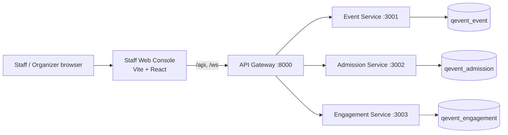
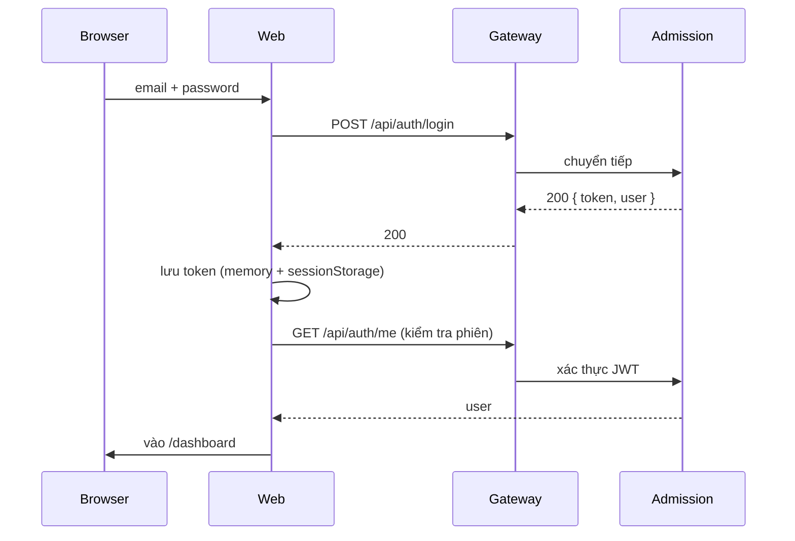

# Kế hoạch xây dựng Staff Web Console (qEvent)

- Ngày lập: 2026-11-13
- Trạng thái: **Backend đã sẵn sàng** (A1–A12 + seed demo hoàn tất ngày 2026-11-14); frontend chỉ còn làm UI
- Commit khảo sát: `d43d60f` (sau khi merge event-service và engagement-service)
- Nhóm: 4 người — Tuấn (nhóm trưởng), Thành, Vũ, Trọng
- Thời lượng mục tiêu: 4 tuần full-time (hoặc 6 tuần nếu làm ~70% thời gian)
- Phạm vi: web cho **STAFF** và **ORGANIZER**; không làm lại app mobile của attendee
- Tài liệu liên quan:
  - `plans/MICROSERVICES_MIGRATION.md`
  - `plans/AI_MICROSERVICES_EXECUTION_PLAN.md`
  - `DESIGN.md`
  - `PRODUCT.md`
  - `MVP.md`

> Đây là kế hoạch kỹ thuật để đọc lại và triển khai. Không tự tạo branch, commit, push hoặc sửa dữ liệu thật khi chưa được nhóm trưởng duyệt.

---

## 0. Điều kiện tiên quyết (đã xử lý xong — 2026-11-14)

Web console sẽ gọi thẳng các service hiện có. Toàn bộ blocker dưới đây đã được sửa và kiểm chứng trước khi bàn giao việc frontend.

| # | Việc phải sửa | Người phụ trách | Trạng thái | Bằng chứng |
|---|---|---|---|---|
| P1 | Root `docker-compose.yml` chạy 3 service + 3 DB + gateway; monolith cũ đã xoá | Tuấn | ✅ | `docker compose up -d --build`; `/health` báo cả 3 downstream `ok` |
| P2 | Engagement có migration checked-in; container chạy `migrate deploy` thành công | Trọng | ✅ | `prisma/migrations/20261114000000_init/migration.sql`, log container |
| P3 | BR-6 lấy `eventId` + `isLive` từ Event Service; bỏ `body.eventId` và fallback `sessionId` | Trọng + Thành | ✅ | `lib/br6.ts`, `lib/event-client.ts`; test `br6.test.ts` |
| P4 | Lỗi hạ tầng trả 503/504, không thành `403 NOT_CHECKED_IN` | Trọng | ✅ | `admission-client.ts` ném `InfraError`; test `br6.test.ts`, `admission-client.test.ts` |
| P5 | WebSocket bắt buộc JWT ở cả gateway và service | Tuấn + Trọng | ✅ | `gateway/src/ws-token.ts`, `engagement/src/lib/ws-token.ts`; anonymous đóng `4401` |
| P6 | Worker xử lý đơn `PENDING` kẹt sau restart (có grace window) | Vũ | ✅ | `order.service.ts` reconcile `PENDING` cũ hơn lease; test `orders.test.ts` |
| P7 | Engagement OpenAPI đầy đủ security/response/example + file checked-in | Trọng | ✅ | `src/openapi.ts`, `openapi.json`, `openapi.yaml`; test `openapi.test.ts` |
| P8 | Gateway qua `tsc --noEmit`, có script `typecheck` | Tuấn | ✅ | `cd gateway && bunx tsc --noEmit` |
| P9 | Postman + bằng chứng fault injection khớp thực tế | Trọng + Tuấn | ✅ | 36 request qua gateway; 2 thử nghiệm lỗi đơn hàng có raw JSON trong `docs/evidence/`; số liệu availability trong defense guide |

**Bổ sung ngoài danh sách ban đầu (phát hiện khi chạy end-to-end):**

- Admission client từng cache cả kết quả âm 60s, khiến attendee vừa check-in vẫn bị 403. Nay chỉ cache kết quả dương.
- Gateway từng không route `/api/game/*` sang Engagement. Đã thêm prefix.
- Gateway từng log URL WebSocket kèm token. Đã bỏ query khỏi log.
- WebSocket có race: message `JOIN` đến trước khi xác thực async xong bị đóng oan. Nay message chờ `authPromise`.
- Engagement internal timeout hạ còn 1000ms (không retry) để trả 503 trước timeout 2000ms của gateway.
- PATCH `maxCapacity` của Event dùng một câu UPDATE có điều kiện, không còn race với reservation.
- Offline sync cho phép lần quét sớm nhất thắng kể cả khi đến ở batch sau.

**Quy tắc:** P1–P6 là blocker của web và đã xong; P7–P9 đã xong trước demo.

---

## 1. Mục tiêu và phạm vi

### 1.1. Mục tiêu

Xây một web app cho nhân sự vận hành sự kiện, dùng được trên laptop và tablet tại cổng:

1. **Organizer** quản lý sự kiện, phòng, phiên, loại vé, đơn, vé, check-in và nội dung tương tác.
2. **Staff** soát vé, xem danh sách vé/đơn được phép, theo dõi check-in tại cổng, và điều khiển Q&A/poll/quiz khi được phân quyền.
3. Mọi màn hình đọc/ghi qua **API Gateway** với JWT; không gọi thẳng database hoặc service nội bộ.
4. Trạng thái lỗi rõ ràng: loading, empty, 401, 403, 404, 409, 422, 503/504, mất mạng.
5. UI tuân thủ `DESIGN.md`: light theme, không border, shadow hướng xuống, không blur, tương phản cao.

### 1.2. Không nằm trong phạm vi MVP

- App mobile attendee (đã ở repo khác).
- Thanh toán thật, hoàn tiền, ví điện tử.
- Dark mode.
- SSO, OAuth, quản lý nhiều tổ chức (multi-tenant).
- Email/SMS/push notification.
- Offline **ra quyết định xanh/đỏ** trên web (xem mục 7).
- Xóa event/session/ticket type có dữ liệu liên quan (chỉ sửa trong MVP).
- Xuất báo cáo PDF/Excel (để Phase 2).

### 1.3. Định nghĩa "MVP xong"

- Organizer tạo được event + session + ticket type; sửa được các thông tin đó.
- Staff quét được QR online, thấy kết quả xanh/vàng/đỏ trong <1 giây sau phản hồi server.
- Organizer xem được danh sách đơn/vé/check-in của event, có tìm kiếm và phân trang.
- Host điều khiển được Q&A, poll, quiz; attendee thấy cập nhật realtime.
- Dashboard hiển thị số liệu thật của event đang chọn.
- RBAC đúng: STAFF không sửa được event; ATTENDEE không vào được console.
- Có E2E cho 5 luồng chính; CI xanh; `docker compose up` chạy được toàn hệ thống.

---

## 2. Người dùng và phân quyền

### 2.1. Vai trò

| Vai trò | Vào console | Quyền chính |
|---|---|---|
| `ORGANIZER` | Có | Toàn bộ event của mình; xem đơn/vé/check-in; host Q&A/poll/quiz; cấu hình sự kiện |
| `STAFF` | Có | Quét/soát vé; xem đơn/vé/check-in; host Q&A/poll/quiz theo backend hiện tại; **không** sửa event |
| `ATTENDEE` | Không | Bị chặn ở login bằng màn hình 403 rõ ràng |
| Khách chưa đăng nhập | Không | Chuyển về `/login` |

> Backend hiện tại coi `ORGANIZER` và `STAFF` đều là host role (`isHostRole`). Web giữ đúng backend, nhưng UI sẽ phân biệt rõ: STAFF không thấy nút sửa event.

### 2.2. Ma trận quyền theo route

| Route | STAFF | ORGANIZER |
|---|---|---|
| `/login` | Có | Có |
| `/dashboard` | Xem (theo event được chọn) | Xem |
| `/events` | Xem | Xem + tạo |
| `/events/:id` | Xem | Xem + sửa |
| `/events/:id/rooms` | Xem | Xem + tạo/sửa |
| `/events/:id/sessions` | Xem | Xem + tạo/sửa + bật live |
| `/events/:id/ticket-types` | Xem | Xem + tạo/sửa |
| `/orders`, `/orders/:id` | Xem | Xem |
| `/tickets`, `/tickets/:id` | Xem + tìm | Xem + tìm |
| `/checkins` | Xem | Xem |
| `/scan` | Có | Có |
| `/sync` | Có | Có |
| `/engagement/:sessionId` | Host | Host |
| `/settings` | Có | Có |

**Nguyên tắc:** UI ẩn nút không phải là bảo mật. Mọi kiểm tra quyền phải được server enforce lại. Web chỉ hiển thị theo quyền để giảm nhầm lẫn.

---

## 3. Kiến trúc và tech stack

### 3.1. Sơ đồ



- Web chỉ biết **một** base URL: gateway.
- Dev: Vite proxy `/api` và `/ws` sang `http://localhost:8000` để tránh CORS.
- Production: Nginx của web proxy `/api` và `/ws` sang gateway, cùng origin với web.

### 3.2. Tech stack

| Thành phần | Chọn | Lý do |
|---|---|---|
| Build | Vite 6 | Nhanh, cấu hình ít, phù hợp SPA nội bộ |
| UI | React 19 + TypeScript 5.9 | Cùng hệ TypeScript với backend |
| Routing | React Router 7 (data router) | Route guard, nested route, loader đơn giản |
| Server state | TanStack Query v5 | Cache, retry, invalidate, trạng thái loading/error thống nhất |
| Form | React Hook Form + Zod | Form event/session/ticket type có nested array; Zod validate client, server vẫn validate lại |
| Styling | Tailwind CSS 4 + CSS variables | Map token từ `DESIGN.md`, không cần UI framework nặng |
| Chart | Recharts | Dashboard nhỏ, dễ đọc, không cần engine lớn |
| QR scan | `@zxing/browser` (lazy import) | Chạy trên Chrome/Edge/Safari, không phụ thuộc native |
| Offline queue | `idb` (IndexedDB) | Nhẹ, không cần thư viện ORM |
| Realtime | WebSocket native + hook tự viết | Không cần socket.io; backend đã có `/ws/qa`, `/ws/game` |
| API types | `openapi-typescript` + `openapi-fetch` | Sinh type từ OpenAPI của từng service; giảm lệch contract |
| Unit/component test | Vitest + React Testing Library + MSW | Chạy tốt với DOM; mock API theo contract |
| E2E | Playwright | Chạy thật qua gateway, có axe-core |
| Lint/format | Biome | Một tool cho lint + format, cấu hình nhẹ |
| Package manager | Bun | Cùng repo |
| Deploy | Docker multi-stage: Bun build → Nginx serve | Nhẹ, cache static tốt, proxy /api và /ws |

### 3.3. Quyết định quan trọng

1. **Không dùng Next.js.** Web là SPA nội bộ sau gateway, không cần SSR/SEO. Vite đơn giản hơn, build nhanh hơn, ít khái niệm hơn.
2. **Không dùng UI kit lớn.** Tự viết ~10 component theo `DESIGN.md` để giữ đúng "zero border / bottom shadow / no blur". UI kit thường kéo theo style xung đột.
3. **Không dùng Zustand/Redux.** Server state do TanStack Query; auth do Context; bộ lọc nằm trên URL; offline queue nằm trong IndexedDB. Không cần global store.
4. **Không gọi thẳng service.** Mọi request đi qua gateway để JWT, CORS, circuit breaker và logging tập trung.
5. **Không lưu JWT trong `localStorage`.** Dùng memory + `sessionStorage` (xem mục 6).

---

## 4. Bản đồ màn hình

### 4.1. Cây route

```text
/login
/                          -> redirect /dashboard
/dashboard
/events
/events/new
/events/:eventId
/events/:eventId/rooms
/events/:eventId/sessions
/events/:eventId/ticket-types
/orders
/orders/:orderId
/tickets
/tickets/:ticketId
/checkins
/scan
/sync
/engagement/:sessionId
/engagement/:sessionId/qa
/engagement/:sessionId/polls
/engagement/:sessionId/quiz
/settings
```

### 4.2. Mô tả từng màn hình

| Màn hình | Mục đích | Dữ liệu chính | Hành động chính |
|---|---|---|---|
| `/login` | Đăng nhập staff/organizer | email, password | Đăng nhập; hiển thị 403 nếu ATTENDEE |
| `/dashboard` | Tổng quan event đang chọn | capacity, vé bán, checked-in, pending, check-in rate, Q&A/poll/quiz | Chọn event; đi tới trang chi tiết |
| `/events` | Danh sách event | tên, địa điểm, thời gian, sức chứa, trạng thái | Tìm/lọc; tạo event |
| `/events/new` | Tạo event | name, venue, start/end, maxCapacity, rooms, sessions, ticketTypes | Lưu; hiển thị lỗi 422 theo field |
| `/events/:id` | Tổng quan event | thông tin event + counts | Sửa nhanh; mở các tab |
| `/events/:id/rooms` | Phòng | danh sách phòng | Thêm/sửa phòng |
| `/events/:id/sessions` | Phiên | title, speaker, start/end, isLive | Thêm/sửa; bật/tắt live |
| `/events/:id/ticket-types` | Loại vé | name, price, quota, sold/available | Thêm/sửa; cảnh báo vượt capacity |
| `/orders` | Đơn hàng | orderId, user, status, quantity, total, failureCode | Lọc theo status; mở chi tiết |
| `/orders/:id` | Chi tiết đơn | order + tickets + timeline | Xem vé; copy orderId |
| `/tickets` | Vé | ticketId, attendee, status, event, checkedInAt | Tìm theo email/tên/mã vé; mở chi tiết |
| `/tickets/:id` | Chi tiết vé | status, order, check-in logs, QR token | Reveal QR (staff/organizer); xem log |
| `/checkins` | Theo dõi check-in | feed, counts, theo cổng, lỗi gần đây | Lọc theo cổng/thời gian; pause/resume |
| `/scan` | Quét QR | camera, manual paste, kết quả | Quét; nhập tay; xem lịch sử gần đây |
| `/sync` | Hàng đợi offline | queue, conflicts, retry | Retry; xóa item lỗi (có xác nhận) |
| `/engagement/:sessionId` | Host console | Q&A, polls, quiz | Điều khiển; moderate |
| `/engagement/:sessionId/qa` | Q&A | câu hỏi, upvotes, trạng thái | Ẩn/xóa câu hỏi; highlight |
| `/engagement/:sessionId/polls` | Poll | poll, options, votes, isActive | Tạo; mở/đóng; xem kết quả |
| `/engagement/:sessionId/quiz` | Quiz | game, questions, state, leaderboard | Tạo; thêm câu; start/reveal/next/end |
| `/settings` | Tài khoản | user, role, event mặc định | Đăng xuất; đổi event mặc định |

### 4.3. Trạng thái bắt buộc cho mọi màn hình

- **Loading:** skeleton, không spinner toàn trang.
- **Empty:** giải thích + hành động tiếp theo (ví dụ: "Chưa có event. Tạo event đầu tiên.").
- **Error:** mã lỗi + thông điệp ngắn + nút thử lại; không hiện stack trace.
- **403:** "Bạn không có quyền cho thao tác này" và đường về.
- **404:** "Không tìm thấy" + quay lại danh sách.
- **503/504:** banner "Dịch vụ tạm thời không phản hồi", giữ nguyên form, có nút thử lại.
- **Mất mạng:** banner offline; scanner chuyển sang chế độ queue nếu Phase 2, còn MVP báo "cần mạng".

---

## 5. API contract và các endpoint còn thiếu

### 5.1. Endpoint hiện có (dùng được ngay)

| Nhu cầu | Endpoint | Service |
|---|---|---|
| Đăng nhập | `POST /api/auth/login` | Admission |
| Danh sách event | `GET /api/events` | Event |
| Chi tiết event | `GET /api/events/:id` | Event |
| Tạo/sửa event | `POST /api/events`, `PATCH /api/events/:id` | Event |
| Tạo phòng/phiên/loại vé | `POST /api/events/:id/rooms`, `/sessions`, `/ticket-types` | Event |
| Tạo đơn | `POST /api/orders` | Admission |
| Chi tiết đơn | `GET /api/orders/:id` | Admission |
| Vé của tôi | `GET /api/tickets/my` | Admission |
| QR token của vé | `GET /api/tickets/:id/qr-token` | Admission |
| Check-in online | `POST /api/checkins` | Admission |
| Sync offline | `POST /api/checkins/sync-offline` | Admission |
| Q&A | `GET/POST /api/sessions/:id/questions`, `PUT /api/questions/:id/votes` | Engagement |
| Poll | `GET/POST /api/sessions/:id/polls`, `POST /api/polls/:id/vote` | Engagement |
| Quiz | `/api/sessions/:id/game`, `/api/game/:id/*` | Engagement |
| Realtime | `/ws/qa`, `/ws/game` | Engagement |

> `GET /api/tickets` đã được đổi thành danh sách theo `eventId` cho STAFF/ORGANIZER (A3); `/api/tickets/my` giữ nguyên cho attendee.

### 5.2. Endpoint đã triển khai cho staff web

| # | Endpoint | Quyền | Hợp đồng | Màn hình |
|---|---|---|---|---|
| A1 | `GET /api/auth/me` | Bearer | `200 { user: { id, email, fullName, role } }` | Toàn app |
| A2 | `GET /api/orders?eventId=&status=&q=&cursor=&limit=` | STAFF/ORGANIZER | `200 { orders: [{ id, attendee, status, quantity, totalAmount, failureCode, createdAt, updatedAt, ticketsCount }], nextCursor }` | `/orders`, dashboard |
| A3 | `GET /api/tickets?eventId=&status=&q=&cursor=&limit=` | STAFF/ORGANIZER | `200 { tickets: [{ id, eventId, ticketTypeId, orderId, status, orderStatus, checkedInAt, createdAt, attendee }], nextCursor }`. Attendee dùng `/api/tickets/my` | `/tickets`, `/scan` |
| A4 | `GET /api/tickets/:id` | STAFF/ORGANIZER | `200 { ticket, order, checkinLogs }`, không có `qrSecret` | `/tickets/:id` |
| A5 | `GET /api/checkins?eventId=&since=&gate=&cursor=&limit=` | STAFF/ORGANIZER | `200 { checkins: [{ id, ticketId, scannedAt, isOffline, syncStatus, deviceId, attendee, ticketStatus }], nextCursor }` | `/checkins` |
| A6 | `GET /api/checkins/stats?eventId=` | STAFF/ORGANIZER | `200 { eventId, tickets: { total, checkedIn, remaining }, orders: { total, confirmed, pending, failed, soldTickets }, byGate, lastCheckinAt }` | `/checkins`, dashboard |
| A7 | `PATCH /api/events/:eventId/rooms/:roomId` | ORGANIZER | `{ name?, capacity? }` → `200 { room }`; `404 ROOM_NOT_FOUND` | `/events/:id/rooms` |
| A8 | `PATCH /api/events/:eventId/sessions/:sessionId` | ORGANIZER | `{ title?, speaker?, startTime?, endTime?, isLive? }` → `200 { session }`; `422 INVALID_SESSION_TIME` | `/events/:id/sessions` |
| A9 | `PATCH /api/events/:eventId/ticket-types/:ticketTypeId` | ORGANIZER | `{ name?, price?, quota? }` → `200 { ticketType }`; `409 QUOTA_BELOW_SOLD` | `/events/:id/ticket-types` |
| A10 | `DELETE /api/questions/:questionId` | STAFF/ORGANIZER | `204`; vote bị xoá theo cascade | `/engagement/:id/qa` |
| A11 | `PATCH /api/polls/:pollId` `{ isActive }` | STAFF/ORGANIZER | `200 { poll }`; broadcast `POLL_UPDATED` | `/engagement/:id/polls` |
| A12 | `GET /api/sessions/:sessionId/stats` | STAFF/ORGANIZER | `200 { sessionId, questions: { total, topQuestion }, activePoll, game }` | Dashboard |

**Vì sao dùng query `eventId`:** gateway định tuyến theo prefix; `/api/events/*` thuộc Event Service, còn `/api/orders`, `/api/tickets`, `/api/checkins` thuộc Admission Service. Đặt `eventId` trong query giữ nguyên routing, không cần sửa gateway.

**`byGate`:** nhóm theo `CheckinLog.deviceId`; scanner gửi `deviceId: "gate-1"`, `"gate-2"`… Không thêm cột DB.

**Quy ước chung:** lỗi `{ code, message }`; cursor `nextCursor`; không trả `qrSecret`/`passwordHash`; role hiện là global (STAFF thấy mọi event) — UI và báo cáo phải ghi rõ.

### 5.3. Endpoint không làm trong MVP

- Hủy/hoàn vé (`POST /api/tickets/:id/cancel`): cần chính sách giải phóng chỗ, hoàn tiền, audit. Để Phase 2.
- Xóa event/session/ticket type: cần dọn dữ liệu liên service (game, Q&A, reservation). Để Phase 2.
- Export CSV/PDF: Phase 2.
- Endpoint tổng hợp dashboard ở gateway: không làm, vì gateway không chứa nghiệp vụ. Web gọi song song 3 service.

---

## 6. Auth, bảo mật, RBAC

### 6.1. Luồng đăng nhập



### 6.2. Lưu token

- Token nằm trong **memory** (React state/context) + **sessionStorage** để reload không mất.
- Không dùng `localStorage` (tồn tại qua tab, dễ bị XSS lâu dài).
- Không lưu role/password trong storage; role lấy từ `/api/auth/me` hoặc payload JWT đã ký (chỉ để hiển thị).
- Khi tab đóng, phiên mất; staff đăng nhập lại ca mới. Chấp nhận cho MVP.
- Phase 2: gateway set `HttpOnly; Secure; SameSite=Lax` cookie để giảm rủi ro XSS. Việc này chạm gateway + admission nên không làm trong MVP.

### 6.3. Bảo mật bắt buộc

- CSP: `default-src 'self'; connect-src 'self' wss:; img-src 'self' data:; script-src 'self'; style-src 'self' 'unsafe-inline'; frame-ancestors 'none'`.
- `X-Content-Type-Options: nosniff`, `Referrer-Policy: strict-origin-when-cross-origin`, `Permissions-Policy: camera=(self)`.
- Không dùng `dangerouslySetInnerHTML`. Nội dung Q&A/poll render như text.
- Không log token, password, QR token, `qrSecret`.
- 401 → xóa phiên, về `/login`, hiện "Phiên đã hết hạn".
- 403 → trang "không có quyền", không tự chuyển về login.
- Rate limit login ở gateway (đề xuất 10 request/phút/IP) — việc của Tuấn, có thể làm sau MVP nếu thời gian.
- CORS production: chỉ cho origin của web (dev dùng proxy nên không cần).
- Không publish port service ra ngoài; web chỉ nói chuyện với gateway.

### 6.4. RBAC ở UI

- `RequireRole` wrapper cho route; `Can` component cho nút.
- STAFF không thấy nút sửa event, không thấy form tạo/sửa.
- ATTENDEE bị chặn ngay sau login, hiện thông báo rõ.
- Nếu server trả 403 dù UI cho phép, hiện lỗi và không retry.

---

## 7. Chiến lược offline

Đây là phần dễ làm sai nhất. **Không được giả lập offline xanh/đỏ nếu client không thể xác thực chữ ký + TOTP.**

### 7.1. MVP: online-only cho web

- Scanner web yêu cầu mạng. Nếu mất mạng:
  - Hiện banner đỏ "Không có kết nối — dùng app mobile để soát offline".
  - Không cho quyết định vé hợp lệ.
- Lý do: vé dùng RSA + TOTP; muốn verify offline phải có public key + `qrSecret` hoặc danh sách mã precomputed. Đưa `qrSecret` xuống browser là rủi ro cao.
- App mobile vẫn là công cụ offline chính (đã có SQLite + queue).

### 7.2. Phase 2: offline queue (không quyết định)

Nếu cần web hoạt động khi mạng chập chờn:

1. Khi mất mạng, lưu `{ qrToken, scannedAt, deviceId, gate }` vào IndexedDB.
2. UI hiện trạng thái **vàng "Đã xếp hàng"**, không hiện xanh.
3. Khi có mạng, gọi `POST /api/checkins/sync-offline` theo `scannedAt`.
4. Server quyết định `SYNCED / CONFLICT / DUPLICATE / ERROR`; UI cập nhật.
5. Không lưu `qrSecret`, không tự tính TOTP trên web.

**Điều kiện để làm Phase 2:** backend ổn định sync offline, có test out-of-order, và nhóm chấp nhận việc khán giả có thể phải chờ xác nhận.

### 7.3. Không làm

- Không cache toàn bộ danh sách vé + secret trong browser.
- Không dùng `localStorage` cho queue nhạy cảm; dùng IndexedDB và xóa sau khi sync.
- Không tự động retry vô hạn; tối đa 3 lần với backoff, sau đó đánh dấu lỗi cho staff xử lý.

---

## 8. Realtime (Q&A, poll, quiz)

### 8.1. Hợp đồng WebSocket

- URL: `/ws/qa`, `/ws/game` qua gateway.
- Auth: **bắt buộc** (P5). Đề xuất token qua subprotocol:
  `new WebSocket(url, ["bearer", token])` hoặc query `?token=` (kém an toàn hơn vì dễ lộ log).
- Gateway verify JWT, gắn `x-user-id`, `x-user-role`, rồi proxy.
- Engagement đóng kết nối nếu không có identity hợp lệ.
- Message Q&A hiện có: `NEW_QUESTION`, `QUESTION_VOTED`, `POLL_CREATED`, `POLL_VOTED`.
- Message game hiện có: `QUESTION_ACTIVE`, `ROUND_REVEALED`, `GAME_FINISHED`, `JOINED_GAME`.
- Client bỏ qua message lạ; không crash.

### 8.2. Hook `useRealtime`

- Kết nối khi vào trang engagement; đóng khi rời trang.
- Reconnect exponential backoff: 1s, 2s, 4s, 8s, tối đa 30s, có jitter.
- Heartbeat ping mỗi 25s; nếu 2 lần không phản hồi thì reconnect.
- Sau 30s không kết nối được: fallback polling 5s (TanStack Query `refetchInterval`).
- Hiển thị trạng thái: `connected` / `reconnecting` / `polling` / `offline`.
- Khi reconnect: refetch dữ liệu một lần để bắt missed events.

### 8.3. Quiz host

- Host điều khiển qua REST: `start`, `reveal`, `next`, `end`.
- WebSocket chỉ để broadcast trạng thái; không gửi đáp án qua WS.
- Attendee không thấy `correctOption` trước khi `ROUND_REVEALED` (backend đã che; web chỉ hiển thị theo response).
- Nút host có confirm cho `end` và `next` để tránh bấm nhầm.

---

## 9. Design system cho web

Áp dụng `DESIGN.md` và `PRODUCT.md`, không tự phát minh style.

### 9.1. Token

```css
:root {
  --color-primary: #2563EB;
  --color-primary-hover: #1D4ED8;
  --color-primary-light: #EFF6FF;
  --color-surface: #FFFFFF;
  --color-bg: #F8FAFC;
  --color-text: #0F172A;
  --color-text-secondary: #334155;
  --color-text-muted: #475569;
  --color-fill: #F1F5F9;
  --color-success: #10B981;
  --color-success-light: #ECFDF5;
  --color-warning: #D97706;
  --color-warning-light: #FFFBEB;
  --color-error: #DC2626;
  --color-error-light: #FEF2F2;
  --radius-card: 16px;
  --radius-control: 12px;
  --shadow-card: 0 4px 10px rgba(0, 0, 0, 0.07);
  --shadow-floating: 0 8px 16px rgba(0, 0, 0, 0.12);
}
```

### 9.2. Quy tắc bắt buộc

- `border: 0` toàn bộ; phân tầng bằng nền và shadow hướng xuống.
- Không blur/glassmorphism; overlay dùng `rgba(15, 23, 42, 0.45)`.
- Không dùng chữ xám nhạt; tương phản ≥ 4.5:1.
- Nút/ô nhập cao tối thiểu 44px; touch target ≥ 48px ở tablet.
- Icon-only button: nền trong suốt, icon đen, vùng bấm 48×48.
- Focus ring: dùng `box-shadow: 0 0 0 3px rgba(37, 99, 235, 0.25)` (không dùng border) để vẫn accessible.
- Motion 150–200ms; tôn trọng `prefers-reduced-motion`.
- Không dark mode.

### 9.3. Component tối thiểu

`Button`, `IconButton`, `Card`, `Input`, `Select`, `Textarea`, `Badge`, `Modal`, `Drawer`, `Table`, `Pagination`, `EmptyState`, `ErrorState`, `Skeleton`, `Toast`, `ConfirmDialog`, `Tabs`, `StatCard`, `EventSwitcher`.

Mỗi component có:
- Props typed.
- Trạng thái disabled/loading.
- aria label.
- Test component cho hành vi chính.

### 9.4. Layout

- Desktop ≥1280px: sidebar 240px + content tối đa 1440px.
- Tablet 768–1279px: sidebar thu gọn, content full.
- Mobile <768px: bottom nav; scanner vẫn dùng được nhưng khuyến khích tablet.
- Top bar: event switcher, trạng thái realtime, user menu, nút logout.
- Scanner: camera chiếm vùng lớn, kết quả nổi bật, nút "Quét tiếp" trong tầm tay.

### 9.5. Trước khi demo

- Chạy `/impeccable audit` (theo `README.md` mục AI Agent).
- Kiểm tra không có `border`, `blur`, màu xám nhạt.
- Kiểm tra contrast bằng axe.

---

## 10. Cấu trúc thư mục

```text
web/
├── package.json
├── vite.config.ts
├── tsconfig.json
├── index.html
├── biome.json
├── Dockerfile
├── nginx.conf
├── scripts/
│   └── gen-api.ts              # sinh type từ openapi.json của 3 service
├── src/
│   ├── main.tsx
│   ├── app/
│   │   ├── router.tsx
│   │   ├── providers.tsx
│   │   ├── AppShell.tsx
│   │   └── RequireRole.tsx
│   ├── components/ui/          # Button, Card, Input, Table, Modal, ...
│   ├── features/
│   │   ├── auth/
│   │   ├── dashboard/
│   │   ├── events/
│   │   ├── orders/
│   │   ├── tickets/
│   │   ├── checkin/
│   │   └── engagement/
│   ├── lib/
│   │   ├── api/                # client, generated.d.ts, errors
│   │   ├── offline/            # idb queue (Phase 2)
│   │   ├── realtime/           # ws client + hook
│   │   └── format/             # date, currency, ticket code
│   └── styles/
│       ├── tokens.css
│       └── globals.css
├── test/
│   ├── setup.ts
│   └── msw/
└── e2e/
    ├── auth.spec.ts
    ├── events.spec.ts
    ├── scan.spec.ts
    └── engagement.spec.ts
```

**Quy ước:**

- Mỗi feature tự chứa `api.ts`, `pages/`, `components/`, `hooks/`, `types.ts`.
- Không import chéo giữa các feature; dùng `components/ui` và `lib`.
- Không đặt logic API trong component; dùng hook TanStack Query.
- Không dùng `any`; nếu bất khả kháng, ghi lý do ngay tại chỗ.

---

## 11. Phân công 4 người

> Mục 11 giữ nguyên phân công gốc để đối chiếu. Toàn bộ việc backend A1–A12 trong mục này đã hoàn tất ngày 2026-11-14; hiện chỉ còn phần UI.

Mỗi người ~20 ngày công (4 tuần). Mỗi người sở hữu **một service backend + một nhóm màn hình web**, để không ai chỉ làm UI hoặc chỉ làm backend.

### 11.1. Bảng tổng hợp

| Người | Backend | Frontend | Test/Docs | Ngày |
|---|---|---|---|---|
| **Tuấn** (lead) | Gateway: CORS/CSP, rate limit login (optional), WebSocket auth, OpenAPI gateway (optional); sửa P1, P5, P8 | Foundation: scaffold, router, auth, RBAC, API client, design tokens, UI kit, AppShell, EventSwitcher, `/login`, `/dashboard`, `/settings` | E2E harness, CI, deploy, README web, demo script | 20 |
| **Thành** | Event: PATCH room/session/ticket type; bật/tắt `isLive`; OpenAPI + test; hỗ trợ P3 phần session | `/events`, `/events/new`, `/events/:id`, tabs Rooms/Sessions/Ticket Types; form + validation + cảnh báo capacity | Unit/component cho form; OpenAPI test; docs Event | 20 |
| **Vũ** | Admission: `/auth/me`, list orders/tickets/checkins, ticket detail, stats; OpenAPI + test; sửa P6 | `/orders`, `/orders/:id`, `/tickets`, `/tickets/:id`, `/checkins`, `/scan`, `/sync` (MVP online); scanner + result screen | Test scan mapping, check-in stats; E2E scan; docs Admission | 20 |
| **Trọng** | Engagement: session→event + isLive (P3), infra error 503 (P4), WS auth phía service (P5), moderate Q&A, close poll, stats; migration (P2); OpenAPI (P7); sửa P9 | `/engagement/:sessionId` + tabs Q&A/Polls/Quiz; realtime hook; quiz host controls | Test BR-6, WS auth, quiz state; E2E engagement; docs Engagement | 20 |

**Ước lượng để cân bằng (ngày công):**

| Người | Backend/blocker | Frontend | Test/CI/Docs | Tổng |
|---|---:|---:|---:|---:|
| Tuấn | 4 (P1, P5, P8) | 9 (foundation, auth, UI kit, dashboard) | 7 (E2E, CI, deploy, docs) | 20 |
| Thành | 5 (P3 phần session, A7–A9) | 9 (event pages, form) | 6 (test, OpenAPI, docs) | 20 |
| Vũ | 8 (A1–A6, P6) | 8 (orders, tickets, check-in, scan) | 4 (test, docs) | 20 |
| Trọng | 8 (P2, P3, P4, P5, A10–A12, P7) | 9 (Q&A, polls, quiz, realtime) | 3 (test, Postman, docs) | 20 |

Nếu một người bị quá tải, cắt theo thứ tự ở mục 12 (offline, export, chart nâng cao) trước khi cắt test/E2E.

### 11.2. Chi tiết từng người

#### Tuấn — Nền tảng, Dashboard, Tích hợp

**Việc backend/gateway**

- P1: root compose chạy 3 service + 3 DB + gateway + web; network chung; backend cũ vào profile `legacy`.
- P5: gateway xác thực JWT cho WebSocket; strip header identity; giới hạn origin CORS.
- P8: sửa type `breaker.fire`, thêm script `typecheck`.
- Optional: rate limit `/api/auth/login`; OpenAPI cho gateway.

**Việc frontend**

- Scaffold Vite + React + TypeScript + Tailwind + Biome.
- `lib/api`: `openapi-fetch` client, chuẩn hóa lỗi, base URL, auth header, 401 handler.
- `AuthProvider`, `RequireRole`, `LoginPage`.
- `AppShell`: sidebar/bottom nav, event switcher, realtime status, user menu.
- UI kit theo `DESIGN.md` (10–15 component).
- `/dashboard`: gọi song song `GET /api/events/:id` (Event), `GET /api/checkins/stats?eventId=...` + `GET /api/orders?eventId=...` (Admission), `GET /api/sessions/:sessionId/stats` (Engagement); chọn session đang live đầu tiên, nếu không có thì session đầu tiên; StatCard + chart; trạng thái degraded khi 503.
- `/settings`: user info, logout, event mặc định.
- E2E harness: Playwright config, global setup tạo dữ liệu qua API, seed test DB.
- CI: lint, typecheck, unit, build, E2E smoke.
- Dockerfile + nginx.conf + service `web` trong compose.

**Acceptance**

- Login organizer/staff thành công; attendee bị chặn.
- Reload không mất phiên; 401 tự logout.
- Dashboard hiển thị đúng số liệu event đang chọn; nếu 1 service lỗi, các phần còn lại vẫn hiển thị.
- `docker compose up` mở `http://localhost:8080`; login được; E2E smoke xanh.

#### Thành — Event domain

**Việc backend**

- A7: `PATCH /api/events/:eventId/rooms/:roomId`.
- A8: `PATCH /api/events/:eventId/sessions/:sessionId` (gồm `isLive`).
- A9: `PATCH /api/events/:eventId/ticket-types/:ticketTypeId`; `409` nếu `quota < soldCount`.
- Cập nhật OpenAPI + test; đảm bảo `GET /api/events/:id` trả đủ dữ liệu cho web.
- Hỗ trợ P3: endpoint nội bộ `GET /internal/sessions/:id` trả `isLive` và `eventId` (đã có, kiểm tra lại contract).

**Việc frontend**

- `/events`: bảng + filter + search + nút tạo.
- `/events/new`: form nested (rooms/sessions/ticketTypes); validate BR-1; hiển thị 422 theo field.
- `/events/:id`: tab overview + edit; hiển thị capacity/reserved/available.
- `/events/:id/rooms`: bảng + modal thêm/sửa.
- `/events/:id/sessions`: bảng + modal; toggle live có confirm; hiển thị trạng thái realtime.
- `/events/:id/ticket-types`: bảng + modal; cảnh báo nếu tổng quota > maxCapacity (không chặn cứng vì backend cho phép).
- STAFF: ẩn toàn bộ nút sửa.

**Acceptance**

- Tạo event có 2 session + 2 ticket type trong 1 form; lỗi thời gian hiện đúng field.
- Sửa session sang live; engagement nhận được (sau P3).
- Không giảm maxCapacity dưới reservedCount; nhận 409 và hiện thông báo.
- STAFF không thấy nút sửa; gọi API trực tiếp vẫn bị 403.

#### Vũ — Admission domain (Orders, Tickets, Check-in, Scan)

**Việc backend**

- A1 `GET /api/auth/me`.
- A2 `GET /api/orders?eventId=...` (cursor, filter status).
- A3 `GET /api/tickets?eventId=...` (cursor, filter status, search email/name/ticketId); giữ `/api/tickets/my` cho attendee.
- A4 `GET /api/tickets/:id` + checkin logs.
- A5 `GET /api/checkins?eventId=...` (feed, `since`, cursor).
- A6 `GET /api/checkins/stats?eventId=...` (total, checked-in, remaining, byGate, lastCheckinAt).
- P6: worker xử lý `PENDING` quá hạn với lease.
- OpenAPI + test; đảm bảo staff/organizer được phép, attendee bị 403.
- Không trả `qrSecret`; QR token chỉ trả cho staff/organizer khi reveal có chủ đích.

**Việc frontend**

- `/orders`: bảng, filter status, search orderId/user; cursor pagination.
- `/orders/:id`: chi tiết + tickets + timeline (created, confirmed, failed, compensating).
- `/tickets`: bảng, filter status, search; hiển thị attendee, order, checkedInAt.
- `/tickets/:id`: chi tiết; nút "Reveal QR" (gọi `/qr-token`, hiện trong modal, tự ẩn sau 30s); check-in logs.
- `/checkins`: feed + stats; polling 3s khi tab active; pause/resume; filter gate; highlight lỗi.
- `/scan`: camera ZXing (lazy), manual paste, gate input, deviceId; result screen xanh/vàng/đỏ; beep bằng Web Audio; `navigator.vibrate` nếu có; debounce cùng mã 3s; lịch sử 10 lần gần nhất.
- `/sync`: MVP hiển thị "online-only" + trạng thái queue nếu Phase 2; không giả lập xanh.

**Mapping kết quả scan**

| HTTP | UI | Âm/rung |
|---|---|---|
| `201 CHECKIN_SUCCESS` | Xanh, tên attendee, giờ | 1 beep, 1 rung ngắn |
| `409 ALREADY_CHECKED_IN` | Vàng, giờ check-in trước | 2 beep, 2 rung |
| `400 INVALID_QR_TOKEN` (expired/signature) | Đỏ, lý do | Beep dài, rung dài |
| `409 ORDER_NOT_CONFIRMED` | Đỏ, "đơn chưa xác nhận" | Beep dài |
| `403` | Đỏ, "không có quyền" | 1 rung |
| `503/504` | Xám, "dịch vụ không phản hồi" | Không beep |
| Mất mạng | Xám, "cần mạng" | Không beep |

**Acceptance**

- Quét vé hợp lệ → 201, xanh, <1s sau server trả.
- Quét lại cùng vé → 409, vàng.
- Vé hết hạn/sai chữ ký → 400, đỏ.
- Hai staff quét cùng vé đồng thời: một xanh, một vàng.
- `/checkins` cập nhật trong 5s; filter gate đúng.
- Danh sách orders/tickets phân trang đúng; search không gọi API mỗi ký tự (debounce 300ms).

#### Trọng — Engagement domain

**Việc backend**

- P2: migration cho engagement; test migrate + query.
- P3: lấy session từ Event Service, dùng `eventId` thật, kiểm tra `isLive`; bỏ `body.eventId`.
- P4: lỗi hạ tầng → 503/504.
- P5: service đóng WS nếu không có identity hợp lệ.
- A10: moderate Q&A (ẩn/xóa).
- A11: đóng/mở poll.
- A12: stats cho dashboard.
- P7: OpenAPI đầy đủ.
- P9: sửa Postman + bằng chứng fault (phối hợp Tuấn).

**Việc frontend**

- `/engagement/:sessionId`: layout 3 tab, trạng thái realtime.
- Q&A: list sắp theo upvote, highlight câu mới, ẩn/xóa có confirm, hiển thị số vote realtime.
- Polls: tạo 2–10 option; mở/đóng; thanh kết quả; tổng vote; trạng thái active.
- Quiz: tạo game; thêm câu (2–6 option, correct index, time limit); start/reveal/next/end; leaderboard; confirm cho end/next.
- Realtime hook dùng chung; fallback polling.
- Attendee view không có trong web này; chỉ host console.

**Acceptance**

- Hai browser: Q&A mới xuất hiện <1s; vote cập nhật <1s.
- Poll đóng thì vote bị từ chối; UI disable.
- Quiz chỉ host đổi trạng thái; attendee không thấy đáp án trước reveal.
- Mất WS → chuyển polling, có banner; reconnect tự phục hồi.
- Gọi Q&A khi chưa check-in → 403; khi session chưa live → 403 (sau P3).

### 11.3. Việc chung

- Daily 15 phút: hôm qua, hôm nay, blocker.
- Mỗi PR phải có 1 người khác review (luân phiên: Tuấn↔Thành, Vũ↔Trọng).
- Không merge nếu test/typecheck/build đỏ.
- Mỗi người tự viết phần docs/demo của mình; Tuấn tổng hợp.

---

## 12. Lộ trình 4 tuần

> P1–P9 và A1–A12 đã xong ngày 2026-11-14. Tuần 1 chỉ còn scaffold UI và nối contract.

| Tuần | Mục tiêu | Tuấn | Thành | Vũ | Trọng | Mốc kiểm tra |
|---|---|---|---|---|---|---|
| 1 | Chốt contract + scaffold UI | Scaffold; auth; shell; UI kit; API client | Event pages; nối OpenAPI | Orders/tickets pages; scanner prototype | Engagement shell; Q&A/poll/quiz | Login + shell + event list thật; contract freeze |
| 2 | CRUD event + orders/tickets + Q&A list | Dashboard skeleton; API client; deploy web | Event pages + form; test | Orders/tickets pages; scanner prototype | Engagement shell; Q&A list + moderate; WS auth | Organizer tạo event thật; staff xem orders/tickets thật |
| 3 | Scan + check-in + poll/quiz + dashboard | Dashboard thật; CI; E2E setup | Session live + capacity warnings; test | Scan result + check-in monitor + stats | Polls + quiz host + realtime | E2E scan valid/duplicate; Q&A realtime; poll/quiz chạy |
| 4 | Hardening + offline (nếu kịp) + demo | Accessibility, performance, deploy, E2E full | Polish form/table; fix bug | Offline queue (Phase 2 nếu kịp); scan polish | Realtime fallback; quiz polish; Postman/fault | Demo rehearsal; `docker compose up` sạch; CI xanh |

**Thứ tự ưu tiên nếu trễ:**

1. Không cắt: auth/RBAC, scan online, check-in result, event CRUD, Q&A/poll/quiz cơ bản, E2E 5 luồng.
2. Có thể cắt: offline web, cancel ticket, export CSV, chart nâng cao, rate limit login.
3. Có thể hoãn: settings nâng cao, dashboard nhiều chart, visual regression.

---

## 13. Testing và CI

### 13.1. Test pyramid

| Loại | Tool | Phạm vi |
|---|---|---|
| Unit | Vitest | format ngày/tiền, error mapping, RBAC matrix, scan result mapping, queue reducer |
| Component | Vitest + RTL | form event, scan result, poll form, quiz control, table empty/error |
| Contract | MSW + generated types | request/response đúng OpenAPI; 4xx/5xx |
| E2E | Playwright | login, event create, order list, scan valid/duplicate, Q&A, poll, quiz |
| Accessibility | axe-core trong Playwright | login, dashboard, scan, engagement |
| Visual (optional) | Playwright screenshot | login, dashboard, scan result |

### 13.2. E2E bắt buộc

1. Organizer login → tạo event + session + ticket type → thấy trong danh sách.
2. Staff login → mở `/scan` → quét vé hợp lệ → xanh; quét lại → vàng.
3. Staff mở `/checkins` → thấy lượt vừa quét trong 5s.
4. Attendee (setup qua API) hỏi Q&A → host thấy realtime; host ẩn câu hỏi → attendee không còn thấy.
5. Host tạo poll → attendee vote (setup API) → host thấy kết quả; đóng poll → vote bị từ chối.
6. Host tạo quiz → start → answer → reveal → next → end → leaderboard.
7. RBAC: staff mở `/events/:id` không thấy nút sửa; gọi API sửa trực tiếp nhận 403.

### 13.3. Setup dữ liệu E2E

- Dùng DB riêng: `qevent_event_e2e`, `qevent_admission_e2e`, `qevent_engagement_e2e`.
- `globalSetup`:
  - Gọi API tạo organizer/staff/attendee (hoặc chạy seed).
  - Tạo event + ticket type + order + ticket.
  - Check-in attendee bằng API (staff token + QR token) để Q&A/poll/quiz có quyền.
  - Tạo session live (sau P3) để Q&A/quiz hợp lệ.
  - Lưu token vào `storageState` của Playwright (organizer, staff, attendee).
- Không dùng DB dev/prod.
- Reset DB trước mỗi lần chạy bằng script riêng, không dùng seed xóa dữ liệu của service.

### 13.4. CI

Workflow `.github/workflows/web.yml`:

```text
- checkout
- setup bun
- bun install (web)
- bun run gen:api (từ openapi checked-in)
- bun run lint
- bun run typecheck
- bun run test
- bun run build
- docker compose up -d (services + DB + web, DB test)
- bun run e2e
- upload report
```

Không phụ thuộc Gemini/AI trả phí.

---

## 14. Deployment

### 14.1. Docker

```dockerfile
# web/Dockerfile
FROM oven/bun:1.2-alpine AS build
WORKDIR /app
COPY package.json bun.lock ./
RUN bun install --frozen-lockfile
COPY . .
RUN bun run build

FROM nginx:alpine
COPY nginx.conf /etc/nginx/conf.d/default.conf
COPY --from=build /app/dist /usr/share/nginx/html
EXPOSE 80
```

`nginx.conf`:

- `try_files $uri /index.html`.
- `location /api/ { proxy_pass http://api-gateway:8000; }`.
- `location /ws/ { proxy_pass http://api-gateway:8000; proxy_http_version 1.1; Upgrade $http_upgrade; Connection "upgrade"; }`.
- Cache `assets/*` immutable 1 năm.
- CSP + security headers.
- `/healthz` trả `200 ok`.

### 14.2. Compose

Thêm vào root `docker-compose.yml`:

```yaml
web:
  build: ./web
  container_name: qevent-web
  restart: unless-stopped
  ports:
    - "8080:80"
  depends_on:
    api-gateway:
      condition: service_started
```

- Dev: `bun run dev` + Vite proxy sang gateway.
- Production: `http://localhost:8080`, cùng origin với `/api`, `/ws`.
- Không cần CORS nếu dùng Nginx proxy cùng origin; nếu tách domain, cấu hình CORS gateway đúng origin.

### 14.3. Biến môi trường

| Biến | Dev | Production |
|---|---|---|
| `VITE_API_BASE_URL` | rỗng (Vite proxy) | rỗng (Nginx proxy) |
| `VITE_WS_BASE_URL` | rỗng (dùng `location.host`) | rỗng |
| `VITE_APP_ENV` | `development` | `production` |

Không đưa secret vào biến `VITE_*`.

---

## 15. Definition of Done

Một feature chỉ được coi là xong khi:

- [ ] API contract đã cập nhật OpenAPI + test contract.
- [ ] UI có loading, empty, error, 403/404/409/422/503.
- [ ] RBAC được server enforce; UI ẩn/hiện đúng.
- [ ] Có test unit/component cho logic rủi ro; có E2E nếu là luồng chính.
- [ ] Không vi phạm `DESIGN.md`: không border, không blur, không xám nhạt, contrast ≥4.5:1.
- [ ] Keyboard dùng được; focus nhìn thấy; aria label cho icon.
- [ ] Không có `console.error`/unhandled rejection khi chạy luồng chính.
- [ ] `bun run lint`, `typecheck`, `test`, `build` xanh.
- [ ] Không thêm dependency nếu không cần; nếu thêm, ghi lý do trong PR.
- [ ] Docs của feature + demo script cập nhật.

---

## 16. Demo script (dùng khi bảo vệ)

1. Mở `http://localhost:8080`, login organizer.
2. Tạo event "Tech Summit 2026" với 2 session, 2 ticket type.
3. Mở tab Sessions, bật live session 1.
4. Mở tab Ticket Types, sửa quota; thử giảm maxCapacity dưới reserved → thấy 409.
5. Mở browser 2, login staff; mở `/scan`.
6. Quét vé hợp lệ → xanh; quét lại → vàng; vé hết hạn → đỏ.
7. Mở `/checkins` ở browser organizer → thấy lượt quét mới trong 5s.
8. Mở `/engagement/session-1`: Q&A realtime, host ẩn câu hỏi; tạo poll, đóng poll; quiz start → answer → reveal → leaderboard.
9. Stop `engagement-service`; quay lại dashboard: phần engagement báo degraded/503, các phần khác vẫn chạy; gateway circuit breaker mở.
10. Mở DevTools → Network: mọi request đi qua `/api` của gateway, có JWT; không có request trực tiếp 3001/3002/3003.
11. Login attendee → bị chặn 403.
12. Kết thúc: `docker compose up` từ máy sạch, không thao tác tay.

---

## 17. Rủi ro và cách giảm

| Rủi ro | Ảnh hưởng | Cách giảm |
|---|---|---|
| UI lệch contract với API | Phải sửa 2 lần | Dùng `openapi.json` + generate type; `bun run e2e` làm bài kiểm tra hồi quy |
| WebSocket auth hồi quy | Lộ realtime | Đã có test anonymous bị đóng `4401`; giữ trong CI |
| BR-6 sai (session/event/isLive) | Q&A/quiz cho sai người | P3 tuần 1; test 2 event + session chưa live |
| Scan trên Safari/iOS không ổn định | Staff không quét được | Ưu tiên Chrome/Edge tablet; manual paste fallback; test trên thiết bị thật |
| Camera cần HTTPS | Không mở camera ở LAN | Dev dùng localhost; demo dùng HTTPS hoặc tablet localhost; ghi rõ |
| Offline web không an toàn | Gian lận vé | MVP online-only; Phase 2 chỉ queue, không quyết định xanh |
| JWT trong browser bị XSS | Lộ phiên | sessionStorage + CSP + không render HTML; Phase 2 httpOnly cookie |
| 4 tuần quá tight | Trễ demo | Cắt offline/cancel/export theo thứ tự ưu tiên; không cắt auth/scan/E2E |
| API trả dữ liệu lớn | Bảng chậm | Cursor pagination, limit 50, debounce search, virtualize nếu >200 dòng |
| Hai người sửa cùng file | Merge conflict | Chia feature folder; review chéo; merge nhỏ, thường xuyên |
| Test DB không sạch | E2E flaky | DB riêng, reset script, seed idempotent |

---

## 18. Câu hỏi mở (chốt trong tuần 1)

1. Web chủ yếu dùng ở **back-office** hay **tablet tại cổng**? Nếu tại cổng, ưu tiên scanner/offline và kích thước nút.
2. Có bắt buộc **offline web** trong MVP không? Nếu có, thêm 1 tuần và cần thiết kế offline bundle an toàn.
3. Có cần **hủy/hoàn vé** không? Nếu có, cần chính sách giải phóng chỗ và audit.
4. Deploy **cùng origin** (Nginx proxy) hay tách domain? Ảnh hưởng CORS/cookie.
5. Có cần **nhiều event cùng lúc** (event switcher) không? Mặc định: có.
6. Có cần **export CSV** cho organizer không? Mặc định: Phase 2.
7. Ngôn ngữ UI: tiếng Việt only hay cần i18n? Mặc định: tiếng Việt, code identifier tiếng Anh.
8. Browser hỗ trợ tối thiểu: Chrome/Edge/Safari bản mới; không hỗ trợ IE.

---

## 19. Tóm tắt một dòng

Làm một SPA React/Vite sau API Gateway, chia 4 workstream: Tuấn lo nền tảng + dashboard + tích hợp; Thành lo Event; Vũ lo Admission/Scan; Trọng lo Engagement; mỗi người vừa làm API service của mình vừa làm màn hình tương ứng, với 5 luồng E2E và `docker compose up` làm tiêu chuẩn hoàn thành.
