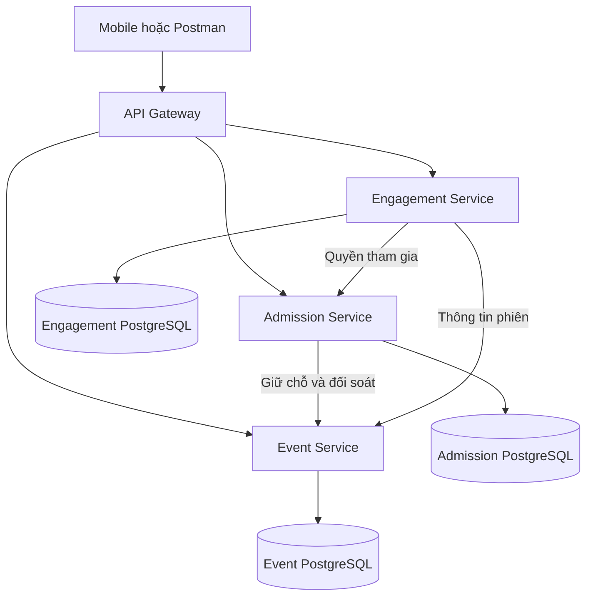
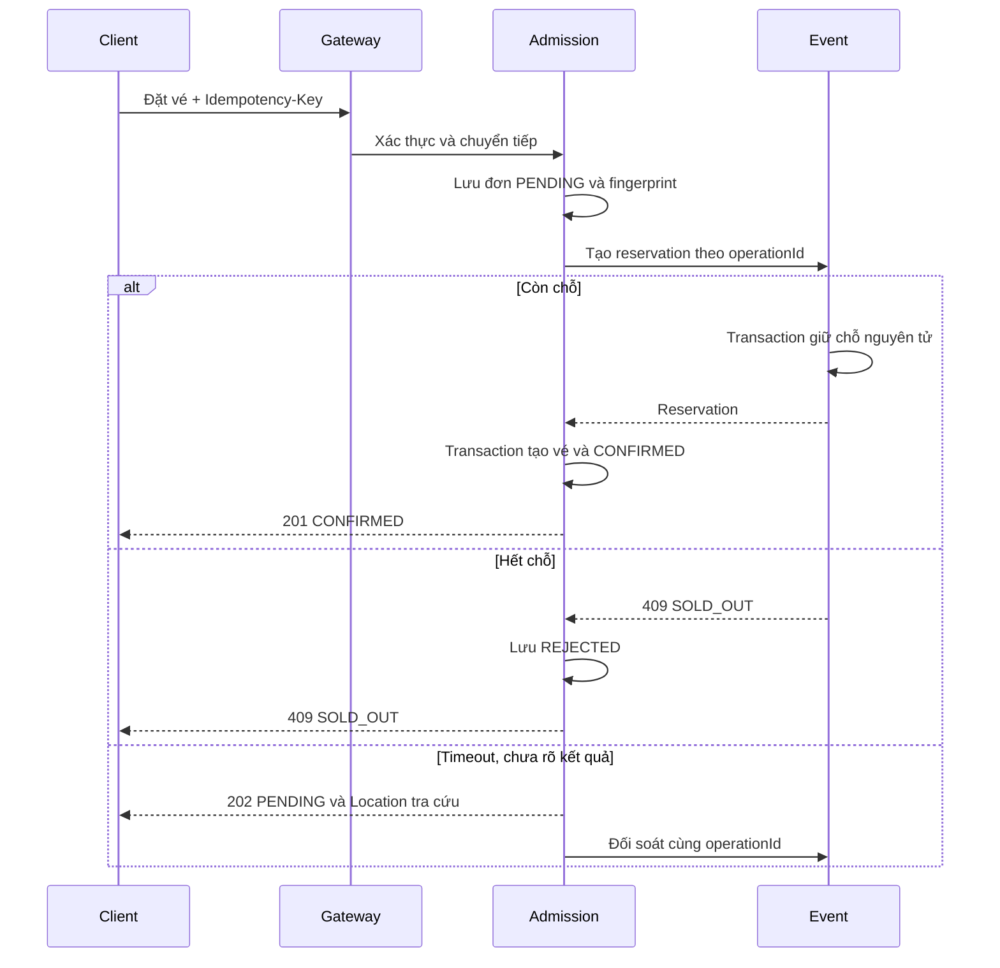

# Kế hoạch chuyển qEvent sang microservices

- Ngày: 2026-11-04
- Nhóm: 4 người; tối thiểu 3 service nghiệp vụ, không tính API Gateway.
- Mức kế hoạch: Tiêu chuẩn, dựa trên khảo sát source hiện tại.
- Commit khảo sát: `c06bc0fa666b0c7f1c7b27efe99a419491188a72`.
- Trạng thái: Đã lập kế hoạch; chưa triển khai các service mới.
- Cách lưu: Ghi trực tiếp theo yêu cầu của người dùng. Đây là kế hoạch kỹ thuật thông thường, không phải artifact đã được helper provenance của GitNexus chứng nhận.

## 1. Mục tiêu và phạm vi

Chuyển backend qEvent hiện tại thành hệ thống gồm Event Service, Admission Service, Engagement Service và API Gateway. Giữ Bun/Elysia, Prisma và PostgreSQL để tận dụng code hiện có; không chuyển framework hoặc viết lại toàn bộ.

Hệ thống đích phải đáp ứng các yêu cầu bắt buộc của bài tập: dữ liệu riêng, API REST và OpenAPI, Gateway, giao tiếp tin cậy, luồng liên service có xử lý lỗi, container, Postman và thử nghiệm lỗi có số liệu.

Không thêm thanh toán thật, service thứ tư, RabbitMQ, Redis hoặc Kubernetes vào phạm vi bắt buộc. Ưu tiên điểm cộng JWT tại Gateway và CI chạy test sau khi luồng chính hoạt động ổn định.

Không tự tạo branch, commit, push hoặc reset dữ liệu.

## 2. Hiện trạng đã xác minh

| Thành phần | Bằng chứng | Hệ quả khi chuyển đổi |
|---|---|---|
| Một app ghép tất cả module | `backend/src/index.ts:22–40` | Cần entrypoint độc lập; tách tạo app khỏi `.listen()` để test không tự mở server |
| Một Prisma schema dùng chung | `backend/prisma/schema.prisma` | Phải phân quyền sở hữu dữ liệu, bỏ relation xuyên service |
| Một backend và một PostgreSQL | `docker-compose.yml` | Chưa phải hệ thống microservices |
| Cấp vé rồi tăng số lượng bán riêng | `backend/src/modules/tickets/routes/tickets.routes.ts:43–101` | Không thể chỉ thay các DB call bằng HTTP; cần transaction nội bộ và tiến trình phân tán bền vững |
| Đổi trạng thái vé và ghi log riêng | `backend/src/modules/checkin/routes/checkin.routes.ts:350–370` | Cần transaction và cập nhật có điều kiện để chống check-in trùng |
| Đồng bộ offline đọc rồi ghi riêng | `backend/src/modules/checkin/services/sync.service.ts:31–98` | Cần xử lý replay và tranh chấp |
| Kiểm tra quyền tương tác đọc User, Session và Ticket chung DB | `backend/src/modules/realtime/services/session-access.service.ts:47–98` | Thay bằng API của service sở hữu, không giữ quyền truy cập DB chung |
| Seed có đường xóa dữ liệu | `backend/prisma/seed.ts:10–31` | Không tái sử dụng cơ chế seed này cho startup của các database mới |
| Frontend đã chuyển sang repo khác | `README.md:33–34,129–133` | Chưa thể xác nhận tương thích mobile trong checkout này |

GitNexus đang có index cũ hơn HEAD một commit. Các kết quả graph dưới đây chỉ là chỉ dẫn điều tra, không thay thế source hiện tại:

- `purchaseTickets`: upstream depth 3, LOW, 1 phụ thuộc trực tiếp, 5 tổng cộng.
- `handleSync`: LOW, 2 entry trực tiếp là `syncRoutes` và file chứa nó.
- `checkUserSessionAccess`: **HIGH**, 11 entry trực tiếp, 24 tổng cộng, 3 process bị ảnh hưởng. Cảnh báo HIGH đã được thông báo trước khi sửa code.
- Graph trả 0 phụ thuộc cho một số callback auth/check-in nhưng source có 12 chỗ `.derive(deriveCurrentUser)`. Không coi 0 graph hit là bằng chứng an toàn.
- CLI hiện tại không hỗ trợ `status --json`; không được tuyên bố đã vượt qua gate runner-provenance của phiên bản skill `gitnexus-work` yêu cầu tính năng này.

## 3. Kiến trúc đích

| Service | Trách nhiệm | Dữ liệu sở hữu |
|---|---|---|
| Event | Sự kiện, phòng, lịch phiên, loại vé, sức chứa và giữ chỗ | `Event`, `Room`, `Session`, `TicketType`, thêm `Reservation` |
| Admission | Tài khoản, đăng nhập, lời mời, đặt/cấp vé, QR, check-in, đồng bộ offline | `User`, `EventInvitation`, `Ticket`, `CheckinLog`, thêm đơn và dữ liệu idempotency |
| Engagement | Q&A, vote, poll, quiz, AI hỗ trợ tùy chọn | Các model Q&A, poll, quiz và vote/answer liên quan |
| API Gateway | Định tuyến HTTP/WebSocket, xác thực JWT và chính sách vận chuyển | Không có database hoặc luật nghiệp vụ |

### Vì sao chia như vậy?

- Event quyết định sự kiện có gì và còn bao nhiêu chỗ.
- Admission quyết định ai có vé và được vào cửa. Giữ vé và check-in cùng service để transaction soát vé vẫn là transaction local.
- Engagement quyết định cách người tham dự tương tác trong phiên.
- Auth là module hỗ trợ Admission, không cần tạo service chỉ đăng nhập để đủ số lượng.

Mỗi service có source, package/lockfile, Prisma schema, migration, Dockerfile, OpenAPI và test riêng. Dùng ba container PostgreSQL với credentials và volume riêng để dễ chứng minh dữ liệu độc lập khi bảo vệ.

ID xuyên service chỉ là scalar tham chiếu; không giữ foreign key, Prisma join hoặc credentials đọc database của service khác. Chỉ Gateway công khai cổng host. API nội bộ không được Gateway công khai.

## 4. Người dùng và quy tắc nghiệp vụ

Người dùng: khách tham dự, nhân viên soát vé, ban tổ chức và diễn giả.

Các quy tắc đích cần tài liệu và test; không khẳng định tất cả đã tồn tại trong code cũ:

1. Chỉ organizer được tạo/sửa sự kiện. Thời gian bắt đầu phải trước kết thúc; sai trả `422 INVALID_EVENT_TIME`.
2. Không cấp vượt số lượng loại vé hoặc sức chứa sự kiện; hết chỗ trả `409 SOLD_OUT`.
3. Cùng user, idempotency key và payload phải trả cùng đơn. Tái sử dụng key với payload khác trả `409 IDEMPOTENCY_CONFLICT`.
4. Chỉ đơn `CONFIRMED` được có vé/QR sử dụng được. Không phát QR cho đơn `PENDING`.
5. Chỉ vé hợp lệ `PAID` được chuyển sang `CHECKED_IN`; quét đồng thời chỉ một lần thành công, lần khác trả `409 ALREADY_CHECKED_IN`.
6. Người tham dự chỉ được ghi tương tác khi đã check-in và phiên đang live; thiếu quyền trả `403 NOT_CHECKED_IN` hoặc mã lỗi live tương ứng.
7. Danh tính lấy từ JWT, không tin `userId` hoặc role trong body. Đăng ký công khai không được tự cấp STAFF/ORGANIZER/SPEAKER.
8. Timeout chưa rõ kết quả không được coi là đã thất bại chắc chắn. Không retry lỗi nghiệp vụ.
9. Nhận lời mời là thao tác một lần, phải xử lý tranh chấp và không được đi đường tắt bỏ qua sức chứa.

Role toàn cục hiện tại là giới hạn cần ghi trong báo cáo; chưa mở rộng thành hệ thống phân quyền theo từng sự kiện trong phạm vi đầu tiên.

## 5. Thiết kế API

Các endpoint dưới đây là thiết kế đề xuất, chưa phải endpoint đã triển khai.

| Service | Method và endpoint | Thành công | Lỗi nghiệp vụ tiêu biểu |
|---|---|---|---|
| Event | `GET /api/events` | 200 | — |
| Event | `GET /api/events/:id` | 200 | 404 EVENT_NOT_FOUND |
| Event | `POST /api/events` | 201 | 422 INVALID_EVENT_TIME |
| Event | `PATCH /api/events/:id` | 200 | 422 INVALID_EVENT_TIME |
| Admission | `POST /api/orders` | 201 CONFIRMED hoặc 202 PENDING | 409 SOLD_OUT / IDEMPOTENCY_CONFLICT |
| Admission | `GET /api/orders/:id` | 200 | 404 ORDER_NOT_FOUND |
| Admission | `GET /api/tickets` | 200 | — |
| Admission | `POST /api/checkins` | 201 | 409 ALREADY_CHECKED_IN |
| Engagement | `GET /api/sessions/:id/questions` | 200 | 404 SESSION_NOT_FOUND |
| Engagement | `POST /api/sessions/:id/questions` | 201 | 403 NOT_CHECKED_IN |
| Engagement | `PUT /api/questions/:id/votes/me` | 201 mới, 200 đã tồn tại | 403 NOT_CHECKED_IN |
| Engagement | `DELETE /api/questions/:id/votes/me` | 204 | 403 NOT_CHECKED_IN |

Mỗi service bổ sung `GET /health` và `openapi.yaml`; không tính health vào bốn endpoint nghiệp vụ. OpenAPI phải mô tả schema, security, response và ví dụ thành công/lỗi.

API nội bộ dự kiến:

- Event: tạo, tra cứu và giải phóng reservation theo operation ID; thông tin event/session/live.
- Admission: kiểm tra quyền tham gia theo event/user đã xác thực.

API nội bộ yêu cầu service credentials. Service vẫn tự kiểm tra role và quyền sở hữu tài nguyên, kể cả khi Gateway đã xác thực JWT.

## 6. Luồng liên service: đăng ký/cấp vé

Admission điều phối; Gateway không điều phối nghiệp vụ.

### Tính nhất quán và phục hồi

1. Lưu order và fingerprint trước network call; phạm vi unique của idempotency gồm user và key.
2. Event dùng transaction để kiểm tra/cập nhật sức chứa và tạo reservation cùng lúc. Unique operation ID chống trừ chỗ hai lần khi retry; cùng ID/payload khác phải bị từ chối.
3. Admission tạo vé và chuyển đơn `CONFIRMED` trong cùng transaction local.
4. Nếu chưa biết remote đã commit hay chưa: giữ `PENDING`, trả `202` cùng URL tra cứu. Worker đối soát theo operation ID; tiến trình phải sống qua restart.
5. Nếu giữ chỗ đã thành công nhưng cấp vé thất bại chắc chắn: gọi giải phóng reservation idempotent. Chưa xác nhận hoàn tác thì giữ `COMPENSATING` và tiếp tục xử lý.
6. Dùng lease/CAS bền vững để worker không đồng thời cấp vé và hoàn tác. Không tự hết hạn reservation nếu chưa có giao thức xác nhận an toàn.
7. Các đường cấp vé sandbox, nhận lời mời và self-scan phải dùng chung nghiệp vụ này.

Không thêm Payment Service; `PAID` ở đây vẫn là vé sandbox, không phải thanh toán thật.

## 7. Giao tiếp tin cậy và bảo mật

Cấu hình ban đầu để thử nghiệm, chưa phải kết quả benchmark:

- Timeout một attempt: 1.000 ms; tối đa một retry với backoff ngắn và tổng deadline có giới hạn.
- Chỉ retry lỗi kết nối, timeout hoặc 503/504 tạm thời khi thao tác safe/idempotent.
- Không retry lỗi nghiệp vụ 400/401/403/404/409/422. 429 có chính sách riêng.
- Gateway không tự retry POST để tránh nhân số lần gọi qua nhiều tầng.
- Địa chỉ lấy từ `EVENT_SERVICE_URL`, `ADMISSION_SERVICE_URL`, `ENGAGEMENT_SERVICE_URL`.
- 503: không truy cập được dependency; 504: quá hạn. Đơn đã tiếp nhận nhưng chưa rõ kết quả vẫn trả 202.
- Không biến lỗi hạ tầng thành 403/404 hoặc tự cho phép tương tác khi kiểm tra quyền thất bại.

Gateway xác thực JWT, kiểm tra expiry/claims và loại bỏ identity header không tin cậy. HTTP và WebSocket đều lấy danh tính từ token, không body. Secrets qua environment; production không dùng fallback công khai.

Health/readiness kiểm tra nội bộ và database của chính service; không tạo chuỗi health-check phụ thuộc toàn hệ thống.

Log request/trace ID, service đích, attempt, duration và status; không log token, mật khẩu hoặc TOTP secret.

## 8. Tương thích và bảo toàn dữ liệu

- Giữ backend cũ đến khi các luồng mới có regression coverage và tương thích được kiểm tra.
- Không xóa, reset hoặc tự import dữ liệu thật. Giữ nguyên volume cũ; hệ mới dùng volume và synthetic seed riêng.
- Seed mới phải idempotent và không xóa dữ liệu khi restart. Không tái sử dụng seed phá dữ liệu hiện tại.
- RSA keys của Admission lưu volume bền vững.
- Thay join xuyên miền trong danh sách vé, lịch, monitor, Q&A và leaderboard bằng API có timeout hoặc snapshot hiển thị cục bộ; tránh gọi N+1, không sao chép credentials.
- Aggregation/adapter nằm trong service sở hữu, không trong Gateway.
- Giữ `/ws/qa` và `/ws/game`. Alias REST cũ nằm trong service sở hữu; không âm thầm trả response khác contract.
- Client ngoài repo cần hỗ trợ `202 PENDING`; chưa thể tuyên bố mobile parity.

## 9. Trình tự triển khai

### Giai đoạn 0 — Điều kiện công cụ

- [ ] Chọn workflow triển khai khả dụng: runner GitNexus tương thích với provenance gate của skill, hoặc người dùng cho phép dùng quy trình source/test thay cho gate không được CLI hiện tại hỗ trợ.
- [ ] Kiểm tra lại HEAD và các thay đổi đang có; không ghi đè công việc người dùng.
- [ ] Chạy impact trước khi sửa các symbol hiện có; báo HIGH/CRITICAL trước khi sửa.

Không tuyên bố đã vượt gate `status --json` trên CLI không hỗ trợ lệnh đó. Đây là giới hạn của công cụ, không phải yêu cầu runtime của app.

### Giai đoạn 1 — Nền tảng và ranh giới

- [ ] Tạo `services/event-service/`, `services/admission-service/`, `services/engagement-service/`, `gateway/`.
- [ ] Mỗi service có package, cấu hình, app factory/entrypoint, schema riêng và health endpoint.
- [ ] Migration và seed demo không phá dữ liệu; giữ backend legacy.
- [ ] Thêm test nhỏ xác nhận app không mở listener khi import và health hoạt động.

### Giai đoạn 2 — Event

- [ ] Event CRUD và API metadata/session.
- [ ] Transaction sức chứa, reservation/idempotency/release.
- [ ] Test tranh chấp vé cuối, replay key, payload khác và release lặp.
- [ ] OpenAPI và Dockerfile riêng.

### Giai đoạn 3 — Admission

- [ ] Auth/tài khoản và quyền đăng ký an toàn.
- [ ] Order bền vững, client Event, reconciliation/compensation.
- [ ] QR và snapshot dữ liệu cần để xuất vé.
- [ ] Check-in transaction/CAS và offline replay.
- [ ] Test timeout trước/sau remote commit, restart, trùng key, cấp vé lỗi và hoàn tác lỗi.
- [ ] OpenAPI và Dockerfile riêng.

### Giai đoạn 4 — Engagement

- [ ] Di chuyển Q&A, poll, quiz và AI tùy chọn.
- [ ] Bỏ quyền truy cập User/Ticket/Event database, dùng owner APIs.
- [ ] Giữ quyền live/check-in cho REST/WebSocket; giữ quiz CAS và che đáp án.
- [ ] Test dependency down/slow không bị nhầm thành lỗi nghiệp vụ.
- [ ] OpenAPI và Dockerfile riêng.

### Giai đoạn 5 — Gateway và container

- [ ] Route HTTP/WebSocket và JWT, không có orchestration nghiệp vụ.
- [ ] Compose mặc định chạy ba service, ba database và Gateway bằng `docker compose up`.
- [ ] Chỉ Gateway công khai cổng; database/service ports nội bộ.
- [ ] Backend legacy nếu cần nằm trong profile riêng; giữ nguyên volume cũ.
- [ ] Test restart không reseed/xóa dữ liệu và không đổi RSA keys.

### Giai đoạn 6 — Kiểm thử, thử lỗi và tài liệu

- [ ] Postman collection/environment tối thiểu 10 request; mục tiêu 15–20.
- [ ] Test tích hợp qua Gateway, không setup chung bằng Prisma client xuyên service.
- [ ] Chạy hai thử nghiệm lỗi và lưu số liệu thật.
- [ ] CI chạy test không phụ thuộc dịch vụ AI trả phí.
- [ ] Cập nhật README/runbook, phân công và hướng dẫn demo/bảo vệ.
- [ ] Review local diff, sửa lỗi do thay đổi gây ra và báo rõ phần chưa kiểm chứng.

## 10. Kiểm thử và số liệu

### Test hiện có

- Đã chạy ở lượt khảo sát: `bun test ./test/ai.validators.test.ts` trong `backend/`: **5 pass, 0 fail**.
- Đã chạy `docker compose config --quiet`: thành công.
- Chưa chạy toàn bộ integration suite hoặc build hệ thống mới.
- `backend/test/flow.test.ts` hiện kỳ vọng PAID/201 ngay; thêm test PENDING cho hệ mới, không làm yếu assertion cũ để che lỗi.
- Một số test game/AI tạo, sửa hoặc xóa dữ liệu; phải dùng database test riêng.

### Test mới dự kiến

| File mới | Kịch bản bắt buộc |
|---|---|
| `services/event-service/test/reservations.test.ts` | Cạnh tranh vé cuối; retry cùng key; key/payload khác; release hai lần; giới hạn sức chứa |
| `services/admission-service/test/orders.test.ts` | Confirm bình thường; remote commit mất response; restart PENDING/COMPENSATING; cấp vé lỗi; hoàn tác lỗi |
| `services/admission-service/test/checkin.test.ts` | Hai scan đồng thời chỉ một accept; vé sai trạng thái; offline replay; cache chỉ staff/organizer |
| `services/engagement-service/test/access.test.ts` | Có/chưa check-in; phiên không live; dependency lỗi 503/504; chống giả userId; quiz state và che đáp án |
| `test/microservices.e2e.test.ts` | Luồng qua Gateway, HTTP/WS auth, cô lập database, restart không mất dữ liệu, kịch bản lỗi |

Đây là đường dẫn dự kiến, không khẳng định các test này đã tồn tại hoặc đã chạy.

### Postman

Bao gồm: event list/detail/create/invalid time, login, đặt vé, tra cứu đơn, replay idempotency, xung đột key, hết chỗ, check-in, check-in trùng, Q&A trước/sau check-in, vote/unvote và JWT sai.

### Hai thử nghiệm lỗi

1. Tắt Event trong lúc đặt vé; quan sát lỗi có giới hạn, đơn pending và phục hồi khi bật lại. Thử restart Admission khi đơn còn pending.
2. Event đã giữ chỗ nhưng response bị làm chậm/mất; quan sát retry/đối soát không trừ chỗ hoặc cấp vé hai lần. Dùng proxy/fake downstream chỉ trong môi trường test, không mở endpoint debug công khai.

Đo baseline và sau cơ chế xử lý với cùng seed, số request và concurrency: p50/p95, số attempt, status/error count, số pending, thời gian phục hồi, vé trùng và chênh lệch sức chứa. Lưu raw JSON/CSV và cách chạy lại; không điền số liệu giả.

## 11. Phân công nhóm

| Người | Phần chính | Trách nhiệm đi kèm |
|---|---|---|
| 1 | Event và reservation | Capacity/concurrency tests, OpenAPI, thiết kế dữ liệu |
| 2 | Admission, order và check-in | Saga/idempotency/compensation, business tests |
| 3 | Engagement và WebSocket | Quyền tham gia, game regression, OpenAPI |
| 4 | Gateway, Compose và tích hợp | JWT/routing, E2E, đo lỗi, CI |

Mỗi người tự viết phần báo cáo và giải thích code mình phụ trách. Người 4 không chỉ làm tài liệu.

## 12. Sản phẩm nộp và phần để sau

- Báo cáo PDF tối thiểu 30 trang: nghiệp vụ; kiến trúc và lý do chia; bảng service/dữ liệu; API; độ tin cậy và số liệu; triển khai/test; hạn chế.
- Sơ đồ kiến trúc một trang, bảng phân công, khai báo dùng AI và nguồn tham khảo.
- Git source chạy được, OpenAPI, Postman collection/environment.
- Slide tối đa 10 trang, demo chạy hệ thống và demo lỗi trực tiếp.

File kế hoạch này không thay cho báo cáo nộp bài hoặc bằng chứng hệ thống đã chạy.

Để sau: payment thật, RabbitMQ/DLQ, Redis, Kubernetes, service thứ tư, autoscaling và thay đổi UI không liên quan. Circuit breaker chỉ cân nhắc khi phần bắt buộc đã ổn định.

## 13. Điều kiện hoàn thành

- [ ] Ba service nghiệp vụ độc lập, dữ liệu/credentials riêng, mỗi service ít nhất bốn REST endpoint nghiệp vụ, một lỗi 4xx có ý nghĩa, OpenAPI và health.
- [ ] Gateway là điểm vào duy nhất cho HTTP/WebSocket, xác thực JWT, không chứa luật nghiệp vụ.
- [ ] Mọi lời gọi nội bộ có timeout/retry giới hạn, địa chỉ qua env và phân biệt lỗi nghiệp vụ/hạ tầng.
- [ ] Luồng cấp vé liên service chịu được timeout, mất response, restart, request trùng và hoàn tác lỗi mà không oversell/cấp vé trùng.
- [ ] Check-in nguyên tử, replay offline, quyền tương tác và game regression được kiểm thử.
- [ ] Một lệnh Compose chạy toàn hệ thống; restart không phá dữ liệu; keys bền vững; volume cũ nguyên vẹn.
- [ ] Postman đạt tối thiểu 10 request và hai thử nghiệm lỗi có số liệu thật trước/sau.
- [ ] Test/build/review được báo đúng kết quả; phần mobile chưa kiểm chứng được ghi rõ.
- [ ] README/runbook, phân công, báo cáo/slide và khai báo AI hoàn thiện trước khi nộp.
- [ ] Không tự commit, đổi branch, push hoặc mở PR.
